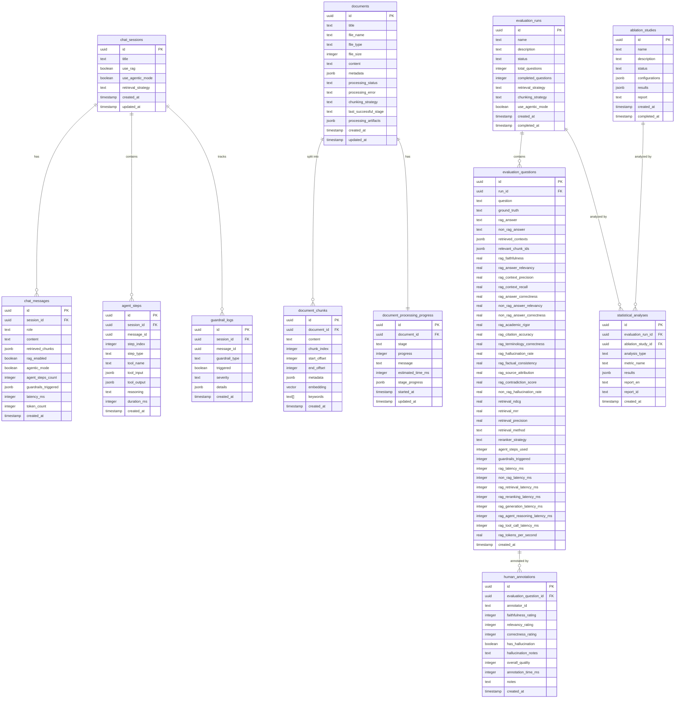

Dibawah adalah diagram Entity-Relationship Diagram (ERD) untuk skema database yang digunakan dalam proyek ini. Ia mengilustrasikan hubungan antara entitas berbeda, atribut mereka, dan bagaimana mereka berinteraksi satu sama lain.

