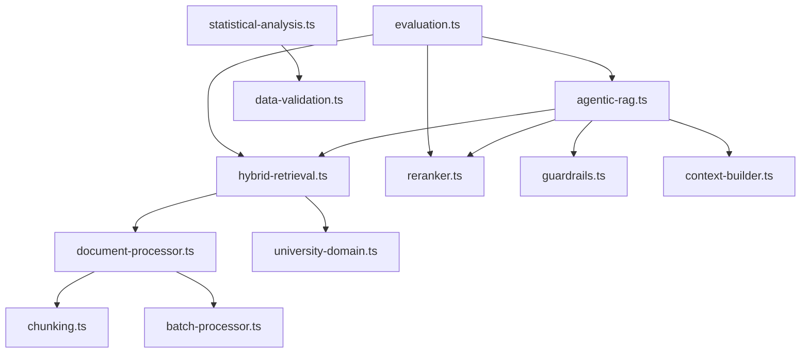

# Arsitektur Sistem

## 1. Pendahuluan

Dokumen ini menjelaskan arsitektur keseluruhan Academic Research RAG Chatbot, mencakup komponen-komponen utama, hubungan antar komponen, alur data, dan prinsip-prinsip desain yang mendasari.

---

## 2. Prinsip Desain Arsitektur

### 2.1 Prinsip Fundamental

| Prinsip                    | Deskripsi                                    | Implementasi                                            |
| -------------------------- | -------------------------------------------- | ------------------------------------------------------- |
| **Separation of Concerns** | Setiap modul memiliki tanggung jawab tunggal | Modularisasi: retrieval, reranking, generation terpisah |
| **Extensibility**          | Mudah menambah strategi baru                 | Strategy pattern untuk chunking, retrieval, reranking   |
| **Observability**          | Setiap langkah dapat dimonitor               | Latency tracking, step logging, evaluation metrics      |
| **Fault Tolerance**        | Graceful degradation saat komponen gagal     | Fallback mechanisms, error boundaries                   |
| **Research-First**         | Mendukung eksperimen dan ablation            | Configurable components, statistical analysis           |

### 2.2 Technology Stack

| Layer          | Teknologi                 | Justifikasi                          |
| -------------- | ------------------------- | ------------------------------------ |
| **Frontend**   | Next.js 15 (React 19)     | App Router, Server Components        |
| **Backend**    | Next.js API Routes        | Serverless-native, type-safe         |
| **Database**   | PostgreSQL + pgvector     | Vector similarity + relational       |
| **ORM**        | Drizzle                   | Type-safe, performant                |
| **LLM**        | Azure OpenAI (GPT-4o)     | Production-grade, Indonesian support |
| **Embedding**  | text-embedding-3-small    | 1536-d, cost-effective               |
| **ML Runtime** | @huggingface/transformers | Browser/server inference             |
| **Validation** | Zod                       | Runtime type checking                |

---

## 3. Diagram Arsitektur Keseluruhan

```
┌─────────────────────────────────────────────────────────────────────────────┐
│                              PRESENTATION LAYER                              │
├─────────────────────────────────────────────────────────────────────────────┤
│  ┌──────────────────┐  ┌──────────────────┐  ┌──────────────────┐          │
│  │   Chat Interface  │  │  Eval Dashboard  │  │  Manage Documents │          │
│  │  (src/app/page)   │  │ (src/app/eval)   │  │ (src/app/manage) │          │
│  └────────┬─────────┘  └────────┬─────────┘  └────────┬─────────┘          │
└───────────┼──────────────────────┼──────────────────────┼────────────────────┘
            │                      │                      │
            ▼                      ▼                      ▼
┌─────────────────────────────────────────────────────────────────────────────┐
│                                 API LAYER                                    │
├─────────────────────────────────────────────────────────────────────────────┤
│  ┌──────────────────┐  ┌──────────────────┐  ┌──────────────────┐          │
│  │   /api/chat      │  │  /api/evaluation │  │  /api/documents  │          │
│  │   Streaming      │  │  RAGAS, Ablation │  │  Upload, Process │          │
│  └────────┬─────────┘  └────────┬─────────┘  └────────┬─────────┘          │
└───────────┼──────────────────────┼──────────────────────┼────────────────────┘
            │                      │                      │
            ▼                      ▼                      ▼
┌─────────────────────────────────────────────────────────────────────────────┐
│                              BUSINESS LOGIC LAYER                            │
├─────────────────────────────────────────────────────────────────────────────┤
│  ┌─────────────────────────────────────────────────────────────────────┐   │
│  │                         RAG PIPELINE (src/lib/rag)                   │   │
│  │  ┌─────────────┐  ┌─────────────┐  ┌─────────────┐  ┌────────────┐  │   │
│  │  │  Agentic    │  │   Hybrid    │  │  Reranker   │  │ Guardrails │  │   │
│  │  │    RAG      │  │  Retrieval  │  │             │  │            │  │   │
│  │  └──────┬──────┘  └──────┬──────┘  └──────┬──────┘  └──────┬─────┘  │   │
│  │         │                │                │                │        │   │
│  │         └────────────────┴────────────────┴────────────────┘        │   │
│  └─────────────────────────────────────────────────────────────────────┘   │
│                                                                             │
│  ┌─────────────────────────────────────────────────────────────────────┐   │
│  │                    EVALUATION (src/lib/rag/evaluation.ts)            │   │
│  │  ┌─────────────┐  ┌─────────────┐  ┌─────────────┐                  │   │
│  │  │   RAGAS     │  │  Ablation   │  │  Latency    │                  │   │
│  │  │   Metrics   │  │   Study     │  │  Tracker    │                  │   │
│  │  └─────────────┘  └─────────────┘  └─────────────┘                  │   │
│  └─────────────────────────────────────────────────────────────────────┘   │
│                                                                             │
│  ┌─────────────────────────────────────────────────────────────────────┐   │
│  │                STATISTICS (src/lib/statistics)                       │   │
│  │  ┌─────────────┐  ┌─────────────┐                                   │   │
│  │  │ Statistical │  │    Data     │                                   │   │
│  │  │  Analysis   │  │ Validation  │                                   │   │
│  │  └─────────────┘  └─────────────┘                                   │   │
│  └─────────────────────────────────────────────────────────────────────┘   │
└─────────────────────────────────────────────────────────────────────────────┘
            │                      │                      │
            ▼                      ▼                      ▼
┌─────────────────────────────────────────────────────────────────────────────┐
│                             DATA ACCESS LAYER                                │
├─────────────────────────────────────────────────────────────────────────────┤
│  ┌──────────────────┐  ┌──────────────────┐  ┌──────────────────┐          │
│  │    AI Module     │  │   Database       │  │  External APIs   │          │
│  │  (src/lib/ai)    │  │  (src/lib/db)    │  │                  │          │
│  │                  │  │                  │  │  • Azure OpenAI  │          │
│  │  • Chat Model    │  │  • Drizzle ORM   │  │  • HuggingFace   │          │
│  │  • Embeddings    │  │  • Schema        │  │                  │          │
│  │  • Judge Model   │  │  • Migrations    │  │                  │          │
│  └──────────────────┘  └──────────────────┘  └──────────────────┘          │
└─────────────────────────────────────────────────────────────────────────────┘
            │                      │
            ▼                      ▼
┌─────────────────────────────────────────────────────────────────────────────┐
│                              DATA STORAGE                                    │
├─────────────────────────────────────────────────────────────────────────────┤
│  ┌──────────────────────────────────────────────────────────────────────┐  │
│  │                     PostgreSQL + pgvector                             │  │
│  │  ┌────────────┐ ┌────────────┐ ┌────────────┐ ┌────────────┐        │  │
│  │  │ documents  │ │  chunks    │ │  sessions  │ │ evaluation │        │  │
│  │  │            │ │ (vectors)  │ │            │ │            │        │  │
│  │  └────────────┘ └────────────┘ └────────────┘ └────────────┘        │  │
│  └──────────────────────────────────────────────────────────────────────┘  │
└─────────────────────────────────────────────────────────────────────────────┘
```

---

## 4. Komponen Utama

### 4.1 Presentation Layer

#### 4.1.1 Chat Interface (`src/app/page.tsx`)

**Fungsi**: Antarmuka percakapan untuk interaksi pengguna dengan sistem RAG.

**Fitur**:
- Streaming response real-time
- Display retrieved sources dengan collapsible
- Toggle RAG/Agentic mode
- Session management

#### 4.1.2 Evaluation Dashboard (`src/app/evaluation/`)

**Fungsi**: Dashboard untuk menjalankan dan menganalisis evaluasi sistem.

**Komponen**:
- `evaluation-dashboard.tsx`: Main dashboard container
- `create-evaluation-dialog.tsx`: Form pembuatan evaluasi
- `evaluation-metrics-view.tsx`: Visualisasi metrik
- `ablation-study-view.tsx`: Hasil ablation study
- `correlation-view.tsx`: Korelasi automated vs human

#### 4.1.3 Document Management (`src/app/manage/`)

**Fungsi**: Upload dan manajemen dokumen knowledge base.

---

### 4.2 API Layer

#### 4.2.1 Chat API (`src/app/api/chat/`)

```typescript
// Endpoint: POST /api/chat
interface ChatRequest {
    messages: Message[];
    sessionId?: string;
    useRag: boolean;
    useAgenticMode: boolean;
    retrievalStrategy: "vector" | "keyword" | "hybrid";
}

interface ChatResponse {
    // Streaming text response
    // + chunks metadata
    // + agent steps (if agentic)
}
```

**Mode Operasi**:
1. **Agentic Mode**: Multi-step reasoning dengan tools
2. **Standard RAG**: Single retrieval + generation
3. **Direct Mode**: LLM tanpa RAG

#### 4.2.2 Evaluation API (`src/app/api/evaluation/`)

| Endpoint                    | Method      | Fungsi                      |
| --------------------------- | ----------- | --------------------------- |
| `/api/evaluation`           | GET, POST   | List/Create evaluation runs |
| `/api/evaluation/[id]`      | GET, DELETE | Get/Delete specific run     |
| `/api/evaluation/[id]/run`  | POST        | Execute evaluation          |
| `/api/evaluation/ablation`  | POST        | Run ablation study          |
| `/api/evaluation/questions` | GET         | Get evaluation questions    |

#### 4.2.3 Documents API (`src/app/api/documents/`)

| Endpoint                       | Method      | Fungsi                     |
| ------------------------------ | ----------- | -------------------------- |
| `/api/documents`               | GET, POST   | List/Upload documents      |
| `/api/documents/[id]`          | GET, DELETE | Get/Delete document        |
| `/api/documents/[id]/process`  | POST        | Trigger processing         |
| `/api/documents/[id]/progress` | GET (SSE)   | Stream processing progress |

---

### 4.3 Business Logic Layer

#### 4.3.1 RAG Pipeline

```
                                    Query
                                      │
                                      ▼
                        ┌─────────────────────────┐
                        │    Input Guardrails     │
                        │  (PII, Injection, etc)  │
                        └─────────────┬───────────┘
                                      │
                    ┌─────────────────┴─────────────────┐
                    │                                   │
                    ▼                                   ▼
          ┌─────────────────┐               ┌─────────────────┐
          │  Agentic Mode   │               │  Standard Mode  │
          │                 │               │                 │
          │ • Plan          │               │ • Retrieve      │
          │ • Tool Execute  │               │ • Augment       │
          │ • Synthesize    │               │ • Generate      │
          └────────┬────────┘               └────────┬────────┘
                   │                                  │
                   └──────────────┬───────────────────┘
                                  │
                                  ▼
                    ┌─────────────────────────┐
                    │   Hybrid Retrieval      │
                    │  Vector + BM25 + RRF    │
                    └─────────────┬───────────┘
                                  │
                                  ▼
                    ┌─────────────────────────┐
                    │      Reranking          │
                    │ (Cross-encoder/LLM/etc) │
                    └─────────────┬───────────┘
                                  │
                                  ▼
                    ┌─────────────────────────┐
                    │    LLM Generation       │
                    │    (Context + Query)    │
                    └─────────────┬───────────┘
                                  │
                                  ▼
                    ┌─────────────────────────┐
                    │   Output Guardrails     │
                    │  (Hallucination check)  │
                    └─────────────┬───────────┘
                                  │
                                  ▼
                              Response
```

#### 4.3.2 Module Dependencies



---

### 4.4 Data Access Layer

#### 4.4.1 AI Module (`src/lib/ai/`)

```typescript
// Model Configuration
export const CHAT_MODEL = azure("gpt-4o-mini");
export const JUDGE_MODEL = azure("gpt-4o-mini");

// Embedding
export async function generateEmbedding(text: string) {
    return embedMany({
        model: azure.textEmbeddingModel("text-embedding-3-small"),
        values: [text],
    });
}
```

#### 4.4.2 Database Module (`src/lib/db/`)

**Schema Tables**:

| Table                  | Purpose                          |
| ---------------------- | -------------------------------- |
| `documents`            | Raw uploaded documents           |
| `document_chunks`      | Processed chunks with embeddings |
| `chat_sessions`        | User conversation sessions       |
| `chat_messages`        | Individual messages              |
| `agent_steps`          | Agentic execution trace          |
| `guardrail_logs`       | Security event logs              |
| `evaluation_runs`      | Evaluation experiments           |
| `evaluation_questions` | Per-question metrics             |
| `ablation_studies`     | Ablation experiment results      |
| `statistical_analyses` | Statistical test results         |
| `human_annotations`    | Human validation data            |

---

## 5. Alur Data

### 5.1 Document Ingestion Flow

```
1. Upload (API)
   └── Validate file type
   └── Store raw file

2. Extract (document-processor.ts)
   └── PDF → pdf-parse
   └── DOCX → mammoth
   └── Apply PDF normalization

3. Analyze (university-domain.ts)
   └── Detect document type
   └── Extract metadata
   └── Detect language

4. Chunk (chunking.ts)
   └── Select strategy based on content
   └── Calculate quality scores
   └── Preserve metadata

5. Embed (ai/embeddings.ts)
   └── Batch embedding generation
   └── Store vectors in pgvector

6. Index (database)
   └── GIN index for full-text
   └── Vector index for similarity
```

### 5.2 Query Processing Flow

```
1. Input Processing
   ├── Detect language
   ├── Expand with synonyms
   └── Check guardrails

2. Retrieval
   ├── Vector search (cosine similarity)
   ├── BM25 search (term frequency)
   └── RRF fusion

3. Reranking
   ├── Score with cross-encoder
   ├── LLM relevance judgment
   └── Ensemble fusion

4. Context Building
   ├── Format retrieved chunks
   ├── Manage citations
   └── Build prompt

5. Generation
   ├── LLM inference
   ├── Stream response
   └── Post-process (guardrails)
```

### 5.3 Evaluation Flow

```
1. Setup
   ├── Load evaluation questions
   ├── Configure run parameters
   └── Initialize trackers

2. Execute (per question)
   ├── RAG pipeline execution
   ├── Non-RAG baseline execution
   └── Metric calculation

3. Aggregate
   ├── Calculate averages
   ├── Update run status
   └── Store results

4. Analyze
   ├── Statistical tests
   ├── Generate reports
   └── Human annotation (optional)
```

---

## 6. Arsitektur Data

### 6.1 Entity Relationship Diagram

```
                    ┌──────────────┐
                    │  documents   │
                    ├──────────────┤
                    │ id (PK)      │
                    │ title        │
                    │ content      │
                    │ metadata     │
                    └──────┬───────┘
                           │ 1:N
                           ▼
                    ┌──────────────┐
                    │document_chunks│
                    ├──────────────┤
                    │ id (PK)      │
                    │ document_id  │──────────┐
                    │ content      │          │
                    │ embedding    │          │
                    │ metadata     │          │
                    └──────────────┘          │
                                              │
┌──────────────┐    ┌──────────────┐          │
│chat_sessions │◄───│chat_messages │          │
├──────────────┤    ├──────────────┤          │
│ id (PK)      │    │ id (PK)      │          │
│ title        │    │ session_id   │          │
│ use_rag      │    │ content      │          │
│ use_agentic  │    │ retrieved_   │──────────┘
└──────┬───────┘    │   chunks     │ (references)
       │            └──────────────┘
       │ 1:N
       ▼
┌──────────────┐    ┌──────────────┐
│ agent_steps  │    │guardrail_logs│
├──────────────┤    ├──────────────┤
│ id (PK)      │    │ id (PK)      │
│ session_id   │    │ session_id   │
│ step_type    │    │ guardrail_   │
│ tool_name    │    │   type       │
│ reasoning    │    │ severity     │
└──────────────┘    └──────────────┘

┌──────────────┐    ┌──────────────┐    ┌──────────────┐
│evaluation_   │◄───│evaluation_   │───►│ human_       │
│   runs       │    │  questions   │    │ annotations  │
├──────────────┤    ├──────────────┤    ├──────────────┤
│ id (PK)      │    │ id (PK)      │    │ id (PK)      │
│ name         │    │ run_id       │    │ question_id  │
│ status       │    │ question     │    │ annotator_id │
│ config       │    │ metrics      │    │ ratings      │
└──────────────┘    └──────────────┘    └──────────────┘

┌──────────────┐    ┌──────────────┐
│ ablation_    │───►│ statistical_ │
│  studies     │    │  analyses    │
├──────────────┤    ├──────────────┤
│ id (PK)      │    │ id (PK)      │
│ name         │    │ eval_run_id  │
│ configs      │    │ ablation_id  │
│ results      │    │ results      │
└──────────────┘    └──────────────┘
```

### 6.2 Vector Storage

```sql
-- pgvector extension
CREATE EXTENSION vector;

-- Embedding column (1536 dimensions untuk text-embedding-3-small)
embedding vector(1536)

-- Similarity search query
SELECT *, 1 - (embedding <=> $1) as similarity
FROM document_chunks
WHERE 1 - (embedding <=> $1) > 0.3
ORDER BY embedding <=> $1
LIMIT 10;
```

---

## 7. Skalabilitas dan Performa

### 7.1 Strategi Optimasi

| Area                 | Strategi                        | Implementasi                     |
| -------------------- | ------------------------------- | -------------------------------- |
| **Retrieval**        | Embedding cache                 | `embedding-cache.ts`             |
| **Reranking**        | Model caching (singleton)       | `getPipeline()` in `reranker.ts` |
| **Batch Processing** | Concurrent embedding generation | `batch-processor.ts`             |
| **Database**         | Connection pooling              | Drizzle + pgbouncer              |
| **Streaming**        | Incremental response            | AI SDK streaming                 |

### 7.2 Latency Optimization

```
Target Latencies:
├── Retrieval:   < 200ms (vector + BM25 + fusion)
├── Reranking:   < 500ms (cross-encoder) / < 3s (LLM)
├── Generation:  Streaming (first token < 500ms)
└── End-to-end:  < 5s (p95)
```

### 7.3 Monitoring Points

```typescript
// Latency tracking
const tracker = createLatencyTracker();
tracker.start();

// After each phase
tracker.mark("retrieval", { documentsProcessed: chunks.length });
tracker.mark("reranking", { tokensGenerated: count });
tracker.mark("generation");

// Get profile
const profile = tracker.getProfile();
// { totalMs, p50Ms, p95Ms, p99Ms, breakdown }
```

---

## 8. Security Architecture

### 8.1 Defense in Depth

```
Layer 1: Input Validation
    └── Zod schema validation
    └── File type checking
    └── Size limits

Layer 2: Guardrails
    └── PII detection
    └── Prompt injection detection
    └── Topic restriction

Layer 3: Output Filtering
    └── Hallucination detection
    └── Citation verification
    └── Content safety

Layer 4: Logging & Audit
    └── Guardrail logs
    └── Session tracking
    └── Error logging
```

### 8.2 Data Privacy

| Data Type     | Protection                          |
| ------------- | ----------------------------------- |
| User messages | Session-scoped, cascading delete    |
| PII in input  | Detected, logged, sanitized         |
| Documents     | University-owned, access controlled |
| Embeddings    | Derived data, non-reversible        |

---

## 9. Referensi Silang

| Dokumen                                          | Konten                 |
| ------------------------------------------------ | ---------------------- |
| [05_rag_pipeline.md](./05_rag_pipeline.md)       | Detail RAG pipeline    |
| [09_database_schema.md](./09_database_schema.md) | Detail database schema |
| [03_key_features.md](./03_key_features.md)       | Detail fitur           |

---

*Dokumen ini merupakan bagian dari dokumentasi teknis Academic Research RAG Chatbot.*
