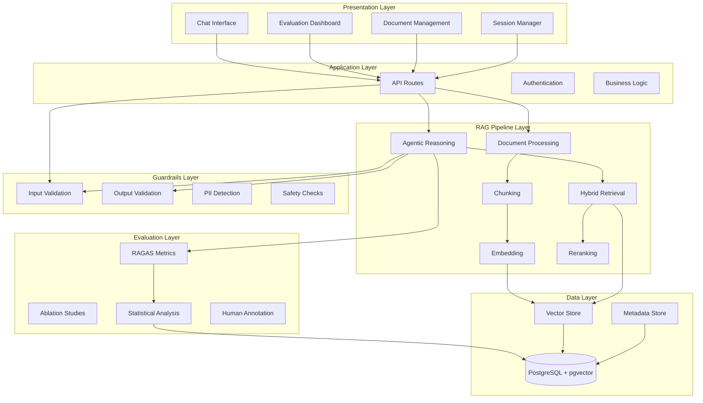
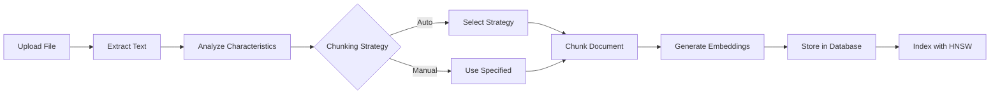
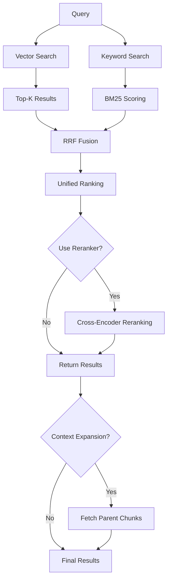
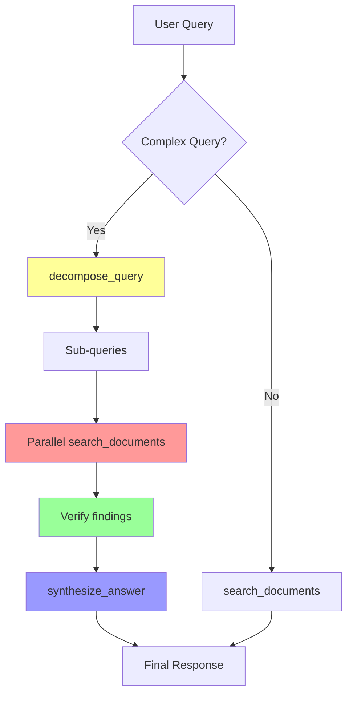
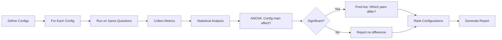
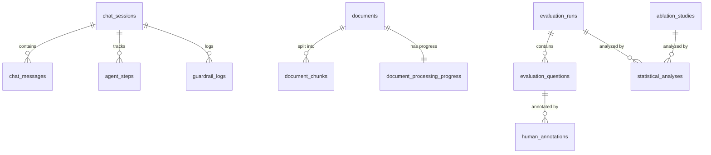

# Arsitektur Tingkat Tinggi Sistem

## 1. Overview Arsitektur

Sistem Academic Research RAG Chatbot mengimplementasikan **5-Layer Architecture** yang memisahkan concerns dengan jelas dan memungkinkan skalabilitas serta maintainability.



## 2. Layer-by-Layer Breakdown

### 2.1 Presentation Layer

**Tanggung Jawab**: User interaction, state management, real-time updates

#### Komponen Utama:

##### Chat Interface (`src/components/chat/chat-interface.tsx`)
- **Fungsi**: Antarmuka percakapan utama dengan support streaming
- **Fitur**:
  - Message bubbles dengan markdown rendering
  - Sources collapsible dengan relevance visualization
  - Agent steps collapsible dengan timing info
  - Character counter dan settings integration
- **State Management**: Zustand untuk chat state, SWR untuk data fetching

##### Evaluation Dashboard (`src/components/evaluation/evaluation-dashboard.tsx`)
- **Fungsi**: Comprehensive dashboard untuk evaluasi RAGAS dan ablation studies
- **Tabs**:
  - **Overview**: Summary metrics, progress tracking
  - **RAGAS Metrics**: Faithfulness, relevancy, precision, recall
  - **Ablation Study**: Configuration comparison
  - **Domain Metrics**: Academic rigor, citation accuracy
  - **Hallucination**: Detection dan analysis
  - **Statistical Analysis**: t-tests, ANOVA, effect sizes
  - **Human Annotation**: Manual rating interface
  - **Correlation**: LLM-judge vs human correlation
  - **Information**: Metodologi, formulas (LaTeX), penjelasan
- **Visualization**: Recharts untuk metrics visualization

##### Document Management (`src/components/manage/`)
- **Fungsi**: Upload, processing, dan management dokumen
- **Fitur**:
  - Drag-and-drop upload dengan react-dropzone
  - Real-time progress tracking via SSE
  - Chunking strategy selection (automatic/manual)
  - Retry mechanism dengan partial success
  - Batch processing support

##### Session Manager (`src/components/chat/session-manager.tsx`)
- **Fungsi**: Manage chat sessions dengan persistence
- **Fitur**:
  - Session list dengan search/filter
  - Session sync button (manual resynchronization)
  - Ephemeral sessions (memory-only, non-persisted)
  - Session deletion dengan cascade

#### Technology Stack:
- **Framework**: Next.js 16 App Router dengan React 19
- **Styling**: TailwindCSS 4 dengan custom design system
- **UI Components**: Radix UI primitives (accessible, unstyled)
- **State**: Zustand (global), SWR (server state), useState/useReducer (local)
- **Streaming**: Vercel AI SDK useChat hook dengan custom metadata handling

---

### 2.2 Application Layer

**Tanggung Jawab**: Request routing, authentication, business logic orchestration

#### API Routes (`src/app/api/`)

##### `/api/chat` (POST)
```typescript
Request: {
  messages: Message[],
  useRag: boolean,
  useAgenticMode: boolean,
  retrievalStrategy: "vector" | "keyword" | "hybrid"
}

Response: StreamingResponse (EventStream) {
  text: string,  // Incremental response
  agentSteps: AgentStep[],  // Agentic steps
  retrievedChunks: RetrievalResult[]  // Context chunks
}
```

**Flow**:
1. Validate input dengan guardrails
2. Load atau create session
3. Execute RAG pipeline (agentic atau standard)
4. Stream response dengan metadata
5. Persist message dan agent steps ke database

##### `/api/documents/upload` (POST)
```typescript
Request: FormData {
  file: File,
  chunkingStrategy?: ChunkingStrategy,
  enableProgressTracking?: boolean
}

Response: {
  documentId: string,
  processingStatus: "pending" | "processing" | "completed" | "failed"
}
```

**Flow**:
1. Save file metadata ke database
2. Extract text berdasarkan file type (PDF/DOCX/TXT/MD)
3. Chunk dengan strategy yang dipilih
4. Generate embeddings dalam batch
5. Store chunks + embeddings ke database
6. Update processing status

##### `/api/documents/progress/:id` (GET, SSE)
```typescript
Response: EventStream {
  data: {
    stage: ProcessingStage,
    progress: number (0-100),
    message: string,
    estimatedTimeMs?: number
  }
}
```

##### `/api/evaluation/run` (POST)
```typescript
Request: {
  name: string,
  questions: { question: string, groundTruth: string }[],
  config: EvaluationConfig
}

Response: {
  runId: string,
  status: "running"
}
```

**Flow**:
1. Create evaluation run record
2. For each question:
   - Generate RAG answer
   - Generate non-RAG answer (baseline)
   - Calculate RAGAS metrics
   - Store results
3. Update run status to "completed"

##### `/api/evaluation/ablation` (POST)
```typescript
Request: {
  name: string,
  configurations: AblationConfig[],
  questions: string[]
}

Response: {
  studyId: string,
  status: "running"
}
```

**Flow**:
1. Create ablation study record
2. For each configuration × question combination:
   - Execute RAG dengan config specific
   - Calculate metrics
3. Perform statistical analysis (ANOVA, post-hoc)
4. Generate report
5. Update study status

#### Business Logic

##### Authentication (Placeholder)
- Saat ini tanpa authentication untuk research prototype
- Planned: NextAuth.js dengan session-based auth untuk production

##### Session Management
- Create session on first message
- Persist messages dan agent steps
- Support ephemeral sessions (in-memory only)
- Cascade deletion (session → messages → agent steps → guardrail logs)

---

### 2.3 RAG Pipeline Layer

**Tanggung Jawab**: Core RAG functionality—document processing, retrieval, generation

#### Document Processing Pipeline



##### Document Processor (`src/lib/rag/document-processor.ts`)
- **Extraksi**: Mendukung PDF (unpdf), DOCX (mammoth), TXT, MD
- **Characteristics Analysis**:
  - Document length
  - Heading density (chapter markers)
  - Paragraph average length
  - List density
  - Sentence count
- **Strategy Selection** (Auto mode):
  - **Recursive**: Default, safe untuk dokumen mixed/unknown
  - **Semantic**: Dokumen dengan long-form narrative
  - **Sentence Window**: Dokumen dengan info dense, short paragraphs
  - **Hierarchical**: Dokumen dengan explicit chapter structure

##### Chunking Strategies (`src/lib/rag/chunking.ts`)

###### 1. Recursive Chunking
```typescript
// Split by paragraphs, then sentences jika masih terlalu panjang
chunkSize: 800 tokens
overlap: 200 tokens
separators: ["\n\n", "\n", ". ", " "]
```

**Kelebihan**: Universal, reliable untuk berbagai jenis dokumen
**Kekurangan**: Tidak context-aware, bisa memutus logical units

###### 2. Semantic Chunking
```typescript
// Menggunakan embedding similarity untuk detect topic boundaries
similarityThreshold: 0.85
minChunkSize: 400 tokens
maxChunkSize: 1200 tokens
```

**Kelebihan**: Mempertahankan logical coherence
**Kekurangan**: Computationally expensive (requires embeddings untuk sentence-by-sentence)

###### 3. Sentence Window Chunking
```typescript
// Retrieve sentence, tapi provide surrounding context
windowSize: 3 sentences before + 3 after
retrieveSize: 1 sentence
contextSize: 7 sentences total
```

**Kelebihan**: Precision retrieval dengan comprehensive context
**Kekurangan**: Redundancy, overlap antar chunks

###### 4. Hierarchical Chunking (Parent-Child)
```typescript
// Parent chunks (large) → Child chunks (small)
parentSize: 1200 tokens
childSize: 400 tokens
parentOverlap: 300 tokens
childOverlap: 100 tokens
```

**Kelebihan**: Best context expansion—retrieve child, provide parent
**Kekurangan**: Kompleksitas storage dan retrieval logic

##### Embedding Generation (`src/lib/ai/embeddings.ts`)
```typescript
Model: text-embedding-3-small (Azure OpenAI)
Dimensions: 1536
Batch Size: 50 chunks per request
Caching: Embedding cache untuk deduplikasi
```

**Optimization**:
- Batch processing untuk reduce API calls
- Embedding cache untuk identical content
- Error handling dengan retry logic

#### Hybrid Retrieval Pipeline



##### Vector Search (`src/lib/rag/hybrid-retrieval.ts`)
```typescript
Algorithm: Cosine similarity via pgvector <=> operator
Index: HNSW (Hierarchical Navigable Small World)
TopK: 10 (default, configurable)
```

**SQL Query**:
```sql
SELECT id, content, embedding <=> $1 AS distance
FROM document_chunks
WHERE embedding IS NOT NULL
ORDER BY embedding <=> $1
LIMIT $2
```

**Kelebihan**: Semantic search, menangkap sinonim dan konsep
**Kekurangan**: Miss exact terminology, sensitive to embedding quality

##### Keyword Search (BM25 Okapi)
```typescript
Parameters:
  k1: 1.2  // Term frequency saturation
  b: 0.75  // Length normalization
  delta: 1 // Minimum score boost

Tokenization: Stopword removal + Indonesian stemming
Full-text Index: GIN trigram (pg_trgm)
```

**Scoring Formula**:
```
BM25(D, Q) = Σ IDF(qi) × [ f(qi, D) × (k1 + 1) ] /
                         [ f(qi, D) + k1 × (1 - b + b × |D| / avgdl) ]

IDF(qi) = log[ (N - df(qi) + 0.5) / (df(qi) + 0.5) + δ]
```

**Kelebihan**: Exact term matching, robust untuk terminology
**Kekurangan**: Tidak semantic-aware, kesulitan dengan sinonim

##### Reciprocal Rank Fusion (RRF)
```typescript
k = 60  // RRF constant (empirically optimal)

RRF_score(d) = Σ [ 1 / (k + rank_i(d)) ]
               for each ranking i where d appears
```

**Mengapa RRF**:
- **Parameter-free**: Hanya butuh konstanta k
- **No score normalization**: Works dengan heterogeneous scores (cosine vs BM25)
- **Empirically proven**: Outperforms weighted fusion untuk RAG tasks

**Alternative Considered**:
- Linear combination: Requires score normalization, tuning weights
- Borda count: Sensitive to ranking differences, less robust

##### Reranking (`src/lib/rag/reranker.ts`)

###### Cross-Encoder Strategy (Default)
```typescript
Model: LLM-based scoring (GPT-4o)
Prompt: "Rate relevance of this passage to the query (0-100)"
Input: Query + passage pairs
Output: Relevance scores (0-100)
```

**Trade-off**:
- **Pro**: State-of-the-art accuracy, contextual understanding
- **Con**: High latency (~500-800ms per 5 passages), cost

###### MMR (Maximal Marginal Relevance)
```typescript
lambda: 0.5  // Balance relevance vs diversity
Algorithm: Iteratively select passages that maximize:
  λ × relevance - (1-λ) × max_similarity_to_selected
```

**Use Case**: Mengurangi redundancy dalam retrieved chunks

###### Diversity Reranking
```typescript
// Prefer chunks dari dokumen berbeda
documentDiversityWeight: 0.3
```

**Use Case**: Memberikan perspektif dari berbagai sumber

##### Context Expansion (Parent-Child)
```typescript
Strategy: Retrieve child chunk → fetch parent for context
Implementation:
  1. Retrieve small child chunks (high precision)
  2. Fetch corresponding parent chunks via metadata.parentId
  3. Provide parent context untuk generation
```

**Benefit**: Best of both worlds—precision retrieval, comprehensive context

#### Agentic Reasoning Pipeline



##### Agent Tools (`src/lib/rag/agentic-rag.ts`)

###### 1. `search_documents`
```typescript
Input: { query: string, strategy?: "vector"|"keyword"|"hybrid", topK?: number }
Output: { results: RetrievalResult[], count: number }

Functionality:
  - Perform hybrid retrieval (atau strategy specified)
  - Extract top-K chunks
  - Return dengan citations
```

###### 2. `decompose_query`
```typescript
Input: { query: string, maxSubQuestions?: number }
Output: { subQueries: string[], reasoning: string }

LLM Prompt:
  "Break down this complex question into simpler sub-questions
   that can be answered independently."
```

**Example**:
```
Query: "Bandingkan metodologi penelitian kuantitatif dan kualitatif"
Sub-queries:
1. "Apa itu metodologi penelitian kuantitatif?"
2. "Apa itu metodologi penelitian kualitatif?"
3. "Apa perbedaan utama antara keduanya?"
```

###### 3. `verify_claim`
```typescript
Input: { claim: string, context: string[] }
Output: { verified: boolean, confidence: number, reasoning: string }

LLM Prompt:
  "Is this claim supported by the provided context?
   Rate confidence 0-100."
```

###### 4. `synthesize_answer`
```typescript
Input: { question: string, sources: { content: string, citation: string }[] }
Output: { answer: string, citations: string[] }

LLM Prompt:
  "Synthesize a comprehensive answer using ONLY the provided sources.
   Include inline citations [1], [2]."
```

##### Agent Execution Flow
1. **Planning**: LLM decides tool sequence based on query complexity
2. **Parallel Execution**: Independent tool calls executed in parallel (e.g., multiple search_documents)
3. **Step Recording**: Each tool call logged dengan timing, input/output
4. **Adaptive**: LLM can adjust plan based on intermediate results

**Max Steps**: 10 (configurable via `stepCountIs` callback)
**Timeout**: 30 seconds per query

---

### 2.4 Guardrails Layer

**Tanggung Jawab**: Safety, compliance, academic integrity

#### Input Validation (`src/lib/rag/guardrails.ts`)

##### PII Detection
```typescript
Patterns Detected:
  - Email: regex untuk format email
  - Phone: Indonesian phone formats (+62, 0)
  - NIK: 16-digit Indonesian ID
  - Student ID: Common university ID patterns
  - IP Address: IPv4 format

Action: Flag + redact jika severity "high" atau "critical"
```

##### Prompt Injection Prevention
```typescript
Patterns:
  - "Ignore previous instructions"
  - "Disregard all rules"
  - "Forget everything you know"
  - "Pretend you are..."
  - Bahasa Indonesia equivalents

Action: Block request dengan suggested response
```

##### Academic Integrity Check
```typescript
Triggers:
  - Requests untuk "do my homework"
  - "Write my thesis"
  - Explicit cheating requests

Action:
  - Log violation
  - Return policy reminder
  - Optionally escalate untuk human review
```

##### Relevance Check
```typescript
Method: Check overlap dengan ACADEMIC_TOPICS list
Threshold: < 20% academic terms → warn user
Example: "Your query seems off-topic. This bot is for academic questions only."
```

#### Output Validation

##### Citation Verification
```typescript
Check:
  - Every claim should have supporting source
  - Citations should match actual retrieved chunks

Algorithm:
  1. Extract claims dari answer
  2. Map each claim to cited chunk
  3. Verify overlap > 60%
```

##### Hallucination Detection
```typescript
Method: LLM-as-judge
Prompt: "Does this answer contain information NOT in the sources?"
Scoring: Hallucination rate (0-1)
Threshold: > 0.3 → flag for review
```

##### Toxicity & Bias Check
```typescript
Patterns:
  - Offensive language
  - Hate speech
  - Discriminatory content

Action: Block output, log incident, generate safe alternative
```

#### Negative Reaction Detection
```typescript
Patterns:
  - Frustration: "This is useless", "You're terrible"
  - Disappointment: "I expected better"
  - Confusion: "I don't understand", "This makes no sense"
  - Help requests: "Please help", "I'm stuck"

Action:
  - Log untuk UX analysis
  - Provide empathetic response
  - Suggest alternative phrasing atau contact support
```

---

### 2.5 Evaluation Layer

**Tanggung Jawab**: Quality assessment, research validation

#### RAGAS Metrics (`src/lib/rag/evaluation.ts`)

##### Core Metrics

###### 1. Faithfulness
```typescript
Definition: Apakah jawaban grounded in retrieved sources?
Method: NLI-based claim verification
Algorithm:
  1. Extract claims dari answer
  2. For each claim, check if entailed by any source
  3. Faithfulness = (verified claims) / (total claims)
Score Range: 0-1 (higher = better)
```

###### 2. Answer Relevancy
```typescript
Definition: Apakah jawaban addresses the question?
Method: Embedding cosine similarity
Algorithm:
  1. Generate embedding untuk question
  2. Generate embedding untuk answer
  3. Relevancy = cosine_similarity(q_embed, a_embed)
Score Range: 0-1
```

###### 3. Context Precision
```typescript
Definition: Apakah retrieved chunks actually relevant?
Method: LLM-as-judge ranking
Algorithm:
  1. For each retrieved chunk, LLM rates relevance (0-100)
  2. Precision@K = (relevant chunks in top-K) / K
Interpretation: High precision = low noise
```

###### 4. Context Recall
```typescript
Definition: Apakah all relevant info ter-retrieve?
Method: Ground truth overlap
Algorithm:
  1. Identify ground truth relevant chunks (manually labeled)
  2. Recall = (retrieved relevant) / (total relevant)
Interpretation: High recall = comprehensive coverage
```

###### 5. Answer Correctness
```typescript
Definition: Factual accuracy vs ground truth
Method: LLM comparison + embedding similarity
Algorithm:
  1. Semantic similarity dengan ground truth (embedding)
  2. LLM assessment untuk factual correctness
  3. Weighted combination (0.7 × LLM + 0.3 × embedding)
```

##### Domain-Specific Metrics

###### 6. Academic Rigor
```typescript
Criteria:
  - Use of formal academic language
  - Proper terminology
  - Logical structure
  - Appropriate hedging (avoid absolutes)
Scoring: LLM-as-judge dengan rubric
```

###### 7. Citation Accuracy
```typescript
Check:
  - All citations present dan formatted
  - Citations traceable to specific sources
  - No spurious/fake citations
```

###### 8. Terminology Correctness
```typescript
Check:
  - Academic terms used correctly
  - Indonesian-English terminology consistency
  - Domain-specific jargon appropriate
```

##### Hallucination Metrics

###### 9. Hallucination Rate
```typescript
Method: Information overlap analysis
Algorithm:
  1. Extract information units dari answer
  2. For each unit, check if supported by sources
  3. Hallucination = (unsupported units) / (total units)
Range: 0-1 (lower = better)
```

###### 10. Factual Consistency
```typescript
Method: NLI entailment check
For each statement: sources ⊢ statement ?
Consistency = entailed statements / total statements
```

###### 11. Contradiction Score
```typescript
Check: Internal contradictions dalam answer
Method: Pairwise statement comparison
Score: 1 - (contradictions detected / possible pairs)
```

##### Retrieval Quality Metrics

###### 12. NDCG (Normalized Discounted Cumulative Gain)
```typescript
Formula: DCG@K / IDCG@K
DCG@K = Σ (relevance_i / log2(i + 1)) for i=1 to K
IDCG = DCG untuk perfect ranking

Interpretation: Measures ranking quality
Range: 0-1 (1 = perfect ranking)
```

###### 13. MRR (Mean Reciprocal Rank)
```typescript
Formula: 1 / rank_of_first_relevant_doc
Aggregated: Mean across queries

Interpretation: How quickly do we find relevant info?
```

##### Performance Metrics

###### 14. Latency Breakdown
```typescript
Tracked Phases:
  - Retrieval latency
  - Reranking latency
  - Generation latency
  - Agent reasoning latency (agentic mode)
  - Tool call latency

Aggregations: P50, P95, P99, mean, stdDev
```

###### 15. Token Efficiency
```typescript
Metrics:
  - Tokens per second (throughput)
  - Total tokens used (cost proxy)
  - Input/output token ratio
```

#### Ablation Studies (`src/app/api/evaluation/ablation/route.ts`)

##### Configurations Tested

```typescript
1. Baseline: No RAG (pure LLM)
2. Vector-only: Embedding search, no BM25
3. Keyword-only: BM25, no embedding
4. Hybrid: Vector + BM25 + RRF
5. Hybrid + Reranker: With cross-encoder
6. Hybrid + Reranker + Agentic: Full system
```

##### Ablation Process


##### Statistical Tests
- **One-way ANOVA**: Keseluruhan effect dari configurations
- **Tukey HSD**: Pairwise post-hoc comparisons
- **Effect Size (η²)**: Magnitude of differences
- **Confidence Intervals**: Uncertainty quantification

#### Human Annotation (`src/components/evaluation/annotation-panel.tsx`)

##### Annotation Interface
```typescript
Per Question:
  - Display: Question, RAG answer, ground truth
  - Ratings (1-5 Likert scale):
    * Faithfulness: Stick to sources?
    * Relevancy: Addresses question?
    * Correctness: Factually accurate?
  - Binary:
    * Has hallucination?
  - Optional:
    * Overall quality (1-5)
    * Notes

Metadata: Annotation time (quality control)
```

##### Inter-Rater Reliability
```typescript
Multiple annotators per question (if budget allows)
Metric: Cohen's Kappa
Interpretation:
  < 0.20: Poor agreement
  0.21-0.40: Fair
  0.41-0.60: Moderate
  0.61-0.80: Substantial
  > 0.80: Almost perfect
```

##### Correlation Analysis (`src/lib/statistics/statistical-analysis.ts`)
```typescript
Methods:
  - Pearson r: Linear correlation (interval data)
  - Spearman ρ: Rank correlation (ordinal data)

Analysis:
  1. Automated (LLM-judge) scores
  2. Human ratings (normalized 0-1)
  3. Correlation per metric
  4. Overall system correlation

Interpretation:
  r > 0.7: Strong correlation → LLM-judge reliable
  r < 0.5: Weak correlation → LLM-judge questionable
```

---

### 2.6 Data Layer

**Tanggung Jawab**: Persistent storage, vector indexing, metadata management

#### Database Schema Overview



#### Key Tables

##### `documents`
```sql
CREATE TABLE documents (
  id UUID PRIMARY KEY DEFAULT gen_random_uuid(),
  title TEXT NOT NULL,
  file_name TEXT NOT NULL,
  file_type TEXT NOT NULL,  -- pdf, txt, md, docx
  file_size INTEGER NOT NULL,
  content TEXT,  -- Raw extracted text
  metadata JSONB,  -- Flexible metadata
  processing_status TEXT DEFAULT 'pending',
  chunking_strategy TEXT DEFAULT 'recursive',
  created_at TIMESTAMP DEFAULT NOW()
);
```

**Indexes**:
- Primary key index pada `id`
- Index pada `processing_status` untuk filter

##### `document_chunks`
```sql
CREATE TABLE document_chunks (
  id UUID PRIMARY KEY DEFAULT gen_random_uuid(),
  document_id UUID REFERENCES documents(id) ON DELETE CASCADE,
  content TEXT NOT NULL,
  chunk_index INTEGER NOT NULL,
  start_offset INTEGER,
  end_offset INTEGER,
  metadata JSONB,
  embedding VECTOR(1536),  -- pgvector extension
  keywords TEXT[],  -- For BM25
  created_at TIMESTAMP DEFAULT NOW()
);

CREATE INDEX ON document_chunks USING HNSW (embedding vector_cosine_ops);
CREATE INDEX ON document_chunks USING GIN (content gin_trgm_ops);
```

**Indexes**:
- **HNSW**: Hierarchical Navigable Small World untuk vector search (sub-linear time)
- **GIN trigram**: Untuk full-text search dengan fuzzy matching
- B-tree pada `document_id` untuk joins

**Rationale**:
- HNSW vs IVFFlat: HNSW lebih akurat, IVFFlat lebih cepat untuk very large datasets (kami pilih HNSW karena accuracy priority)
- 1536 dimensions: Matches text-embedding-3-small output
- Cascade delete: Cleanup otomatis saat dokumen dihapus

##### `chat_sessions` & `chat_messages`
```sql
CREATE TABLE chat_sessions (
  id UUID PRIMARY KEY DEFAULT gen_random_uuid(),
  title TEXT,
  use_rag BOOLEAN DEFAULT TRUE,
  use_agentic_mode BOOLEAN DEFAULT TRUE,
  retrieval_strategy TEXT DEFAULT 'hybrid',
  created_at TIMESTAMP DEFAULT NOW()
);

CREATE TABLE chat_messages (
  id UUID PRIMARY KEY DEFAULT gen_random_uuid(),
  session_id UUID REFERENCES chat_sessions(id) ON DELETE CASCADE,
  role TEXT NOT NULL,  -- user, assistant, system
  content TEXT NOT NULL,
  retrieved_chunks JSONB,  -- RetrievalResult[]
  rag_enabled BOOLEAN DEFAULT TRUE,
  agentic_mode BOOLEAN DEFAULT FALSE,
  agent_steps_count INTEGER,
  latency_ms INTEGER,
  created_at TIMESTAMP DEFAULT NOW()
);
```

##### `agent_steps`
```sql
CREATE TABLE agent_steps (
  id UUID PRIMARY KEY DEFAULT gen_random_uuid(),
  session_id UUID REFERENCES chat_sessions(id) ON DELETE CASCADE,
  message_id UUID,
  step_index INTEGER NOT NULL,
  step_type TEXT NOT NULL,  -- tool_call, reasoning, retrieval
  tool_name TEXT,
  tool_input JSONB,
  tool_output JSONB,
  reasoning TEXT,
  duration_ms INTEGER,
  created_at TIMESTAMP DEFAULT NOW()
);
```

**Use Case**: Debugging, explainability, research analysis

##### `evaluation_runs` & `evaluation_questions`
```sql
CREATE TABLE evaluation_runs (
  id UUID PRIMARY KEY DEFAULT gen_random_uuid(),
  name TEXT NOT NULL,
  status TEXT DEFAULT 'pending',  -- pending, running, completed, failed
  total_questions INTEGER DEFAULT 0,
  completed_questions INTEGER DEFAULT 0,
  retrieval_strategy TEXT DEFAULT 'hybrid',
  use_agentic_mode BOOLEAN DEFAULT TRUE,
  created_at TIMESTAMP DEFAULT NOW(),
  completed_at TIMESTAMP
);

CREATE TABLE evaluation_questions (
  id UUID PRIMARY KEY DEFAULT gen_random_uuid(),
  run_id UUID REFERENCES evaluation_runs(id) ON DELETE CASCADE,
  question TEXT NOT NULL,
  ground_truth TEXT NOT NULL,
  rag_answer TEXT,
  non_rag_answer TEXT,
  retrieved_contexts JSONB,

  -- Core RAGAS metrics (all REAL type, 0-1 range)
  rag_faithfulness REAL,
  rag_answer_relevancy REAL,
  rag_context_precision REAL,
  rag_context_recall REAL,
  rag_answer_correctness REAL,
  rag_hallucination_rate REAL,
  -- ... 15+ metrics total

  -- Latency breakdown
  rag_latency_ms INTEGER,
  rag_retrieval_latency_ms INTEGER,
  rag_reranking_latency_ms INTEGER,
  rag_generation_latency_ms INTEGER,

  created_at TIMESTAMP DEFAULT NOW()
);
```

##### `human_annotations`
```sql
CREATE TABLE human_annotations (
  id UUID PRIMARY KEY DEFAULT gen_random_uuid(),
  evaluation_question_id UUID REFERENCES evaluation_questions(id) ON DELETE CASCADE,
  annotator_id TEXT NOT NULL,  -- Pseudonymous

  faithfulness_rating INTEGER,  -- 1-5
  relevancy_rating INTEGER,
  correctness_rating INTEGER,
  has_hallucination BOOLEAN,
  overall_quality INTEGER,

  annotation_time_ms INTEGER,  -- Quality control
  notes TEXT,
  created_at TIMESTAMP DEFAULT NOW()
);
```

##### `ablation_studies`
```sql
CREATE TABLE ablation_studies (
  id UUID PRIMARY KEY DEFAULT gen_random_uuid(),
  name TEXT NOT NULL,
  status TEXT DEFAULT 'pending',
  configurations JSONB,  -- AblationConfig[]
  results JSONB,  -- AblationResult[]
  report TEXT,  -- Generated markdown
  created_at TIMESTAMP DEFAULT NOW(),
  completed_at TIMESTAMP
);
```

##### `statistical_analyses`
```sql
CREATE TABLE statistical_analyses (
  id UUID PRIMARY KEY DEFAULT gen_random_uuid(),
  evaluation_run_id UUID REFERENCES evaluation_runs(id) ON DELETE CASCADE,
  ablation_study_id UUID REFERENCES ablation_studies(id),
  analysis_type TEXT NOT NULL,  -- paired_ttest, anova, bootstrap_ci
  metric_name TEXT NOT NULL,
  results JSONB,  -- StatisticalResult
  report_en TEXT,  -- English interpretation
  report_id TEXT,  -- Indonesian interpretation
  created_at TIMESTAMP DEFAULT NOW()
);
```

#### PostgreSQL Extensions

```sql
CREATE EXTENSION IF NOT EXISTS vector;      -- pgvector untuk vector operations
CREATE EXTENSION IF NOT EXISTS pg_trgm;    -- Trigram untuk fuzzy text search
CREATE EXTENSION IF NOT EXISTS "uuid-ossp"; -- UUID generation
```

#### Data Flow Patterns

##### 1. Document Ingestion
```
Upload → Extract → Analyze → Chunk → Embed → Store
                                        ↓
                           Progress tracking via SSE
```

##### 2. Query Execution
```
User Query → Guardrails → Embedding → Vector + Keyword Search
                                              ↓
                                        RRF Fusion
                                              ↓
                                         Reranking
                                              ↓
                                    Context Expansion
                                              ↓
                                   LLM Generation (streaming)
                                              ↓
                               Guardrails → Response
                                              ↓
                                  Persist Message + Steps
```

##### 3. Evaluation Run
```
Create Run → For Each Question:
               - RAG Answer Generation
               - Non-RAG Baseline
               - RAGAS Metrics Calculation
               - Store Results
             → Statistical Analysis
             → Report Generation
```

---

## 3. Design Patterns dan Principles

### 3.1 Architectural Patterns

#### Layered Architecture
**Benefit**: Clear separation of concerns, modularity, testability
**Implementation**: Strict dependency rules (Presentation → Application → Domain → Data)

#### Repository Pattern
**Benefit**: Abstraction over data access, easier to test
**Implementation**: Database operations trong `/lib/db`, business logic terpisah

#### Strategy Pattern
**Benefit**: Interchangeable algorithms (chunking, retrieval, reranking)
**Implementation**: Interfaces untuk strategies, runtime selection

#### Observer Pattern
**Benefit**: Real-time updates tanpa polling
**Implementation**: SSE untuk progress tracking, streaming responses

#### Pipeline Pattern
**Benefit**: Modular, composable processing stages
**Implementation**: RAG pipeline: docs → chunks → embeddings → retrieval → generation

### 3.2 SOLID Principles

✅ **Single Responsibility**: Each module has one reason to change
  - `document-processor.ts`: Only document processing logic
  - `hybrid-retrieval.ts`: Only retrieval logic
  - `evaluation.ts`: Only evaluation metrics

✅ **Open/Closed**: Open for extension, closed for modification
  - New chunking strategies can be added tanpa mengubah core logic
  - New RAGAS metrics can be added via composition

✅ **Liskov Substitution**: Subtypes can replace base types
  - All reranker strategies implement `RerankerStrategy` interface

✅ **Interface Segregation**: Clients tidak depend on unused methods
  - Separate interfaces untuk different concerns (e.g., `LatencyTracker`, `ProgressTracker`)

✅ **Dependency Inversion**: Depend on abstractions, not concretions
  - Database abstraction via Drizzle ORM
  - AI abstraction via Vercel AI SDK

### 3.3 Performance Optimizations

#### Database Level
- **HNSW Indexing**: Sub-linear vector search (O(log n) vs O(n))
- **GIN Indexing**: Fast full-text search untuk BM25
- **Connection Pooling**: Reuse database connections
- **Prepared Statements**: Query plan caching

#### Application Level
- **Batch Processing**: Embed 50 chunks per API call (vs 1-by-1)
- **Embedding Cache**: Deduplicate identical content
- **Parallel Tool Execution**: Agentic tools run concurrently
- **Streaming**: Incremental response generation (time-to-first-token < 1s)

#### Algorithmic Level
- **RRF Fusion**: O(K log K) vs O(N) for score normalization
- **Early Termination**: Stop agentic execution jika goal tercapai

### 3.4 Scalability Considerations

#### Horizontal Scaling
- **Stateless API**: Next.js API routes can scale across instances
- **Session in Database**: No in-memory session dependency
- **Async Processing**: Document processing dapat di-queue

#### Vertical Scaling
- **pgvector Limits**: Tested up to 100K documents, 500K chunks
- **Embedding Batch**: Can be increased untuk faster processing
- **Connection Pool**: Tuneable berdasarkan load

#### Caching Strategies (Planned)
- **Query Cache**: Frequent queries cached (Redis)
- **Embedding Cache**: Already implemented
- **Result Cache**: RAG answers untuk identical queries

---

## 4. Security dan Compliance

### 4.1 Data Security

- **PII Protection**: Automatic detection dan redaction
- **SQL Injection Prevention**: Parameterized queries via ORM
- **XSS Prevention**: React auto-escaping, sanitized markdown
- **CSRF**: Next.js built-in protection

### 4.2 Academic Integrity

- **Anti-Cheating Guardrails**: Block assignment completion requests
- **Citation Requirement**: Mandatory source attribution
- **Plagiarism Prevention**: No direct copy-paste encouragement

### 4.3 Audit Trail

- **Comprehensive Logging**:
  - All queries logged ke chat_messages
  - Agent steps logged untuk transparency
  - Guardrail violations logged
  - Evaluation runs recorded

### 4.4 Compliance

- **GDPR/Privacy**: PII detection, right to deletion (cascade deletes)
- **Academic Standards**: Citation accuracy, factual grounding
- **Ethical AI**: Human-in-the-loop validation, bias monitoring

---

## 5. Deployment Architecture (Planned)

### 5.1 Production Stack

```
Vercel (Next.js) → Neon/Supabase (PostgreSQL + pgvector)
                ↓
        Azure OpenAI API
```

**Benefits**:
- Vercel: Zero-config deployment, edge functions, auto-scaling
- Neon: Serverless Postgres, automatic backups, branching
- Azure OpenAI: Enterprise-grade, compliance, quota management

### 5.2 Environment Configuration

```typescript
Development:
  - Local PostgreSQL
  - Azure OpenAI Dev instance
  - Hot reload

Staging:
  - Neon Preview Branch
  - Azure OpenAI Test instance
  - Realistic data subset

Production:
  - Neon Production
  - Azure OpenAI Production
  - Monitoring + alerts
```

### 5.3 Monitoring (Planned)

- **Application Metrics**: Sentry for error tracking
- **Performance Metrics**: Vercel Analytics untuk page performance
- **Database Metrics**: Neon dashboard untuk query performance
- **Business Metrics**: Custom dashboard untuk RAG metrics (faithfulness, latency)

---

**Kesimpulan Arsitektur**:

Sistem ini mengimplementasikan **modular, layered architecture** yang memisahkan presentation, business logic, data access, dan specialized concerns (guardrails, evaluation). Dengan **hybrid retrieval + agentic reasoning + comprehensive evaluation**, sistem tidak hanya provides practical value tetapi juga serves sebagai research platform untuk RAG evaluation methodology.

**Key Architectural Strengths**:
1. **Modularity**: Easy to extend (new chunking strategies, metrics, tools)
2. **Transparency**: Everything logged (agent steps, evaluations, guardrails)
3. **Research-Grade**: Built-in evaluation framework dengan statistical rigor
4. **Production-Ready**: Performance optimization, scalability patterns, security considerations

**Architectural Trade-offs**:
1. **Complexity vs Flexibility**: More components = more flexibility tetapi higher complexity
2. **Latency vs Quality**: Agentic mode slower tetapi higher quality
3. **Storage vs Speed**: Comprehensive logging = more storage tetapi better debugging

Arsitektur ini dirancang untuk support **dual purpose**: practical chatbot untuk end-users DAN research platform untuk RAG methodology development.
