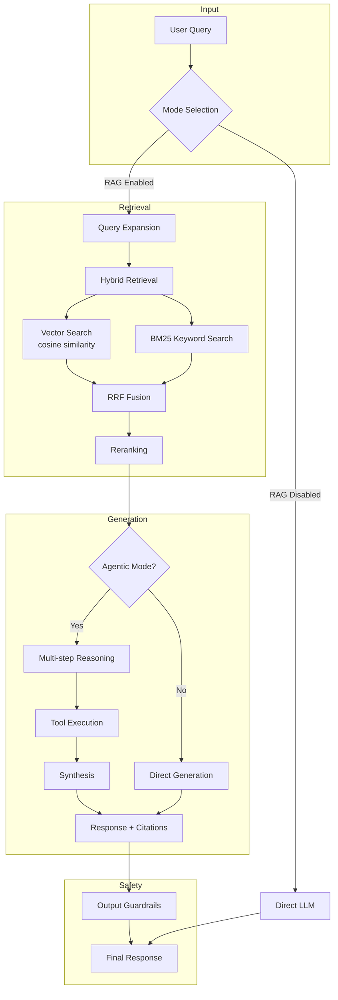

# Ikhtisar Arsitektur Sistem

## Deskripsi Umum

Academic Research RAG Chatbot adalah sistem chatbot berbasis Retrieval-Augmented Generation (RAG) yang dirancang khusus untuk konteks informasi universitas Indonesia. Sistem ini mengintegrasikan pencarian semantik, pemrosesan bahasa alami, dan generasi teks untuk memberikan jawaban yang akurat dan kontekstual terhadap pertanyaan akademis.

---

## Prinsip Arsitektur

### 1. Layered Architecture

Sistem mengadopsi arsitektur berlapis yang memisahkan tanggung jawab:

```
┌─────────────────────────────────────────────────────────┐
│                    Presentation Layer                    │
│              (React Components, UI State)                │
├─────────────────────────────────────────────────────────┤
│                      API Layer                           │
│                (Next.js API Routes)                      │
├─────────────────────────────────────────────────────────┤
│                   Business Logic Layer                   │
│     (RAG Pipeline, Evaluation, Statistical Analysis)    │
├─────────────────────────────────────────────────────────┤
│                    Data Access Layer                     │
│           (Drizzle ORM, PostgreSQL, pgvector)           │
└─────────────────────────────────────────────────────────┘
```

### 2. Event-Driven Streaming

Untuk mengurangi latensi yang dirasakan pengguna, sistem menggunakan streaming response:
- Real-time feedback selama eksekusi pipeline RAG
- Progressive output daripada menunggu respons lengkap
- Custom data parts untuk metadata (agent steps, retrieved chunks)

---

## Alur Data RAG Pipeline



---

## Struktur Direktori Codebase

```
src/
├── app/                    # Next.js App Router
│   ├── api/               # REST API endpoints
│   │   ├── chat/          # Chat streaming endpoint
│   │   ├── documents/     # Document CRUD operations
│   │   ├── evaluation/    # Evaluation runs & metrics
│   │   ├── export/        # Data export functionality
│   │   └── sessions/      # Session management
│   ├── evaluation/        # Evaluation dashboard page
│   └── manage/            # Document management page
│
├── components/            # React UI Components
│   ├── chat/              # Chat interface components
│   ├── evaluation/        # Evaluation dashboard components
│   ├── manage/            # Document management components
│   └── ui/                # Reusable UI primitives (shadcn/ui)
│
└── lib/                   # Core Business Logic
    ├── ai/                # AI model configuration & embeddings
    ├── db/                # Database schema & connection
    ├── export/            # Data export utilities
    ├── rag/               # RAG pipeline modules
    │   ├── handlers/      # File format handlers (PDF, DOCX, TXT)
    │   ├── parsers/       # Specialized content parsers
    │   └── utils/         # Language utilities
    ├── statistics/        # Statistical analysis module
    ├── stores/            # Zustand state management
    └── utils/             # General utilities
```

---

## Komponen Utama

### 1. RAG Pipeline (`src/lib/rag/`)

| Modul                  | Tanggung Jawab                      | Dokumentasi                                              |
| ---------------------- | ----------------------------------- | -------------------------------------------------------- |
| `chunking.ts`          | Strategi pemecahan dokumen          | [04-pemrosesan-dokumen.md](./04-pemrosesan-dokumen.md)   |
| `hybrid-retrieval.ts`  | Pencarian hibrid (Vector + BM25)    | [05-sistem-retrieval.md](./05-sistem-retrieval.md)       |
| `reranker.ts`          | Pemeringkatan ulang hasil pencarian | [05-sistem-retrieval.md](./05-sistem-retrieval.md)       |
| `agentic-rag.ts`       | Multi-step reasoning dengan tools   | [06-agentic-rag.md](./06-agentic-rag.md)                 |
| `university-domain.ts` | Intelijen domain universitas        | [07-domain-universitas.md](./07-domain-universitas.md)   |
| `guardrails.ts`        | Keamanan dan validasi konten        | [08-guardrails-keamanan.md](./08-guardrails-keamanan.md) |
| `evaluation.ts`        | Metrik RAGAS dan ablation           | [09-metrik-evaluasi.md](./09-metrik-evaluasi.md)         |

### 2. Infrastruktur Data (`src/lib/db/`)

- **PostgreSQL** dengan ekstensi **pgvector** untuk penyimpanan vektor
- **Drizzle ORM** untuk type-safe database operations
- **JSONB** untuk metadata fleksibel tanpa migrasi

Lihat: [02-infrastruktur-data.md](./02-infrastruktur-data.md)

### 3. Modul AI (`src/lib/ai/`)

- Azure OpenAI untuk model chat (`gpt-4o-mini`) dan embedding (`text-embedding-3-small`)
- Batch processing untuk efisiensi embedding
- Telemetry configuration

Lihat: [03-modul-ai-embedding.md](./03-modul-ai-embedding.md)

---

## Pola Desain Utama

### 1. Strategy Pattern (Chunking & Retrieval)

Sistem mendukung multiple strategi yang dapat dikonfigurasi:

```typescript
type ChunkingStrategy = "recursive" | "semantic" | "sentence_window" | "hierarchical";
type RetrievalStrategy = "vector" | "keyword" | "hybrid";
type RerankerStrategy = "cross_encoder" | "llm" | "llm_listwise" | "cohere" | "ensemble" | "none";
```

### 2. Pipeline Pattern (Document Processing)

```
Upload → Extract Text → Analyze → Chunk → Embed → Store
```

### 3. Tool Pattern (Agentic RAG)

Agent memiliki akses ke tools yang didefinisikan dengan Zod schema:
- `search_documents`: Pencarian konteks akademis
- `expand_query`: Ekspansi query dengan sinonim
- `decompose_query`: Dekomposisi pertanyaan kompleks
- `verify_claim`: Verifikasi klaim terhadap sumber
- `synthesize_answer`: Sintesis jawaban akhir

---

## Teknologi Stack

| Kategori       | Teknologi                                                           |
| -------------- | ------------------------------------------------------------------- |
| **Frontend**   | Next.js 15, React, Tailwind CSS, shadcn/ui                          |
| **Backend**    | Next.js API Routes, Drizzle ORM                                     |
| **Database**   | PostgreSQL + pgvector                                               |
| **AI/ML**      | Azure OpenAI (GPT-4o-mini, text-embedding-3-small), Transformers.js |
| **State**      | Zustand dengan localStorage persistence                             |
| **Validation** | Zod                                                                 |
| **Runtime**    | Bun                                                                 |

---

## Pertimbangan Arsitektur

### Mengapa RAG, Bukan Fine-tuning?

1. **Aktualitas Data**: Informasi universitas berubah (kalender, peraturan)
2. **Transparansi**: Sumber dapat di-cite dan diverifikasi
3. **Biaya**: Tidak perlu retrain model untuk update konten
4. **Kontrol**: Administrator dapat mengelola korpus dokumen

### Mengapa Hybrid Retrieval?

1. **Vector Search**: Menangkap kesamaan semantik ("metode penelitian" ≈ "metodologi")
2. **BM25**: Menangkap exact match yang penting ("SK Rektor No. 123")
3. **Fusion**: Menggabungkan kekuatan keduanya dengan RRF

### Mengapa Agentic Mode?

1. **Query Kompleks**: Pertanyaan multi-aspek membutuhkan dekomposisi
2. **Verifikasi**: Klaim dapat dicek terhadap multiple sources
3. **Reasoning**: Langkah-langkah reasoning dapat di-trace untuk debugging

---

## Referensi Dokumen Terkait

- [02-infrastruktur-data.md](./02-infrastruktur-data.md) - Skema database dan tipe data
- [03-modul-ai-embedding.md](./03-modul-ai-embedding.md) - Konfigurasi model AI
- [04-pemrosesan-dokumen.md](./04-pemrosesan-dokumen.md) - Pipeline pemrosesan dokumen
- [05-sistem-retrieval.md](./05-sistem-retrieval.md) - Sistem retrieval hibrid
- [06-agentic-rag.md](./06-agentic-rag.md) - Pipeline RAG agentik
- [11-api-endpoints.md](./11-api-endpoints.md) - Dokumentasi API
