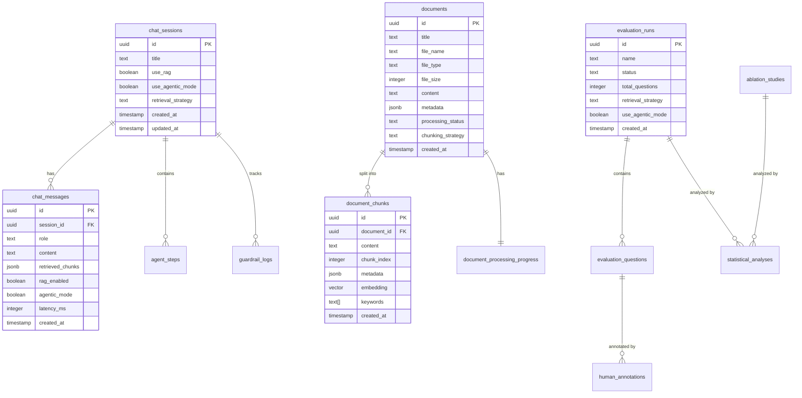

# Infrastruktur Data

## Pendahuluan

Dokumen ini menjelaskan arsitektur penyimpanan data sistem Academic Research RAG Chatbot, mencakup skema database PostgreSQL, definisi tipe TypeScript, dan keputusan desain yang mendasari struktur data.

---

## Arsitektur Database

### Teknologi

- **PostgreSQL**: Database relasional dengan dukungan JSONB dan ekstensi
- **pgvector**: Ekstensi untuk penyimpanan dan pencarian vektor embedding
- **Drizzle ORM**: Type-safe ORM untuk TypeScript dengan migrasi deklaratif

### Keputusan Desain Utama

| Keputusan                      | Rasional                                                       |
| ------------------------------ | -------------------------------------------------------------- |
| **JSONB untuk metadata**       | Evolusi skema fleksibel tanpa migrasi database                 |
| **Cascading deletes**          | Menjamin integritas referensial saat dokumen/sesi dihapus      |
| **Tabel chunks terpisah**      | Memungkinkan retrieval independen tanpa memuat dokumen lengkap |
| **GIN index pada content**     | Pencarian full-text cepat untuk BM25 keyword retrieval         |
| **Vector dengan 1536 dimensi** | Sesuai output model text-embedding-3-small                     |

---

## Entity Relationship Diagram



---

## Skema Tabel Detail

### 1. Documents

Menyimpan dokumen akademis yang diunggah.

```typescript
// src/lib/db/schema.ts
export const documents = pgTable("documents", {
    id: uuid("id").defaultRandom().primaryKey(),
    title: text("title").notNull(),
    fileName: text("file_name").notNull(),
    fileType: text("file_type").notNull(), // pdf, txt, md, docx
    fileSize: integer("file_size").notNull(),
    content: text("content"), // Full extracted text
    metadata: jsonb("metadata").$type<DocumentMetadata>(),
    processingStatus: text("processing_status").default("pending"),
    processingError: text("processing_error"),
    chunkingStrategy: text("chunking_strategy"),
    lastSuccessfulStage: text("last_successful_stage"),
    processingArtifacts: jsonb("processing_artifacts"),
    createdAt: timestamp("created_at").defaultNow().notNull(),
    updatedAt: timestamp("updated_at").defaultNow().notNull(),
});
```

**Catatan Desain**:
- `processingStatus`: Mendukung retry dengan tracking stage terakhir yang berhasil
- `chunkingStrategy`: Memungkinkan A/B testing strategi chunking per dokumen
- `metadata`: JSONB untuk fleksibilitas (author, department, academic_year, dll.)

---

### 2. Document Chunks

Menyimpan segmen teks yang telah diproses dengan embedding.

```typescript
export const documentChunks = pgTable(
    "document_chunks",
    {
        id: uuid("id").defaultRandom().primaryKey(),
        documentId: uuid("document_id")
            .references(() => documents.id, { onDelete: "cascade" })
            .notNull(),
        content: text("content").notNull(),
        chunkIndex: integer("chunk_index").notNull(),
        startOffset: integer("start_offset"),
        endOffset: integer("end_offset"),
        metadata: jsonb("metadata").$type<DocumentChunkMetadata>(),
        embedding: vector("embedding", { dimensions: 1536 }),
        keywords: text("keywords").array(), // For BM25
        createdAt: timestamp("created_at").defaultNow().notNull(),
    },
    (table) => [
        index("content_search_idx").using("gin", sql`${table.content} gin_trgm_ops`)
    ]
);
```

**Arsitektur Pencarian Hibrid**:
- `embedding`: Vektor 1536 dimensi untuk similarity search
- `keywords`: Array kata kunci untuk BM25 retrieval
- `content_search_idx`: GIN index untuk full-text search

**Metadata Chunk** mendukung:
- `parentChunkId` / `childChunkIds`: Hierarki chunk untuk context expansion
- `sentenceWindowContext`: Konteks sekitar untuk sentence window chunking
- `qualityScore`: Skor kualitas untuk weighted retrieval

---

### 3. Chat Sessions

Kontainer sesi percakapan dengan konfigurasi.

```typescript
export const chatSessions = pgTable("chat_sessions", {
    id: uuid("id").defaultRandom().primaryKey(),
    title: text("title").notNull(),
    useRag: boolean("use_rag").default(true),
    useAgenticMode: boolean("use_agentic_mode").default(false),
    retrievalStrategy: text("retrieval_strategy").default("hybrid"),
    createdAt: timestamp("created_at").defaultNow().notNull(),
    updatedAt: timestamp("updated_at").defaultNow().notNull(),
});
```

**Konfigurasi per-sesi** memungkinkan:
- Eksperimen dengan mode berbeda (RAG on/off, agentic/standard)
- Ablation study dengan kontrol retrieval strategy

---

### 4. Chat Messages

Pesan individual dengan metadata RAG.

```typescript
export const chatMessages = pgTable("chat_messages", {
    id: uuid("id").defaultRandom().primaryKey(),
    sessionId: uuid("session_id")
        .references(() => chatSessions.id, { onDelete: "cascade" })
        .notNull(),
    role: text("role").notNull(), // user, assistant, system
    content: text("content").notNull(),
    retrievedChunks: jsonb("retrieved_chunks").$type<RetrievedChunks[]>(),
    ragEnabled: boolean("rag_enabled"),
    agenticMode: boolean("agentic_mode"),
    agentStepsCount: integer("agent_steps_count"),
    guardrailsTriggered: jsonb("guardrails_triggered").$type<string[]>(),
    latencyMs: integer("latency_ms"),
    tokenCount: integer("token_count"),
    createdAt: timestamp("created_at").defaultNow().notNull(),
});
```

---

### 5. Agent Steps

Trace eksekusi langkah-langkah reasoning agentic.

```typescript
export const agentSteps = pgTable("agent_steps", {
    id: uuid("id").defaultRandom().primaryKey(),
    sessionId: uuid("session_id")
        .references(() => chatSessions.id, { onDelete: "cascade" })
        .notNull(),
    messageId: uuid("message_id"),
    stepIndex: integer("step_index").notNull(),
    stepType: text("step_type").notNull(), // reasoning, tool_call, retrieval, synthesis
    toolName: text("tool_name"),
    toolInput: jsonb("tool_input"),
    toolOutput: jsonb("tool_output"),
    reasoning: text("reasoning"),
    durationMs: integer("duration_ms"),
    retrievalStrategy: text("retrieval_strategy").default("hybrid"),
    createdAt: timestamp("created_at").defaultNow().notNull(),
});
```

**Mengapa Logging Setiap Langkah**:
1. **Reproduksibilitas**: Dapat replay reasoning untuk debugging
2. **Analisis Latensi**: Identifikasi bottleneck per langkah
3. **Audit Trail**: Transparansi untuk konteks akademis

---

### 6. Evaluation Runs & Questions

Mendukung evaluasi sistematis dengan metrik RAGAS.

```typescript
export const evaluationRuns = pgTable("evaluation_runs", {
    id: uuid("id").defaultRandom().primaryKey(),
    name: text("name").notNull(),
    description: text("description"),
    status: text("status").default("pending"),
    totalQuestions: integer("total_questions").default(0),
    completedQuestions: integer("completed_questions").default(0),
    retrievalStrategy: text("retrieval_strategy"),
    chunkingStrategy: text("chunking_strategy"),
    useAgenticMode: boolean("use_agentic_mode"),
    createdAt: timestamp("created_at").defaultNow().notNull(),
    completedAt: timestamp("completed_at"),
});

export const evaluationQuestions = pgTable("evaluation_questions", {
    id: uuid("id").defaultRandom().primaryKey(),
    runId: uuid("run_id").references(() => evaluationRuns.id, { onDelete: "cascade" }),
    question: text("question").notNull(),
    groundTruth: text("ground_truth"),
    ragAnswer: text("rag_answer"),
    nonRagAnswer: text("non_rag_answer"),
    retrievedContexts: jsonb("retrieved_contexts"),

    // RAGAS Core Metrics
    ragFaithfulness: real("rag_faithfulness"),
    ragAnswerRelevancy: real("rag_answer_relevancy"),
    ragContextPrecision: real("rag_context_precision"),
    ragContextRecall: real("rag_context_recall"),
    ragAnswerCorrectness: real("rag_answer_correctness"),

    // Domain-Specific Metrics
    ragAcademicRigor: real("rag_academic_rigor"),
    ragCitationAccuracy: real("rag_citation_accuracy"),
    ragTerminologyCorrectness: real("rag_terminology_correctness"),

    // Hallucination Metrics
    ragHallucinationRate: real("rag_hallucination_rate"),
    ragFactualConsistency: real("rag_factual_consistency"),

    // Latency Metrics
    ragLatencyMs: integer("rag_latency_ms"),
    ragRetrievalLatencyMs: integer("rag_retrieval_latency_ms"),
    ragGenerationLatencyMs: integer("rag_generation_latency_ms"),

    createdAt: timestamp("created_at").defaultNow().notNull(),
});
```

---

### 7. Statistical Analyses

Menyimpan hasil analisis statistik dengan interpretasi bilingual.

```typescript
export const statisticalAnalyses = pgTable("statistical_analyses", {
    id: uuid("id").defaultRandom().primaryKey(),
    evaluationRunId: uuid("evaluation_run_id")
        .references(() => evaluationRuns.id, { onDelete: "cascade" }),
    ablationStudyId: uuid("ablation_study_id")
        .references(() => ablationStudies.id, { onDelete: "cascade" }),
    analysisType: text("analysis_type").notNull(), // paired_t_test, anova, bootstrap_ci
    metricName: text("metric_name").notNull(),
    results: jsonb("results").$type<StatisticalAnalysisResult>(),
    reportEn: text("report_en"), // English interpretation
    reportId: text("report_id"), // Indonesian interpretation
    createdAt: timestamp("created_at").defaultNow().notNull(),
});
```

---

## Definisi Tipe TypeScript

### DocumentMetadata

```typescript
// src/lib/types.ts
export interface DocumentMetadata {
    author?: string;
    pages?: number;
    wordCount?: number;
    chunksCount?: number;
    source?: string;
    tags?: string[];
    category?: string;
    courseCode?: string;
    department?: string;
    academicYear?: string;
    documentType?: ExtendedDocumentType;
    citations?: string[];
    keywords?: string[];
    effectiveDate?: string;
    faculty?: string;
    semester?: string;
    instructor?: string;
    hasTableContent?: boolean;
}
```

### DocumentChunkMetadata

```typescript
export interface DocumentChunkMetadata {
    pageNumber?: number;
    section?: string;
    headings?: string[];
    chunkingStrategy?: string;
    parentChunkId?: string;
    childChunkIds?: string[];
    sentenceWindowContext?: string;
    qualityScore?: number;
    qualityMetrics?: {
        informationDensity: number;
        structuralImportance: number;
        citationPresence: number;
        keywordConcentration: number;
        completeness: number;
    };
}
```

### RetrievedChunks

```typescript
export interface RetrievedChunks {
    chunkId: string;
    documentTitle: string;
    content: string;
    similarity: number;
    retrievalMethod?: "vector" | "keyword" | "hybrid";
    bm25Score?: number;
}
```

---

## Indeks Database

| Nama Indeks          | Tabel                | Kolom      | Tipe               | Tujuan                      |
| -------------------- | -------------------- | ---------- | ------------------ | --------------------------- |
| `content_search_idx` | document_chunks      | content    | GIN (gin_trgm_ops) | Full-text search untuk BM25 |
| `embedding_idx`      | document_chunks      | embedding  | IVFFlat/HNSW       | Vector similarity search    |
| `session_id_idx`     | chat_messages        | session_id | B-tree             | Filter pesan per sesi       |
| `run_id_idx`         | evaluation_questions | run_id     | B-tree             | Filter pertanyaan per run   |

---

## Referensi Terkait

- [01-ikhtisar-arsitektur.md](./01-ikhtisar-arsitektur.md) - Arsitektur sistem keseluruhan
- [03-modul-ai-embedding.md](./03-modul-ai-embedding.md) - Generasi embedding 1536 dimensi
- [04-pemrosesan-dokumen.md](./04-pemrosesan-dokumen.md) - Pipeline pembuatan chunks
- [09-metrik-evaluasi.md](./09-metrik-evaluasi.md) - Metrik RAGAS yang disimpan
