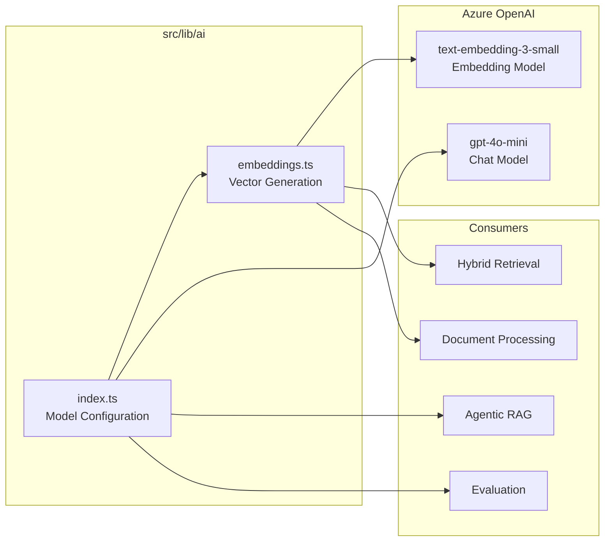
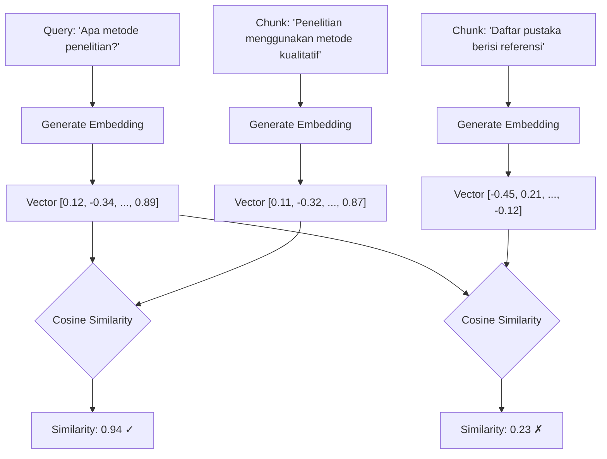

# Modul AI dan Embedding

## Pendahuluan

Modul AI merupakan komponen inti yang menyediakan kemampuan pemahaman bahasa dan generasi teks. Dokumen ini menjelaskan konfigurasi model, mekanisme embedding, dan pertimbangan desain yang mendasari pemilihan teknologi.

---

## Arsitektur Modul AI



---

## Konfigurasi Model

### File: `src/lib/ai/index.ts`

```typescript
import { createAzure } from "@ai-sdk/azure";

// Azure OpenAI provider configuration
const azure = createAzure({
    resourceName: env.AZURE_OPENAI_RESOURCE_NAME,
    apiKey: env.AZURE_OPENAI_API_KEY,
});

// Chat model for generation
export const CHAT_MODEL = azure("gpt-4o-mini");

// Embedding model for vector search
export const EMBEDDING_MODEL = azure.textEmbeddingModel("text-embedding-3-small");

// Telemetry configuration for observability
export const telemetryConfig = {
    isEnabled: true,
    functionId: "academic-rag-chatbot",
};
```

### Pemilihan Model

| Model                      | Tipe      | Dimensi | Biaya              | Alasan Pemilihan                                  |
| -------------------------- | --------- | ------- | ------------------ | ------------------------------------------------- |
| **gpt-4o-mini**            | Chat      | -       | Rendah             | Balance antara kualitas dan biaya untuk produksi  |
| **text-embedding-3-small** | Embedding | 1536    | $0.00002/1K tokens | 5x lebih murah dari 3-large dengan kualitas cukup |

---

## Sistem Embedding

### Mengapa Embedding Penting untuk RAG



**Keunggulan Semantik**:
- "metode penelitian" cocok dengan "metodologi kualitatif" (semantik serupa)
- Keyword search akan gagal karena tidak ada kata yang sama persis

---

## Fungsi Embedding

### `generateEmbedding()` - Single Text

```typescript
// src/lib/ai/embeddings.ts

export interface EmbeddingResult {
    embedding: number[];  // 1536-dimensional vector
    usage: {
        tokens: number;   // Token count for cost tracking
    };
}

export async function generateEmbedding(text: string): Promise<EmbeddingResult> {
    try {
        const { embedding, usage } = await embed({
            model: EMBEDDING_MODEL,
            value: text,
        });
        return { embedding, usage: { tokens: usage?.tokens || 0 } };
    } catch (error) {
        console.error("Error generating embedding:", error);
        throw error;
    }
}
```

**Kapan Menggunakan**:
- Embedding query user (real-time, tidak bisa di-batch)
- Single chunk untuk analisis

**Contoh Penggunaan**:
```typescript
const { embedding } = await generateEmbedding("Bagaimana cara mengurus KRS?");
// Gunakan untuk similarity search di database
const results = await db.select()
    .from(documentChunks)
    .orderBy(sql`embedding <=> ${embedding}`)
    .limit(5);
```

---

### `generateEmbeddings()` - Batch Processing

```typescript
export async function generateEmbeddings(texts: string[]): Promise<EmbeddingResult[]> {
    try {
        const { embeddings, usage } = await embedMany({
            model: EMBEDDING_MODEL,
            values: texts,
        });
        // Distribute tokens evenly for per-text cost tracking
        return embeddings.map((embedding) => ({
            embedding,
            usage: { tokens: Math.floor((usage?.tokens || 0) / texts.length) },
        }));
    } catch (error) {
        console.error("Error generating embeddings:", error);
        throw error;
    }
}
```

**Kapan Menggunakan**:
- Document processing (embed semua chunks sekaligus)
- Semantic chunking (embed sentences untuk similarity boundaries)
- Batch reranking

**Performa**:
| Metode     | 100 Chunks | Catatan                 |
| ---------- | ---------- | ----------------------- |
| Sequential | ~200 detik | 100 API calls × 2s each |
| Batch      | ~2 detik   | 1 API call              |

---

## Pertimbangan Desain

### 1. Mengapa text-embedding-3-small (bukan 3-large)?

| Aspek                  | 3-small            | 3-large            |
| ---------------------- | ------------------ | ------------------ |
| **Dimensi**            | 1536               | 3072               |
| **Biaya**              | $0.00002/1K tokens | $0.00013/1K tokens |
| **Kecepatan**          | 3x lebih cepat     | Baseline           |
| **Kualitas Retrieval** | ~97% of 3-large    | 100% (baseline)    |
| **Storage**            | 50% lebih kecil    | Baseline           |

**Kesimpulan**: Trade-off 2-3% kualitas retrieval diterima untuk penghematan biaya 5x dan kecepatan 3x pada use case akademik.

### 2. Mengapa Track Token Usage?

```typescript
// Token tracking memungkinkan:
// 1. Cost monitoring per dokumen
// 2. Budget forecasting (100K chunks ≈ $2-5)
// 3. Optimization detection (truncation needed?)

const result = await generateEmbedding(largeText);
if (result.usage.tokens > 8000) {
    console.warn("Text mungkin terpotong, pertimbangkan chunking lebih agresif");
}
```

### 3. Mengapa Azure OpenAI (bukan OpenAI langsung)?

1. **Compliance**: Data residency untuk institusi pendidikan
2. **Enterprise SLA**: Guaranteed uptime untuk produksi
3. **Private Endpoint**: Option untuk deployment internal
4. **Billing Integration**: Consolidated dengan Azure services lain

---

## Integrasi dengan Komponen Lain

### Document Processing

```typescript
// src/lib/rag/document-processor.ts
import { generateEmbeddings } from "@/lib/ai/embeddings";

async function createChunkRecords(chunks: Chunk[]): Promise<NewDocumentChunk[]> {
    // Batch generate embeddings untuk semua chunks
    const embeddings = await generateEmbeddings(chunks.map(c => c.content));

    return chunks.map((chunk, i) => ({
        ...chunk,
        embedding: embeddings[i].embedding,
        // ... metadata lainnya
    }));
}
```

### Hybrid Retrieval

```typescript
// src/lib/rag/hybrid-retrieval.ts
import { generateEmbedding } from "@/lib/ai/embeddings";

export async function hybridRetrieve(query: string): Promise<RetrievalResult[]> {
    // Generate query embedding untuk vector search
    const { embedding } = await generateEmbedding(query);

    // Vector search dengan pgvector
    const vectorResults = await db.execute(sql`
        SELECT *, embedding <=> ${embedding} as distance
        FROM document_chunks
        ORDER BY distance
        LIMIT ${topK}
    `);

    // ... combine dengan BM25 results
}
```

### Semantic Chunking

```typescript
// src/lib/rag/chunking.ts
import { generateEmbeddings } from "@/lib/ai/embeddings";
import { cosineSimilarity } from "ai";

async function semanticChunking(sentences: string[]): Promise<Chunk[]> {
    // Embed semua sentences dalam batch
    const embeddings = await generateEmbeddings(sentences);

    // Hitung similarity antar adjacent sentences
    const boundaries: number[] = [];
    for (let i = 0; i < embeddings.length - 1; i++) {
        const sim = cosineSimilarity(
            embeddings[i].embedding,
            embeddings[i + 1].embedding
        );
        if (sim < threshold) {
            boundaries.push(i);  // Semantic break point
        }
    }

    // Split di boundaries untuk chunks yang koheren secara semantik
    return createChunksFromBoundaries(sentences, boundaries);
}
```

---

## Best Practices

### 1. Error Handling

```typescript
try {
    const { embedding } = await generateEmbedding(text);
} catch (error) {
    if (error.message.includes("rate limit")) {
        // Implement exponential backoff
        await sleep(retryAfter);
        return generateEmbedding(text);
    }
    throw error;
}
```

### 2. Input Validation

```typescript
// text-embedding-3-small has 8191 token limit
const MAX_TOKENS = 8000; // Leave buffer

function validateEmbeddingInput(text: string): string {
    const estimatedTokens = text.length / 4; // Rough estimate
    if (estimatedTokens > MAX_TOKENS) {
        console.warn("Text may be truncated by embedding model");
        // Consider chunking or summarization
    }
    return text;
}
```

### 3. Caching Strategy

Untuk query yang sering diulang, pertimbangkan caching:

```typescript
// src/lib/rag/embedding-cache.ts
const embeddingCache = new Map<string, number[]>();

async function getCachedEmbedding(text: string): Promise<number[]> {
    const key = hashText(text);
    if (embeddingCache.has(key)) {
        return embeddingCache.get(key)!;
    }

    const { embedding } = await generateEmbedding(text);
    embeddingCache.set(key, embedding);
    return embedding;
}
```

---

## Referensi Terkait

- [01-ikhtisar-arsitektur.md](./01-ikhtisar-arsitektur.md) - Posisi modul AI dalam arsitektur
- [02-infrastruktur-data.md](./02-infrastruktur-data.md) - Penyimpanan vektor di database
- [04-pemrosesan-dokumen.md](./04-pemrosesan-dokumen.md) - Batch embedding saat processing
- [05-sistem-retrieval.md](./05-sistem-retrieval.md) - Query embedding untuk retrieval
