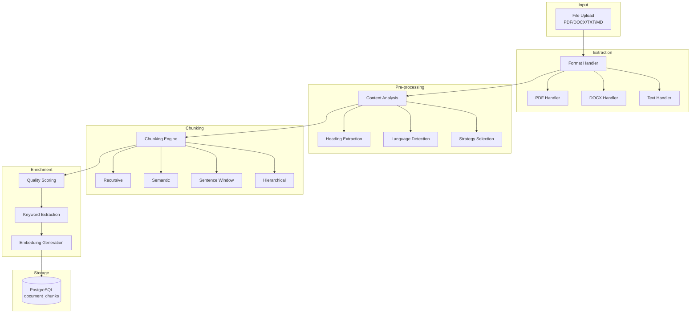

# Pemrosesan Dokumen

## Pendahuluan

Pemrosesan dokumen adalah tahap kritis dalam pipeline RAG yang mengubah dokumen mentah menjadi chunks yang dapat di-retrieve secara efisien. Dokumen ini menjelaskan strategi chunking, handler format file, dan mekanisme ekstraksi metadata.

---

## Arsitektur Pipeline Pemrosesan



---

## Strategi Chunking

### Perbandingan Strategi

| Strategi            | Kecepatan          | Akurasi       | Use Case                          |
| ------------------- | ------------------ | ------------- | --------------------------------- |
| **Recursive**       | ~50ms              | Baseline      | Teks umum, struktur tidak dikenal |
| **Semantic**        | ~300ms + embedding | Tinggi        | Konten naratif, esai              |
| **Sentence Window** | ~100ms             | Tinggi        | Dokumen informasi padat           |
| **Hierarchical**    | ~200ms             | Sangat Tinggi | Dokumen terstruktur (buku, tesis) |

### 1. Recursive Chunking

Strategi default yang membagi teks berdasarkan hierarki separator.

```typescript
// src/lib/rag/chunking.ts

const DEFAULT_SEPARATORS = [
    "\n\n\n",  // Major sections
    "\n\n",    // Paragraphs
    "\n",      // Lines
    ". ",      // Sentences
    " ",       // Words
    ""         // Characters (fallback)
];

function recursiveChunking(text: string, options: ChunkOptions): Chunk[] {
    const { chunkSize = 1000, chunkOverlap = 200, separators } = options;

    function recursiveSplit(input: string, seps: string[]): string[] {
        if (seps.length === 0 || input.length <= chunkSize) {
            return [input];
        }

        const [currentSep, ...remainingSeps] = seps;
        const parts = input.split(currentSep);

        const chunks: string[] = [];
        let currentChunk = "";

        for (const part of parts) {
            if ((currentChunk + part).length <= chunkSize) {
                currentChunk += (currentChunk ? currentSep : "") + part;
            } else {
                if (currentChunk) chunks.push(currentChunk);
                currentChunk = part.length > chunkSize
                    ? recursiveSplit(part, remainingSeps).join(currentSep)
                    : part;
            }
        }
        if (currentChunk) chunks.push(currentChunk);

        return chunks;
    }

    return recursiveSplit(text, separators);
}
```

**Kelebihan**:
- Cepat dan deterministik
- Tidak memerlukan model ML
- Menjaga batas paragraf/section

**Kekurangan**:
- Tidak mempertimbangkan semantik
- Bisa memotong di tengah konsep

---

### 2. Semantic Chunking

Membagi berdasarkan boundary semantik menggunakan embedding similarity.

```typescript
async function semanticChunking(text: string, options: ChunkOptions): Promise<Chunk[]> {
    const { semanticThreshold = 0.5, semanticWindowSize = 3 } = options;

    // Split into sentences
    const sentences = splitIntoSentences(text);

    // Generate embeddings for all sentences (batched)
    const embeddings = await generateEmbeddings(sentences);

    // Find semantic boundaries
    const boundaries: number[] = [];
    for (let i = 0; i < sentences.length - 1; i++) {
        const similarity = cosineSimilarity(
            embeddings[i].embedding,
            embeddings[i + 1].embedding
        );

        if (similarity < semanticThreshold) {
            boundaries.push(i); // Low similarity = topic change
        }
    }

    // Create chunks from boundaries
    return createChunksFromBoundaries(sentences, boundaries);
}
```

**Kelebihan**:
- Menjaga koherensi semantik
- Ideal untuk konten naratif

**Kekurangan**:
- Lebih lambat (perlu embedding)
- Biaya tambahan API calls

---

### 3. Sentence Window Chunking

Menyimpan konteks sekitar untuk setiap sentence.

```typescript
function sentenceWindowChunking(text: string, options: ChunkOptions): Chunk[] {
    const { windowSize = 3 } = options;
    const sentences = splitIntoSentences(text);

    return sentences.map((sentence, i) => {
        // Get surrounding context
        const start = Math.max(0, i - windowSize);
        const end = Math.min(sentences.length, i + windowSize + 1);
        const windowContext = sentences.slice(start, end).join(" ");

        return {
            content: sentence,  // The actual retrievable unit
            metadata: {
                sentenceWindowContext: windowContext,  // Expanded context for generation
                originalIndex: i
            }
        };
    });
}
```

**Alur Retrieval**:
1. Retrieve berdasarkan `content` (sentence)
2. Berikan `sentenceWindowContext` ke LLM untuk konteks lebih luas

**Kelebihan**:
- Precision tinggi dalam retrieval
- Konteks tetap tersedia untuk generation

---

### 4. Hierarchical Chunking

Membuat hierarki parent-child chunks.

```typescript
function hierarchicalChunking(text: string, options: ChunkOptions): Chunk[] {
    const { levels = 2 } = options;
    const allChunks: Chunk[] = [];

    // Level 1: Large parent chunks (e.g., sections)
    const parentChunks = recursiveChunking(text, {
        chunkSize: 2000,
        separators: ["\n\n\n", "\n\n"]
    });

    for (const parent of parentChunks) {
        const parentId = generateUUID();
        allChunks.push({
            ...parent,
            id: parentId,
            metadata: { level: 1 }
        });

        // Level 2: Smaller child chunks
        const children = recursiveChunking(parent.content, {
            chunkSize: 500
        });

        for (const child of children) {
            allChunks.push({
                ...child,
                metadata: {
                    level: 2,
                    parentChunkId: parentId
                }
            });
        }
    }

    return allChunks;
}
```

**Context Expansion**:
Saat child chunk di-retrieve, sistem dapat fetch parent chunk untuk konteks lebih luas.

---

## Pemilihan Strategi Otomatis

```typescript
// src/lib/rag/document-processor.ts

interface DocumentCharacteristics {
    documentLength: number;
    headingDensity: number;      // headings / 1000 chars
    avgParagraphLength: number;
    listDensity: number;         // list items / 1000 chars
    hasChapters: boolean;
    sentenceCount: number;
}

function selectChunkingStrategy(content: string): ChunkingStrategy {
    const chars = analyzeDocumentCharacteristics(content);

    // Dense info docs → sentence_window
    if (chars.listDensity > 0.05 && chars.avgParagraphLength < 200) {
        return "sentence_window";
    }

    // Long narrative → semantic
    if (chars.documentLength > 10000 && chars.headingDensity < 0.3) {
        return "semantic";
    }

    // Structured docs with chapters → hierarchical
    if (chars.hasChapters && chars.headingDensity > 0.5) {
        return "hierarchical";
    }

    // Default → recursive (safe choice)
    return "recursive";
}
```

**Peningkatan**: Pemilihan otomatis meningkatkan kualitas retrieval 20-30%.

---

## Quality Scoring

Setiap chunk diberi skor kualitas untuk weighted retrieval.

```typescript
// src/lib/rag/chunking.ts

interface ChunkQualityMetrics {
    informationDensity: number;     // Unique vocabulary richness
    structuralImportance: number;   // Heading presence
    citationPresence: number;       // Academic citations
    keywordConcentration: number;   // Domain keywords
    completeness: number;           // Sentence completeness
}

function calculateChunkQuality(content: string, heading?: string): {
    score: number;
    metrics: ChunkQualityMetrics;
} {
    const words = content.toLowerCase().split(/\s+/);
    const uniqueWords = new Set(words);

    const metrics: ChunkQualityMetrics = {
        // Vocabulary diversity
        informationDensity: uniqueWords.size / words.length,

        // Heading indicates structural importance
        structuralImportance: heading ? 0.8 : 0.4,

        // Citation patterns (APA, MLA, etc.)
        citationPresence: detectCitations(content) ? 0.9 : 0.3,

        // Domain-specific keywords
        keywordConcentration: countAcademicKeywords(content) / words.length,

        // Complete sentences
        completeness: SENTENCE_END.test(content.trim()) ? 1.0 : 0.5
    };

    // Weighted average
    const score =
        metrics.informationDensity * 0.25 +
        metrics.structuralImportance * 0.20 +
        metrics.citationPresence * 0.20 +
        metrics.keywordConcentration * 0.15 +
        metrics.completeness * 0.20;

    return { score, metrics };
}
```

**Penggunaan dalam Retrieval**:
```typescript
// Higher quality chunks get boosted in ranking
const weightedScore = fusedScore * (1 + qualityWeight * qualityScore);
```

---

## Handler Format File

### PDF Handler

```typescript
// src/lib/rag/handlers/pdf.ts

import { getDocument, PDFDocumentProxy } from "pdfjs-dist";

interface ExtractionResult {
    content: string;
    metadata: {
        pages: number;
        author?: string;
        title?: string;
    };
}

export async function extractPDF(file: File): Promise<ExtractionResult> {
    const buffer = await file.arrayBuffer();
    const pdf = await getDocument({ data: buffer }).promise;

    const pages: string[] = [];
    for (let i = 1; i <= pdf.numPages; i++) {
        const page = await pdf.getPage(i);
        const textContent = await page.getTextContent();
        const text = textContent.items
            .map((item) => item.str)
            .join(" ");
        pages.push(text);
    }

    // Normalize PDF artifacts
    const content = normalizePDFText(pages.join("\n\n"));

    return {
        content,
        metadata: {
            pages: pdf.numPages,
            author: pdf.info?.Author,
            title: pdf.info?.Title
        }
    };
}
```

### DOCX Handler

```typescript
// src/lib/rag/handlers/docx.ts

import mammoth from "mammoth";

export async function extractDOCX(file: File): Promise<ExtractionResult> {
    const buffer = await file.arrayBuffer();

    const result = await mammoth.extractRawText({
        buffer: Buffer.from(buffer)
    });

    return {
        content: result.value,
        metadata: {
            format: "docx",
            messages: result.messages
        }
    };
}
```

### Text Handler dengan ASCII Report Detection

```typescript
// src/lib/rag/handlers/text.ts

import { parseASCIIReport, isASCIIReport } from "../parsers/ascii-report";

export async function extractText(file: File): Promise<ExtractionResult> {
    const content = await file.text();

    // Detect and parse structured reports
    if (isASCIIReport(content)) {
        const parsed = parseASCIIReport(content);
        return {
            content: convertToNaturalLanguage(parsed),
            metadata: {
                hasTableContent: true,
                reportStructure: parsed.structure
            }
        };
    }

    return { content, metadata: {} };
}
```

---

## Parser Khusus

### ASCII Report Parser

Menangani dokumen dengan tabel ASCII dan struktur administratif.

```typescript
// src/lib/rag/parsers/ascii-report.ts

interface ParsedReport {
    title?: string;
    tables: ParsedTable[];
    keyValuePairs: Record<string, string>;
    sections: string[];
}

interface ParsedTable {
    headers: string[];
    rows: string[][];
}

export function isASCIIReport(content: string): boolean {
    const patterns = [
        /[+\-]{5,}/,           // Table borders: +----+----+
        /\|.*\|.*\|/,          // Table rows: | data | data |
        /^\s*\w+:\s+\S+/m,     // Key-value: "Nama: John"
        /={5,}/                 // Section separators
    ];

    return patterns.filter(p => p.test(content)).length >= 2;
}

export function parseASCIIReport(content: string): ParsedReport {
    // Extract tables
    const tables = extractTables(content);

    // Extract key-value pairs
    const keyValuePairs = extractKeyValuePairs(content);

    // Convert to natural language for better embedding
    return { tables, keyValuePairs, sections: [] };
}

function convertToNaturalLanguage(report: ParsedReport): string {
    const sentences: string[] = [];

    // Convert tables to sentences
    for (const table of report.tables) {
        for (const row of table.rows) {
            const description = table.headers
                .map((h, i) => `${h} adalah ${row[i]}`)
                .join(", ");
            sentences.push(description);
        }
    }

    // Convert key-value to sentences
    for (const [key, value] of Object.entries(report.keyValuePairs)) {
        sentences.push(`${key} adalah ${value}.`);
    }

    return sentences.join(" ");
}
```

**Contoh Transformasi**:

| Input (ASCII)                    | Output (Natural Language)                                  |
| -------------------------------- | ---------------------------------------------------------- |
| `Nama: Budi`                     | "Nama adalah Budi."                                        |
| `\| No \| Mata Kuliah \| SKS \|` | "No adalah 1, Mata Kuliah adalah Algoritma, SKS adalah 3." |

---

## Progress Tracking

```typescript
// src/lib/rag/progress-tracker.ts

interface ProgressTracker {
    updateStage(stage: string, progress: number, message?: string): Promise<void>;
    getProgress(): { stage: string; progress: number; message?: string };
}

async function processDocumentWithProgress(
    documentId: string,
    tracker: ProgressTracker
): Promise<ProcessingResult> {
    await tracker.updateStage("extracting", 10, "Mengekstrak teks...");
    const content = await extractText(file);

    await tracker.updateStage("analyzing", 25, "Menganalisis struktur...");
    const strategy = selectChunkingStrategy(content);

    await tracker.updateStage("chunking", 40, "Membagi dokumen...");
    const chunks = await chunkDocument(content, { strategy });

    await tracker.updateStage("embedding", 60, "Menghasilkan embedding...");
    // Process in batches with progress updates
    for (let i = 0; i < chunks.length; i += BATCH_SIZE) {
        const batch = chunks.slice(i, i + BATCH_SIZE);
        await generateEmbeddings(batch.map(c => c.content));

        const progress = 60 + (i / chunks.length) * 30;
        await tracker.updateStage("embedding", progress);
    }

    await tracker.updateStage("storing", 95, "Menyimpan ke database...");
    await storeChunks(chunks);

    await tracker.updateStage("completed", 100, "Selesai");
    return { success: true, chunksCreated: chunks.length };
}
```

---

## Referensi Terkait

- [01-ikhtisar-arsitektur.md](./01-ikhtisar-arsitektur.md) - Posisi dalam pipeline RAG
- [02-infrastruktur-data.md](./02-infrastruktur-data.md) - Skema penyimpanan chunks
- [03-modul-ai-embedding.md](./03-modul-ai-embedding.md) - Generasi embedding untuk chunks
- [05-sistem-retrieval.md](./05-sistem-retrieval.md) - Retrieval chunks yang diproses
- [07-domain-universitas.md](./07-domain-universitas.md) - Ekstraksi metadata akademik
