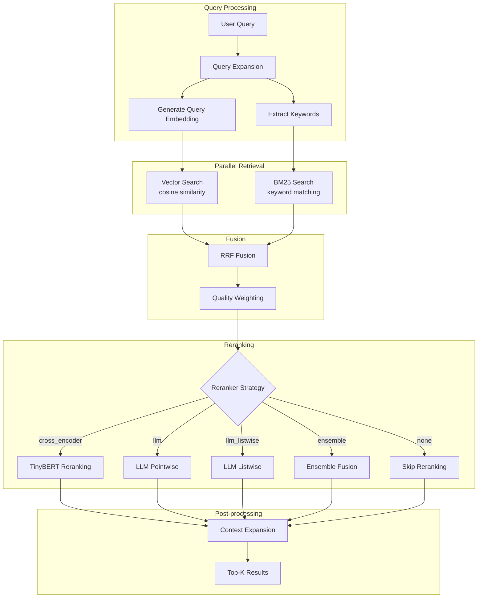
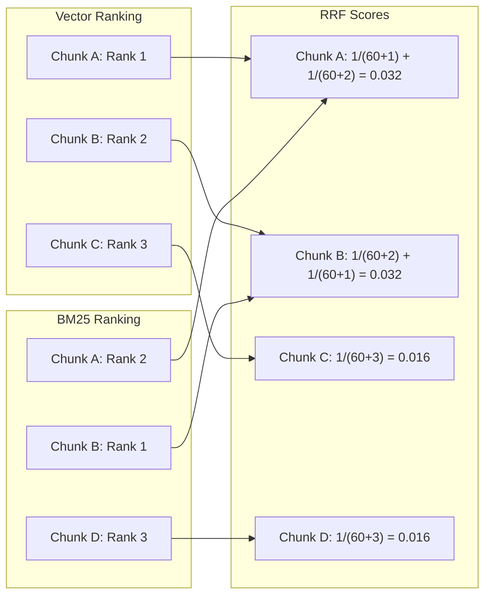

# Sistem Retrieval

## Pendahuluan

Sistem retrieval merupakan komponen sentral dalam pipeline RAG yang bertanggung jawab menemukan dokumen relevan dari korpus. Dokumen ini menjelaskan arsitektur pencarian hibrid yang menggabungkan vector similarity search dengan BM25 keyword matching, serta mekanisme reranking untuk meningkatkan precision.

---

## Arsitektur Hybrid Retrieval



---

## Mengapa Hybrid Retrieval?

### Keterbatasan Single Strategy

| Strategi         | Kekuatan                                               | Kelemahan                                         |
| ---------------- | ------------------------------------------------------ | ------------------------------------------------- |
| **Vector-only**  | Semantic matching ("metodologi" ≈ "metode penelitian") | Gagal pada exact match ("SK Rektor No. 123/2024") |
| **Keyword-only** | Exact match, istilah teknis                            | Gagal pada sinonim dan parafrase                  |

### Solusi Hybrid

Menggabungkan kekuatan keduanya:

```typescript
// src/lib/rag/hybrid-retrieval.ts

const DEFAULT_OPTIONS = {
    topK: 10,
    vectorWeight: 0.6,    // 60% weight untuk semantic
    bm25Weight: 0.4,      // 40% weight untuk keyword
    qualityWeight: 0.15,  // 15% boost dari chunk quality
    strategy: "hybrid",
    rrfK: 60,             // RRF constant
    useReranker: true,
    rerankerStrategy: "cross_encoder"
};
```

---

## Vector Search

### Implementasi dengan pgvector

```typescript
async function vectorSearch(
    queryEmbedding: number[],
    topK: number
): Promise<VectorResult[]> {
    const results = await db.execute(sql`
        SELECT
            dc.id as chunk_id,
            dc.content,
            dc.metadata,
            d.title as document_title,
            dc.embedding <=> ${queryEmbedding}::vector as distance
        FROM document_chunks dc
        JOIN documents d ON dc.document_id = d.id
        WHERE dc.embedding IS NOT NULL
        ORDER BY distance ASC
        LIMIT ${topK * 2}  -- Fetch more for fusion
    `);

    // Convert distance to similarity (1 - distance for cosine)
    return results.map(r => ({
        ...r,
        vectorScore: 1 - r.distance
    }));
}
```

**Operator pgvector**:
- `<=>`: Cosine distance (default untuk text similarity)
- `<->`: Euclidean distance
- `<#>`: Inner product

---

## BM25 Keyword Search

### Algoritma Okapi BM25

BM25 adalah fungsi ranking probabilistik yang mempertimbangkan:
1. **Term Frequency (TF)**: Seberapa sering kata muncul dalam dokumen
2. **Inverse Document Frequency (IDF)**: Seberapa jarang kata di seluruh korpus
3. **Document Length Normalization**: Penalti untuk dokumen panjang

**Formula BM25**:

```
score(D,Q) = Σ IDF(qi) × (f(qi,D) × (k1 + 1)) / (f(qi,D) + k1 × (1 - b + b × |D|/avgdl))
```

Dimana:
- `f(qi,D)`: Frekuensi term qi dalam dokumen D
- `|D|`: Panjang dokumen D
- `avgdl`: Rata-rata panjang dokumen
- `k1 = 1.2`: Saturasi term frequency
- `b = 0.75`: Normalisasi panjang dokumen

### Implementasi

```typescript
// src/lib/rag/hybrid-retrieval.ts

// BM25 hyperparameters
const BM25_K1 = 1.2;   // Term frequency saturation
const BM25_B = 0.75;   // Document length normalization
const BM25_DELTA = 1;  // BM25+ smoothing

function calculateOkapiBM25(
    queryTerms: string[],
    docTerms: string[],
    avgDocLength: number,
    docFrequencies: Map<string, number>,
    totalDocs: number
): number {
    let score = 0;
    const docLength = docTerms.length;
    const termCounts = new Map<string, number>();

    // Count term frequencies in document
    for (const term of docTerms) {
        termCounts.set(term, (termCounts.get(term) || 0) + 1);
    }

    for (const queryTerm of queryTerms) {
        const tf = termCounts.get(queryTerm) || 0;
        if (tf === 0) continue;

        const df = docFrequencies.get(queryTerm) || 0;

        // IDF with smoothing
        const idf = Math.log(
            (totalDocs - df + 0.5) / (df + 0.5) + 1
        );

        // BM25+ formula
        const tfNormalized =
            (tf * (BM25_K1 + 1)) /
            (tf + BM25_K1 * (1 - BM25_B + BM25_B * docLength / avgDocLength));

        score += idf * (tfNormalized + BM25_DELTA);
    }

    return score;
}
```

### Tokenization untuk Bahasa Indonesia

```typescript
function tokenize(text: string, language: "en" | "id"): string[] {
    const normalized = text
        .toLowerCase()
        .replace(/[^\w\s\u00C0-\u024F]/g, "")  // Remove special chars
        .split(/\s+/)
        .filter(Boolean);

    const stopWords = getStopWords(language);

    return normalized
        .filter(token => !stopWords.has(token))
        .filter(token => token.length > 2)
        .map(token => stemWord(token, language));
}

// Indonesian stopwords
const ID_STOPWORDS = new Set([
    "yang", "dan", "di", "dari", "ke", "dengan", "untuk",
    "pada", "adalah", "ini", "itu", "atau", "juga", "akan",
    "dapat", "dalam", "oleh", "sebuah", "tersebut", "sebagai"
]);
```

---

## Reciprocal Rank Fusion (RRF)

Menggabungkan ranking dari multiple sources tanpa normalisasi skor.



### Formula RRF

```
RRF(d) = Σ 1 / (k + rank_r(d))
```

Dimana:
- `k = 60`: Konstanta untuk smoothing
- `rank_r(d)`: Ranking dokumen d dalam ranking r

### Implementasi

```typescript
function reciprocalRankFusion(
    rankings: { id: string; rank: number }[][],
    k = 60
): Map<string, number> {
    const scores = new Map<string, number>();

    for (const ranking of rankings) {
        for (const { id, rank } of ranking) {
            const rrfScore = 1 / (k + rank);
            scores.set(id, (scores.get(id) || 0) + rrfScore);
        }
    }

    return scores;
}
```

**Kelebihan RRF**:
- Parameter-free (hanya k constant)
- Tidak perlu normalisasi skor (scores bisa dari skala berbeda)
- Robust terhadap outliers

---

## Strategi Reranking

Reranking meningkatkan precision dari hasil first-stage retrieval.

### 1. Cross-Encoder (Default)

Menggunakan model TinyBERT untuk scoring cepat.

```typescript
// src/lib/rag/reranker.ts

import { pipeline } from "@huggingface/transformers";

async function crossEncoderScore(
    query: string,
    passages: string[]
): Promise<number[]> {
    const reranker = await pipeline(
        "text-classification",
        "cross-encoder/ms-marco-TinyBERT-L-2-v2"
    );

    const scores: number[] = [];
    for (const passage of passages) {
        const result = await reranker(`${query} [SEP] ${passage}`);
        scores.push(result[0].score);
    }

    return scores;
}
```

| Aspek        | Nilai                              |
| ------------ | ---------------------------------- |
| **Latency**  | ~100ms untuk 10 passages           |
| **Accuracy** | 80-85% pada benchmark              |
| **Use Case** | Production (balance speed/quality) |

### 2. LLM Pointwise

Meminta LLM menilai relevansi setiap passage.

```typescript
async function llmRerank(
    query: string,
    passages: { content: string; originalScore: number }[],
    language: "id"
): Promise<{ score: number; reasoning?: string }[]> {
    const prompt = `
Anda adalah asisten yang menilai relevansi dokumen terhadap query.

Query: "${query}"

Untuk setiap dokumen, berikan skor 0-10 dan alasan singkat.

${passages.map((p, i) => `Dokumen ${i + 1}: ${p.content.slice(0, 500)}`).join("\n\n")}

Format output: JSON array dengan {score, reasoning} untuk setiap dokumen.
    `;

    const { text } = await generateText({
        model: CHAT_MODEL,
        prompt
    });

    return JSON.parse(text);
}
```

| Aspek        | Nilai                                   |
| ------------ | --------------------------------------- |
| **Latency**  | ~3-5 detik                              |
| **Accuracy** | 90-95% (lebih baik untuk nuance)        |
| **Use Case** | Offline evaluation, high-stakes queries |

### 3. LLM Listwise

Meminta LLM meranking semua dokumen sekaligus.

```typescript
async function llmListwiseRerank(
    query: string,
    passages: { content: string; id: string }[]
): Promise<Map<string, { score: number }>> {
    const prompt = `
Berikan ranking dokumen berikut berdasarkan relevansi terhadap query:
Query: "${query}"

${passages.map((p, i) => `[${p.id}] ${p.content.slice(0, 300)}`).join("\n")}

Output format: daftar ID terurut dari paling relevan, pisahkan dengan koma.
    `;

    const { text } = await generateText({ model: CHAT_MODEL, prompt });

    const rankedIds = text.split(",").map(s => s.trim());
    const scores = new Map<string, { score: number }>();

    rankedIds.forEach((id, rank) => {
        scores.set(id, { score: 1 - rank / rankedIds.length });
    });

    return scores;
}
```

### 4. Ensemble

Menggabungkan multiple reranking strategies.

```typescript
async function ensembleRerank(
    query: string,
    results: RetrievalResult[],
    weights = { crossEncoder: 0.4, llm: 0.4, original: 0.2 }
): Promise<RerankedResult[]> {
    // Get scores from each strategy
    const ceScores = await crossEncoderScore(query, results.map(r => r.content));
    const llmScores = await llmRerank(query, results);

    // Weighted fusion
    return results.map((result, i) => ({
        ...result,
        rerankedScore:
            weights.crossEncoder * ceScores[i] +
            weights.llm * llmScores[i].score +
            weights.original * result.fusedScore
    }));
}
```

---

## Context Expansion (Parent-Child)

Memperluas konteks dengan hierarki chunk.

```typescript
async function expandContext(
    results: RetrievalResult[]
): Promise<RetrievalResult[]> {
    const expanded: RetrievalResult[] = [];

    for (const result of results) {
        expanded.push(result);

        // Fetch parent for more context
        if (result.metadata?.parentChunkId) {
            const parent = await fetchChunk(result.metadata.parentChunkId);
            if (parent) {
                expanded.push({
                    ...parent,
                    similarity: result.similarity * 0.8,  // Slightly lower score
                    metadata: { ...parent.metadata, isParentContext: true }
                });
            }
        }
    }

    // Deduplicate
    return deduplicateByChunkId(expanded);
}
```

---

## Fungsi Utama: `hybridRetrieve()`

```typescript
// src/lib/rag/hybrid-retrieval.ts

export async function hybridRetrieve(
    query: string,
    options: Partial<HybridRetrievalOptions> = {}
): Promise<RetrievalResult[]> {
    const opts = { ...DEFAULT_OPTIONS, ...options };

    // 1. Query expansion
    const expandedQueries = expandQueryWithSynonyms(query);

    // 2. Generate query embedding
    const { embedding: queryEmbedding } = await generateEmbedding(query);

    // 3. Parallel retrieval
    const [vectorResults, bm25Results] = await Promise.all([
        vectorSearch(queryEmbedding, opts.topK * 2),
        bm25Search(query, opts.topK * 2)
    ]);

    // 4. RRF fusion
    const vectorRanking = vectorResults.map((r, i) => ({ id: r.chunkId, rank: i + 1 }));
    const bm25Ranking = bm25Results.map((r, i) => ({ id: r.chunkId, rank: i + 1 }));
    const rrfScores = reciprocalRankFusion([vectorRanking, bm25Ranking], opts.rrfK);

    // 5. Merge results with RRF scores
    const merged = mergeResults(vectorResults, bm25Results, rrfScores);

    // 6. Apply quality weighting
    const qualityWeighted = merged.map(r => ({
        ...r,
        fusedScore: r.rrfScore * (1 + opts.qualityWeight * (r.qualityScore || 0))
    }));

    // 7. Sort and take top-K for reranking
    const topK = qualityWeighted
        .sort((a, b) => b.fusedScore - a.fusedScore)
        .slice(0, opts.rerankerTopK);

    // 8. Reranking (if enabled)
    let reranked: RetrievalResult[];
    if (opts.useReranker && opts.rerankerStrategy !== "none") {
        const rerankedResults = await rerank(query, topK, {
            strategy: opts.rerankerStrategy,
            topK: opts.topK
        });
        reranked = rerankedResults
            .filter(r => r.rerankedScore >= opts.rerankerMinScore);
    } else {
        reranked = topK;
    }

    // 9. Context expansion (if enabled)
    if (opts.useContextExpansion) {
        reranked = await expandContext(reranked);
    }

    return reranked.slice(0, opts.topK);
}
```

---

## Metrik Evaluasi Retrieval

### NDCG (Normalized Discounted Cumulative Gain)

Mengukur kualitas ranking dengan mempertimbangkan posisi.

```typescript
function calculateNDCG(
    retrievedIds: string[],
    relevantIds: Set<string>,
    k: number
): number {
    const dcg = retrievedIds.slice(0, k).reduce((sum, id, i) => {
        const rel = relevantIds.has(id) ? 1 : 0;
        return sum + rel / Math.log2(i + 2);  // log2(rank + 1)
    }, 0);

    // Ideal DCG
    const idealRelevant = Math.min(k, relevantIds.size);
    const idcg = Array.from({ length: idealRelevant }).reduce<number>(
        (sum, _, i) => sum + 1 / Math.log2(i + 2), 0
    );

    return idcg > 0 ? dcg / idcg : 0;
}
```

### MRR (Mean Reciprocal Rank)

Posisi rata-rata dokumen relevan pertama.

```typescript
function calculateMRR(
    retrievedIds: string[],
    relevantIds: Set<string>
): number {
    const firstRelevantIndex = retrievedIds.findIndex(id => relevantIds.has(id));
    return firstRelevantIndex >= 0 ? 1 / (firstRelevantIndex + 1) : 0;
}
```

---

## Referensi Terkait

- [01-ikhtisar-arsitektur.md](./01-ikhtisar-arsitektur.md) - Posisi retrieval dalam pipeline
- [03-modul-ai-embedding.md](./03-modul-ai-embedding.md) - Generasi query embedding
- [04-pemrosesan-dokumen.md](./04-pemrosesan-dokumen.md) - Pembuatan chunks yang di-retrieve
- [06-agentic-rag.md](./06-agentic-rag.md) - Penggunaan retrieval dalam agentic mode
- [09-metrik-evaluasi.md](./09-metrik-evaluasi.md) - Evaluasi kualitas retrieval
