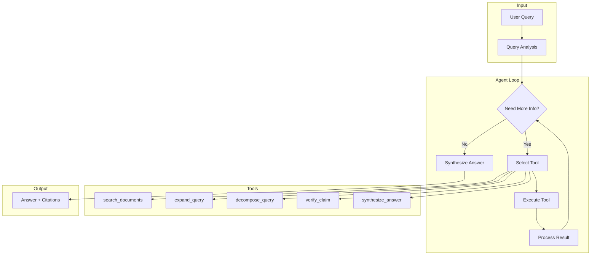

# Agentic RAG

## Pendahuluan

Agentic RAG adalah mode operasi lanjutan yang memungkinkan sistem melakukan multi-step reasoning dengan menggunakan tools untuk menjawab pertanyaan kompleks. Berbeda dengan standard RAG yang melakukan single retrieval, Agentic RAG dapat melakukan multiple retrieval, query decomposition, dan claim verification.

---

## Mengapa Agentic Mode?

### Keterbatasan Standard RAG

| Skenario                                                                           | Standard RAG                             | Agentic RAG                  |
| ---------------------------------------------------------------------------------- | ---------------------------------------- | ---------------------------- |
| Query sederhana: "Apa itu KRS?"                                                    | ✓ Single retrieval cukup                 | Overkill                     |
| Query multi-aspek: "Bandingkan prosedur skripsi di FK dan FT"                      | ✗ Satu retrieval tidak mencakup keduanya | ✓ Multiple retrieval         |
| Query membutuhkan reasoning: "Apakah saya bisa mengambil 24 SKS jika IP saya 3.2?" | ✗ Tidak bisa reasoning                   | ✓ Retrieve rules + calculate |
| Verifikasi fakta: "Benarkah batas KRS 7 hari setelah kuliah dimulai?"              | ✗ Tidak bisa verify                      | ✓ Cross-check sources        |

### Arsitektur Agentic RAG



---

## Definisi Tools

### 1. `search_documents`

Melakukan pencarian konteks akademis.

```typescript
// src/lib/rag/agentic-rag.ts

const searchTool = tool({
    description: `Mencari informasi di database dokumen universitas.
    Gunakan tool ini untuk menemukan informasi spesifik tentang prosedur,
    peraturan, atau kebijakan akademik.`,

    parameters: z.object({
        query: z.string().describe("Query pencarian dalam Bahasa Indonesia"),
        strategy: z.enum(["vector", "keyword", "hybrid"])
            .default("hybrid")
            .describe("Strategi pencarian"),
        topK: z.number().min(1).max(20).default(5)
            .describe("Jumlah hasil yang diambil")
    }),

    execute: async ({ query, strategy, topK }) => {
        const results = await hybridRetrieve(query, {
            topK,
            strategy,
            useReranker: true
        });

        // Update streaming state
        if (streamingState) {
            streamingState.retrievedChunks.push(...results);
        }

        return {
            success: true,
            resultsCount: results.length,
            documents: results.map(r => ({
                title: r.documentTitle,
                content: r.content,
                similarity: r.similarity
            }))
        };
    }
});
```

### 2. `expand_query`

Memperluas query dengan sinonim akademik.

```typescript
const expandQueryTool = tool({
    description: `Memperluas query dengan sinonim dan variasi istilah akademik
    Indonesia. Berguna ketika query awal tidak memberikan hasil yang cukup.`,

    parameters: z.object({
        query: z.string().describe("Query original")
    }),

    execute: async ({ query }) => {
        const expansions = expandQueryWithSynonyms(query);
        const indonesianExpansions = expandQueryIndonesian(query);

        return {
            original: query,
            expansions: [...new Set([...expansions, ...indonesianExpansions])],
            hint: "Gunakan expansions untuk search_documents berikutnya"
        };
    }
});
```

### 3. `decompose_query`

Memecah pertanyaan kompleks menjadi sub-questions.

```typescript
const decomposeQueryTool = tool({
    description: `Memecah pertanyaan kompleks menjadi sub-pertanyaan yang
    lebih sederhana. Gunakan untuk query multi-aspek.`,

    parameters: z.object({
        query: z.string().describe("Pertanyaan kompleks"),
        maxSubQuestions: z.number().min(2).max(5).default(3)
    }),

    execute: async ({ query, maxSubQuestions }) => {
        const { text } = await generateText({
            model: CHAT_MODEL,
            prompt: `
Pecah pertanyaan berikut menjadi ${maxSubQuestions} sub-pertanyaan yang lebih fokus.
Pertanyaan: "${query}"

Format output: JSON array of strings.
            `
        });

        const subQuestions = JSON.parse(text);

        return {
            original: query,
            subQuestions,
            hint: "Jawab setiap sub-question dengan search_documents terpisah"
        };
    }
});
```

### 4. `verify_claim`

Memverifikasi klaim terhadap sumber.

```typescript
const verifyClaimTool = tool({
    description: `Memverifikasi apakah klaim didukung oleh konteks yang diberikan.
    Gunakan untuk fact-checking sebelum menyampaikan informasi penting.`,

    parameters: z.object({
        claim: z.string().describe("Klaim yang akan diverifikasi"),
        context: z.string().describe("Konteks dari dokumen sumber")
    }),

    execute: async ({ claim, context }) => {
        const { text } = await generateText({
            model: CHAT_MODEL,
            prompt: `
Verifikasi apakah klaim berikut didukung oleh konteks:

Klaim: "${claim}"
Konteks: "${context}"

Jawab dalam format JSON:
{
    "supported": boolean,
    "confidence": number (0-1),
    "evidence": "kutipan relevan dari konteks",
    "reasoning": "penjelasan singkat"
}
            `
        });

        return JSON.parse(text);
    }
});
```

### 5. `synthesize_answer`

Mensintesis jawaban akhir dari multiple sources.

```typescript
const synthesizeAnswerTool = tool({
    description: `Mensintesis jawaban komprehensif dari multiple sumber.
    Gunakan setelah mengumpulkan informasi dari berbagai pencarian.`,

    parameters: z.object({
        question: z.string().describe("Pertanyaan original"),
        sources: z.array(z.object({
            content: z.string(),
            title: z.string()
        })).describe("Sumber informasi yang dikumpulkan")
    }),

    execute: async ({ question, sources }) => {
        const sourceContext = sources
            .map((s, i) => `[${i + 1}] ${s.title}: ${s.content}`)
            .join("\n\n");

        const { text } = await generateText({
            model: CHAT_MODEL,
            prompt: `
Berdasarkan sumber berikut, jawab pertanyaan dengan komprehensif.
Sertakan nomor sitasi [1], [2], dll.

Pertanyaan: ${question}

Sumber:
${sourceContext}

Jawab dalam Bahasa Indonesia dengan format akademis.
            `
        });

        return { answer: text, sourcesUsed: sources.length };
    }
});
```

---

## System Prompt Agentic

```typescript
const AGENTIC_SYSTEM_PROMPT = `
Anda adalah asisten penelitian akademis canggih dengan akses ke alat-alat khusus.

Kemampuan Anda:
1. Pencarian multi-langkah untuk pertanyaan kompleks
2. Ekspansi query dengan sinonim akademik
3. Dekomposisi pertanyaan menjadi sub-questions
4. Verifikasi fakta terhadap sumber
5. Sintesis jawaban dari multiple sources

Strategi Optimal:
- Untuk pertanyaan SEDERHANA: Langsung gunakan search_documents sekali
- Untuk pertanyaan KOMPLEKS: Gunakan decompose_query terlebih dahulu
- Untuk perbandingan: Lakukan multiple search_documents
- SELALU verifikasi klaim penting dengan verify_claim

Bahasa:
- SELALU jawab dalam Bahasa Indonesia
- Gunakan istilah akademik yang tepat

Sitasi:
- SELALU sertakan nomor referensi [1], [2], dst.
- Sebutkan sumber dokumen untuk transparansi
`;
```

---

## Citation Manager

Mengelola penomoran sitasi yang konsisten.

```typescript
class CitationManager {
    private readonly citations = new Map<string, number>();
    private nextId = 1;

    assignCitation(chunkId: string): number {
        if (!this.citations.has(chunkId)) {
            this.citations.set(chunkId, this.nextId++);
        }
        return this.citations.get(chunkId)!;
    }

    getCitations(): Array<{
        id: string;
        documentTitle: string;
        citationNumber: number;
    }> {
        return Array.from(this.citations.entries())
            .map(([id, num]) => ({
                id,
                documentTitle: this.getTitle(id),
                citationNumber: num
            }))
            .sort((a, b) => a.citationNumber - b.citationNumber);
    }

    clear(): void {
        this.citations.clear();
        this.nextId = 1;
    }
}
```

---

## Streaming Support

Mendukung real-time feedback selama eksekusi agent.

```typescript
// Streaming callbacks

interface AgentCallbacks {
    onStepStart?: (step: AgentStep) => void;
    onStepComplete?: (step: AgentStep) => void;
    onChunksRetrieved?: (chunks: RetrievalResult[]) => void;
    onProgress?: (current: number, max: number, status: string) => void;
}

async function runAgenticRagWithStreaming(
    query: string,
    callbacks: AgentCallbacks
): Promise<AgenticRagResult> {
    let stepIndex = 0;

    const result = await streamText({
        model: CHAT_MODEL,
        system: AGENTIC_SYSTEM_PROMPT,
        messages: [{ role: "user", content: query }],
        tools: {
            search_documents: searchTool,
            expand_query: expandQueryTool,
            decompose_query: decomposeQueryTool,
            verify_claim: verifyClaimTool,
            synthesize_answer: synthesizeAnswerTool
        },
        maxSteps: 10,

        onStepStart: ({ toolName, toolInput }) => {
            callbacks?.onStepStart?.({
                stepIndex: stepIndex++,
                stepType: "tool_call",
                toolName,
                toolInput,
                status: "executing",
                timestamp: Date.now()
            });
        },

        onStepFinish: ({ toolName, toolOutput, durationMs }) => {
            callbacks?.onStepComplete?.({
                stepIndex: stepIndex - 1,
                stepType: "tool_call",
                toolName,
                toolOutput,
                status: "completed",
                durationMs,
                timestamp: Date.now()
            });
        }
    });

    return {
        answer: result.text,
        steps: collectedSteps,
        retrievedChunks: streamingState.retrievedChunks,
        citations: citationManager.getCitations()
    };
}
```

---

## Agent Step Types

```typescript
interface AgentStep {
    stepIndex: number;
    stepType: "reasoning" | "tool_call" | "retrieval" | "synthesis" | "reranking";
    toolName?: string;
    toolInput?: Record<string, unknown>;
    toolOutput?: unknown;
    reasoning?: string;
    durationMs: number;
    timestamp: number;
    tokenUsage?: {
        inputTokens: number;
        outputTokens: number;
        totalTokens: number;
    };
}
```

---

## Contoh Eksekusi

### Pertanyaan Sederhana

```
User: "Apa itu KRS?"

Agent Steps:
1. [tool_call] search_documents({ query: "KRS kartu rencana studi" })
   → Found 5 documents about KRS
2. [synthesis] Generate answer from retrieved context

Answer: "KRS (Kartu Rencana Studi) adalah dokumen yang berisi
daftar mata kuliah yang akan diambil mahasiswa pada semester
tertentu [1]. KRS harus disetujui oleh dosen pembimbing akademik
sebelum periode perkuliahan dimulai [2]."

Citations:
[1] Buku Pedoman Akademik 2024, hal 45
[2] SK Rektor tentang Registrasi Akademik
```

### Pertanyaan Kompleks

```
User: "Bandingkan syarat kelulusan skripsi di Fakultas Teknik dan Fakultas Kedokteran"

Agent Steps:
1. [tool_call] decompose_query({ query: "..." })
   → ["Syarat skripsi FK", "Syarat skripsi FT"]

2. [tool_call] search_documents({ query: "syarat kelulusan skripsi Fakultas Teknik" })
   → Found 3 documents

3. [tool_call] search_documents({ query: "syarat kelulusan skripsi Fakultas Kedokteran" })
   → Found 4 documents

4. [tool_call] synthesize_answer({ question: "...", sources: [...] })

Answer: "Perbandingan Syarat Kelulusan Skripsi:

**Fakultas Teknik [1][2]:**
- Minimal lulus 144 SKS
- IPK ≥ 2.50
- TOEFL ≥ 450
- Sidang skripsi dengan 3 penguji

**Fakultas Kedokteran [3][4]:**
- Minimal lulus 160 SKS
- IPK ≥ 2.75
- Lulus UKMPPD
- Sidang dengan 5 penguji termasuk external examiner

Perbedaan utama terletak pada beban SKS yang lebih tinggi di FK..."
```

---

## Guardrails Integration

Agentic mode terintegrasi dengan guardrails untuk keamanan.

```typescript
async function runAgenticRag(
    query: string,
    options: AgenticOptions
): Promise<AgenticRagResult> {
    // Input guardrails
    const inputCheck = await validateInput(query);
    if (!inputCheck.passed) {
        return {
            answer: inputCheck.suggestedResponse,
            blocked: true,
            violations: inputCheck.violations
        };
    }

    // Execute agent
    const result = await runAgenticRagWithStreaming(query, options.callbacks);

    // Output guardrails
    const outputCheck = await validateOutput(result.answer, result.retrievedChunks);
    if (!outputCheck.passed) {
        // Modify or flag response
        result.answer = outputCheck.modifiedContent || result.answer;
        result.guardrails = outputCheck;
    }

    return result;
}
```

---

## Batasan dan Konfigurasi

```typescript
const AGENTIC_CONFIG = {
    maxSteps: 10,           // Prevent infinite loops
    maxRetrievals: 5,       // Limit API calls
    timeoutMs: 60000,       // 1 minute timeout
    parallelToolCalls: true // Execute independent tools in parallel
};
```

---

## Referensi Terkait

- [01-ikhtisar-arsitektur.md](./01-ikhtisar-arsitektur.md) - Posisi agentic dalam arsitektur
- [05-sistem-retrieval.md](./05-sistem-retrieval.md) - Mekanisme retrieval yang digunakan tools
- [07-domain-universitas.md](./07-domain-universitas.md) - Ekspansi query akademik
- [08-guardrails-keamanan.md](./08-guardrails-keamanan.md) - Integrasi keamanan
- [11-api-endpoints.md](./11-api-endpoints.md) - Chat API dengan streaming
