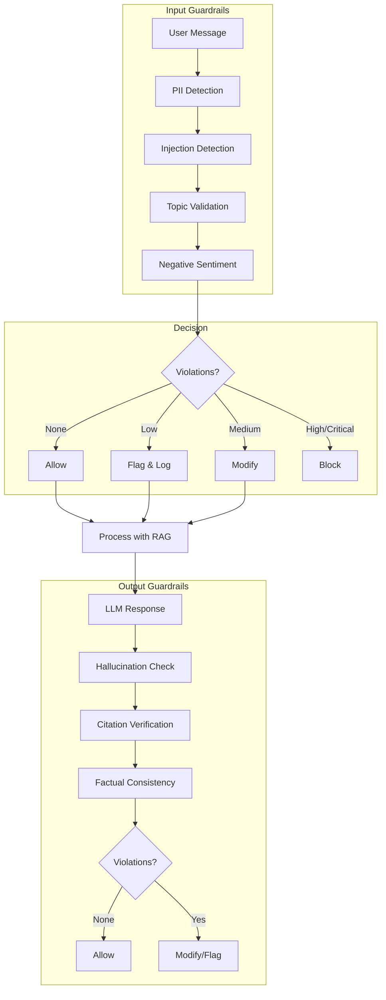

# Guardrails dan Keamanan

## Pendahuluan

Sistem guardrails menyediakan lapisan keamanan komprehensif untuk chatbot akademis. Modul ini menangani deteksi PII, perlindungan prompt injection, validasi topik akademik, dan deteksi sentimen negatif untuk memastikan penggunaan yang aman dan sesuai dalam konteks universitas.

---

## Arsitektur Guardrails



---

## Struktur Hasil Guardrail

```typescript
// src/lib/rag/guardrails.ts

interface GuardrailResult {
    passed: boolean;
    violations: GuardrailViolation[];
    modifiedContent?: string;           // Konten setelah redaction
    severity: "none" | "low" | "medium" | "high" | "critical";
    suggestedResponse?: string;         // Respons alternatif untuk blocked content
    requiresEscalation?: boolean;       // Perlu intervensi manusia
}

interface GuardrailViolation {
    rule: string;                       // Nama aturan yang dilanggar
    type: GuardrailType;
    severity: "low" | "medium" | "high" | "critical";
    description: string;
    matchedContent?: string;            // Konten yang memicu
    action: "blocked" | "flagged" | "modified" | "allowed" | "redirect";
    remediation?: string;               // Saran perbaikan
}

type GuardrailType =
    | "pii"                 // Personal Identifiable Information
    | "injection"           // Prompt injection attempts
    | "off_topic"           // Non-academic topics
    | "toxicity"            // Harmful content
    | "hallucination"       // Fabricated information
    | "academic_integrity"  // Plagiarism, cheating
    | "negative_reaction";  // User frustration/confusion
```

---

## Deteksi PII (Personal Identifiable Information)

### Pola PII Indonesia

```typescript
const PII_PATTERNS = {
    // Email
    email: /\b[A-Za-z0-9._%+-]+@[A-Za-z0-9.-]+\.[A-Z|a-z]{2,}\b/g,

    // Telepon Indonesia (format: +62/0 + 2-4 digit + 3-4 digit + 3-4 digit)
    phone: /\b(\+?62|0)[\s-]?\d{2,4}[\s-]?\d{3,4}[\s-]?\d{3,4}\b/g,

    // NIM (8-12 digit, pola umum universitas)
    studentId: /\b(NIM[\s:]*)?(\d{8,12})\b/gi,

    // NIK (16 digit)
    nationalId: /\b\d{16}\b/g,

    // NPWP
    npwp: /\b\d{2}[.]\d{3}[.]\d{3}[.]\d{1}[-]\d{3}[.]\d{3}\b/g,

    // Kartu Kredit (redact all 16-digit sequences)
    creditCard: /\b\d{4}[\s-]?\d{4}[\s-]?\d{4}[\s-]?\d{4}\b/g,

    // IP Address
    ipAddress: /\b\d{1,3}\.\d{1,3}\.\d{1,3}\.\d{1,3}\b/g
};
```

### Implementasi Deteksi

```typescript
async function detectPII(content: string): Promise<GuardrailResult> {
    const violations: GuardrailViolation[] = [];
    let modifiedContent = content;

    for (const [type, pattern] of Object.entries(PII_PATTERNS)) {
        let match;
        pattern.lastIndex = 0; // Reset regex

        while ((match = pattern.exec(content)) !== null) {
            violations.push({
                rule: `pii_${type}`,
                type: "pii",
                severity: getSeverity(type),
                description: `Terdeteksi ${formatPIIType(type)}`,
                matchedContent: match[0],
                action: "modified"
            });

            // Redact PII in content
            modifiedContent = modifiedContent.replace(
                match[0],
                `[${type.toUpperCase()}_REDACTED]`
            );
        }
    }

    return {
        passed: violations.length === 0,
        violations,
        modifiedContent: violations.length > 0 ? modifiedContent : undefined,
        severity: getMaxSeverity(violations)
    };
}

function getSeverity(piiType: string): "low" | "medium" | "high" | "critical" {
    const severityMap: Record<string, "low" | "medium" | "high" | "critical"> = {
        email: "medium",
        phone: "medium",
        studentId: "high",
        nationalId: "critical",
        npwp: "critical",
        creditCard: "critical",
        ipAddress: "low"
    };
    return severityMap[piiType] || "medium";
}
```

---

## Deteksi Prompt Injection

### Pola Injection

```typescript
const INJECTION_PATTERNS = [
    // English patterns
    /ignore\s+(all\s+)?(previous|prior|above)\s+(instructions?|prompts?|rules?)/i,
    /disregard\s+(all\s+)?(previous|prior|above)/i,
    /forget\s+(everything|all|your)\s+(you|instructions?|rules?)/i,
    /you\s+are\s+now\s+(a|an|my)/i,
    /pretend\s+(to\s+be|you('re|'re))/i,
    /act\s+as\s+(if|though|a)/i,
    /new\s+instructions?:/i,
    /system\s*:\s*/i,
    /\[INST\]/i,
    /override\s+(your|the|all)/i,

    // Indonesian patterns
    /abaikan\s+(semua\s+)?(instruksi|perintah|aturan)/i,
    /lupakan\s+(semua|seluruh)\s+(instruksi|perintah|aturan)/i,
    /pura-pura\s+(menjadi|jadi)\s+/i,
    /anggap\s+(dirimu|kamu)\s+sebagai/i,
    /ganti\s+(peran|fungsi|tugas)mu\s+menjadi/i
];

async function detectInjection(content: string): Promise<GuardrailResult> {
    const violations: GuardrailViolation[] = [];

    for (const pattern of INJECTION_PATTERNS) {
        if (pattern.test(content)) {
            violations.push({
                rule: "prompt_injection",
                type: "injection",
                severity: "critical",
                description: "Terdeteksi upaya prompt injection",
                matchedContent: content.match(pattern)?.[0],
                action: "blocked"
            });
        }
    }

    return {
        passed: violations.length === 0,
        violations,
        severity: violations.length > 0 ? "critical" : "none",
        suggestedResponse: violations.length > 0
            ? "Maaf, saya tidak dapat memproses permintaan tersebut. Silakan ajukan pertanyaan tentang informasi akademik."
            : undefined
    };
}
```

---

## Validasi Topik Akademik

### Topik yang Diizinkan

```typescript
const ACADEMIC_TOPICS = [
    // English terms
    "research", "study", "paper", "thesis", "dissertation",
    "lecture", "course", "assignment", "exam", "grade",
    "professor", "student", "university", "college", "curriculum",
    "methodology", "analysis", "conclusion", "hypothesis",
    "experiment", "data", "statistics", "equation", "formula",

    // Indonesian terms
    "penelitian", "studi", "jurnal", "skripsi", "tesis", "disertasi",
    "kuliah", "mata kuliah", "tugas", "ujian", "nilai",
    "dosen", "mahasiswa", "universitas", "fakultas", "jurusan",
    "metodologi", "analisis", "kesimpulan", "hipotesis",
    "eksperimen", "data", "statistik", "persamaan", "rumus",
    "kampus", "prodi", "semester", "sks"
];

async function validateTopic(content: string): Promise<GuardrailResult> {
    const lowerContent = content.toLowerCase();

    // Check if query is a question
    const isQuestion = IS_QUESTION_PATTERN.test(content);

    // Check for academic topic presence
    const hasAcademicTopic = ACADEMIC_TOPICS.some(topic =>
        lowerContent.includes(topic.toLowerCase())
    );

    // Check for toxicity
    const toxicityResult = await detectToxicity(content);

    if (toxicityResult.violations.length > 0) {
        return toxicityResult;
    }

    // Off-topic warning (not blocking, just flagging)
    if (isQuestion && !hasAcademicTopic) {
        return {
            passed: true, // Still allow, but flag
            violations: [{
                rule: "possible_off_topic",
                type: "off_topic",
                severity: "low",
                description: "Pertanyaan mungkin di luar konteks akademik",
                action: "flagged"
            }],
            severity: "low"
        };
    }

    return { passed: true, violations: [], severity: "none" };
}
```

### Deteksi Konten Toksik

```typescript
const TOXICITY_PATTERNS = [
    /\b(hate|kill|murder|attack|destroy|harm)\s+(the|all|every)\b/i,
    /\b(racist|sexist|homophobic|transphobic)\b/i,
    /\bcheating\s+(on|in)\s+(exam|test|assignment)/i,
    /\bplagiarize?\b/i,
    /\bplagiat\b/i,  // Indonesian
    /\bcontek\b/i,   // Indonesian slang for cheating

    // Indonesian toxicity
    /\b(bunuh|serang|musnahkan|hancurkan)\s+(semua|seluruh)\b/i
];

async function detectToxicity(content: string): Promise<GuardrailResult> {
    const violations: GuardrailViolation[] = [];

    for (const pattern of TOXICITY_PATTERNS) {
        if (pattern.test(content)) {
            violations.push({
                rule: "toxicity",
                type: "toxicity",
                severity: "high",
                description: "Terdeteksi konten yang tidak pantas",
                matchedContent: content.match(pattern)?.[0],
                action: "blocked"
            });
        }
    }

    // Academic integrity check
    if (/\b(cheating|plagiari|contek|plagiat)\b/i.test(content)) {
        violations.push({
            rule: "academic_integrity",
            type: "academic_integrity",
            severity: "high",
            description: "Pertanyaan terkait pelanggaran integritas akademik",
            action: "redirect",
            remediation: "Silakan hubungi bagian akademik untuk pertanyaan terkait kebijakan integritas."
        });
    }

    return {
        passed: violations.length === 0,
        violations,
        severity: getMaxSeverity(violations)
    };
}
```

---

## Deteksi Sentimen Negatif

### Pola Reaksi Negatif

```typescript
const NEGATIVE_REACTION_PATTERNS = {
    frustration: {
        en: [
            /this\s+(is\s+)?(useless|worthless|garbage|trash|terrible)/i,
            /you('re|\s+are)\s+(useless|stupid|dumb|terrible|the\s+worst)/i,
            /stop\s+giving\s+me\s+(wrong|bad|useless)\s+answers?/i
        ],
        id: [
            /ini\s+(tidak\s+)?(berguna|membantu)/i,
            /kamu\s+(bodoh|tidak\s+berguna)/i,
            /berhenti\s+(memberi|kasih)\s+jawaban\s+(salah|tidak\s+berguna)/i,
            /apa\s+sih\s+ini/i,
            /masa\s+(begini|gitu)\s+aja\s+(tidak|nggak)\s+bisa/i
        ]
    },

    disappointment: {
        en: [
            /i\s+expected\s+(better|more)/i,
            /this\s+is\s+(disappointing|not\s+what\s+i\s+(asked|wanted))/i,
            /you\s+(missed|didn'?t\s+understand)\s+(the\s+point|my\s+question)/i
        ],
        id: [
            /saya\s+kecewa/i,
            /bukan\s+(itu|ini)\s+(yang\s+)?(saya\s+)?(maksud|tanya|mau)/i,
            /kamu\s+(tidak|nggak)\s+(paham|mengerti)/i
        ]
    },

    confusion: {
        en: [
            /i('m|\s+am)\s+(confused|lost)/i,
            /this\s+(doesn'?t|does\s+not)\s+make\s+sense/i,
            /what\s+(do\s+you|are\s+you)\s+mean/i
        ],
        id: [
            /(ini\s+)?membingungkan/i,
            /apa\s+(maksud|artinya)(mu|nya)?/i,
            /(tidak|nggak)\s+masuk\s+akal/i,
            /bingung/i,
            /jelaskan\s+(lagi|lebih\s+jelas)/i
        ]
    },

    helpRequest: {
        en: [
            /please\s+help/i,
            /i\s+(really\s+)?need\s+help/i,
            /i('m|\s+am)\s+stuck/i
        ],
        id: [
            /tolong\s+bantu/i,
            /saya\s+(butuh|perlu)\s+bantuan/i,
            /saya\s+(buntu|stuck|mentok)/i
        ]
    }
};
```

### Respons Empatis

```typescript
const NEGATIVE_REACTION_RESPONSES = {
    frustration:
        "Saya memahami ini bisa membuat frustrasi. Mari saya coba pendekatan berbeda untuk membantu Anda lebih baik. Bisakah Anda jelaskan aspek spesifik mana yang tidak sesuai?",

    disappointment:
        "Mohon maaf jawaban sebelumnya tidak sesuai harapan. Bisakah Anda berikan lebih banyak detail tentang apa yang Anda cari? Saya akan berusaha memberikan informasi yang lebih tepat.",

    confusion:
        "Saya mohon maaf jika penjelasan saya kurang jelas. Mari saya coba jelaskan dengan cara yang berbeda. Bagian mana yang perlu saya perjelas?",

    helpRequest:
        "Tentu, saya di sini untuk membantu! Mari kita selesaikan bersama. Ceritakan lebih lanjut apa yang sedang Anda kerjakan."
};

async function detectNegativeReaction(content: string): Promise<{
    detected: boolean;
    type?: keyof typeof NEGATIVE_REACTION_RESPONSES;
    suggestedResponse?: string;
}> {
    for (const [reactionType, patterns] of Object.entries(NEGATIVE_REACTION_PATTERNS)) {
        const allPatterns = [...patterns.en, ...patterns.id];

        for (const pattern of allPatterns) {
            if (pattern.test(content)) {
                return {
                    detected: true,
                    type: reactionType as keyof typeof NEGATIVE_REACTION_RESPONSES,
                    suggestedResponse: NEGATIVE_REACTION_RESPONSES[
                        reactionType as keyof typeof NEGATIVE_REACTION_RESPONSES
                    ]
                };
            }
        }
    }

    return { detected: false };
}
```

---

## Output Guardrails

### Deteksi Halusinasi

```typescript
const HALLUCINATION_INDICATORS = [
    /\$\d+/,  // Currency amounts (should cite source)
    /\d+\s*(million|billion|thousand|k|m|b)/i,  // Large numbers
    /\b(proven|guarantee|always|never|100%)\b/i,  // Absolute claims
    /\b(study|research|found|showed|concluded)\b/i  // Research claims
];

async function checkHallucination(
    response: string,
    retrievedContexts: string[]
): Promise<GuardrailResult> {
    const violations: GuardrailViolation[] = [];

    // Check for claims that need citation
    for (const pattern of HALLUCINATION_INDICATORS) {
        if (pattern.test(response)) {
            // Verify claim exists in context
            const matchedText = response.match(pattern)?.[0];
            const foundInContext = retrievedContexts.some(ctx =>
                ctx.toLowerCase().includes(matchedText?.toLowerCase() || "")
            );

            if (!foundInContext) {
                violations.push({
                    rule: "unsupported_claim",
                    type: "hallucination",
                    severity: "medium",
                    description: "Klaim tidak ditemukan dalam sumber yang di-retrieve",
                    matchedContent: matchedText,
                    action: "flagged"
                });
            }
        }
    }

    return {
        passed: violations.filter(v => v.severity === "high" || v.severity === "critical").length === 0,
        violations,
        severity: getMaxSeverity(violations)
    };
}
```

### Verifikasi Sitasi

```typescript
async function verifyCitations(
    response: string,
    retrievedChunks: { chunkId: string; content: string }[]
): Promise<GuardrailResult> {
    const violations: GuardrailViolation[] = [];

    // Extract citation numbers from response [1], [2], etc.
    const citationNumbers = [...response.matchAll(/\[(\d+)\]/g)]
        .map(m => parseInt(m[1]));

    // Check if citation numbers exceed retrieved chunks
    for (const num of citationNumbers) {
        if (num > retrievedChunks.length) {
            violations.push({
                rule: "invalid_citation",
                type: "hallucination",
                severity: "high",
                description: `Sitasi [${num}] tidak merujuk ke sumber yang valid`,
                matchedContent: `[${num}]`,
                action: "flagged"
            });
        }
    }

    return {
        passed: violations.length === 0,
        violations,
        severity: getMaxSeverity(violations)
    };
}
```

---

## Fungsi Validasi Utama

```typescript
export async function validateInput(content: string): Promise<GuardrailResult> {
    // Run all input guardrails in parallel
    const [piiResult, injectionResult, topicResult, sentimentResult] = await Promise.all([
        detectPII(content),
        detectInjection(content),
        validateTopic(content),
        detectNegativeReaction(content)
    ]);

    // Aggregate violations
    const allViolations = [
        ...piiResult.violations,
        ...injectionResult.violations,
        ...topicResult.violations
    ];

    // Determine final action
    const hasCritical = allViolations.some(v => v.severity === "critical");
    const hasHigh = allViolations.some(v => v.severity === "high");

    return {
        passed: !hasCritical && !hasHigh,
        violations: allViolations,
        modifiedContent: piiResult.modifiedContent,
        severity: getMaxSeverity(allViolations),
        suggestedResponse: hasCritical ? injectionResult.suggestedResponse :
                          sentimentResult.detected ? sentimentResult.suggestedResponse : undefined,
        requiresEscalation: hasCritical
    };
}

export async function validateOutput(
    response: string,
    retrievedChunks: { chunkId: string; content: string }[]
): Promise<GuardrailResult> {
    const contexts = retrievedChunks.map(c => c.content);

    const [hallucinationResult, citationResult] = await Promise.all([
        checkHallucination(response, contexts),
        verifyCitations(response, retrievedChunks)
    ]);

    const allViolations = [
        ...hallucinationResult.violations,
        ...citationResult.violations
    ];

    return {
        passed: allViolations.filter(v => v.severity === "high" || v.severity === "critical").length === 0,
        violations: allViolations,
        severity: getMaxSeverity(allViolations)
    };
}
```

---

## Logging Guardrails

```typescript
// Guardrail violations are logged to database for analysis

async function logGuardrailViolation(
    sessionId: string,
    messageId: string,
    result: GuardrailResult
): Promise<void> {
    if (result.violations.length === 0) return;

    for (const violation of result.violations) {
        await db.insert(guardrailLogs).values({
            sessionId,
            messageId,
            guardrailType: violation.type,
            triggered: true,
            severity: violation.severity,
            details: {
                rule: violation.rule,
                matchedContent: violation.matchedContent,
                action: violation.action
            }
        });
    }
}
```

---

## Referensi Terkait

- [01-ikhtisar-arsitektur.md](./01-ikhtisar-arsitektur.md) - Posisi guardrails dalam pipeline
- [02-infrastruktur-data.md](./02-infrastruktur-data.md) - Skema tabel guardrail_logs
- [06-agentic-rag.md](./06-agentic-rag.md) - Integrasi dengan agentic mode
- [11-api-endpoints.md](./11-api-endpoints.md) - Penggunaan dalam chat API
