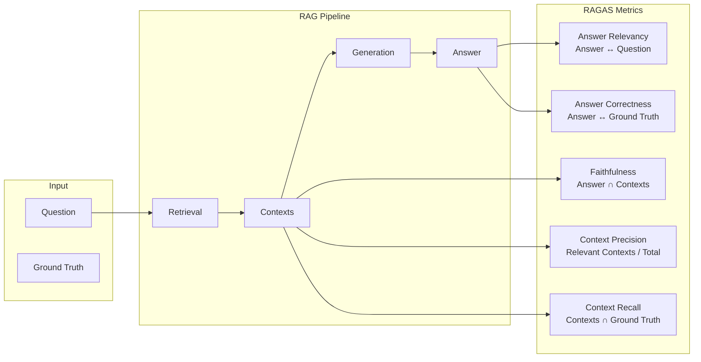

# Metrik Evaluasi

## Pendahuluan

Sistem evaluasi mengimplementasikan framework RAGAS (Retrieval-Augmented Generation Assessment) untuk mengukur kualitas sistem RAG secara komprehensif. Modul ini juga mendukung ablation studies untuk menganalisis kontribusi setiap komponen pipeline.

---

## Framework RAGAS

### Apa itu RAGAS?

RAGAS adalah framework evaluasi standar untuk sistem RAG yang diperkenalkan oleh Shahul et al. (2023). Framework ini mengukur:

1. **Faithfulness**: Apakah jawaban didukung oleh konteks?
2. **Answer Relevancy**: Apakah jawaban relevan dengan pertanyaan?
3. **Context Precision**: Apakah konteks yang diambil presisi?
4. **Context Recall**: Apakah konteks mencakup informasi yang dibutuhkan?



---

## Definisi Metrik

### Struktur Metrik Evaluasi

```typescript
// src/lib/rag/evaluation.ts

interface EvaluationMetrics {
    // Core RAGAS Metrics (0-1 scale, higher is better)
    faithfulness: number;
    answerRelevancy: number;
    contextPrecision: number;
    contextRecall: number;
    answerCorrectness: number;

    // Domain-Specific Metrics
    academicRigor: number;
    citationAccuracy: number;
    terminologyCorrectness: number;

    // Hallucination Metrics (0-1, lower is better)
    hallucinationRate: number;
    factualConsistency: number;      // higher is better
    sourceAttribution: number;       // higher is better
    contradictionScore: number;      // higher is better (less contradiction)

    // Retrieval Metrics
    ndcg: number;                    // Normalized Discounted Cumulative Gain
    mrr: number;                     // Mean Reciprocal Rank
    retrievalPrecision: number;

    // Latency Metrics (milliseconds)
    totalLatencyMs: number;
    retrievalLatencyMs: number;
    rerankingLatencyMs: number;
    generationLatencyMs: number;
    agentReasoningLatencyMs: number;
    toolCallLatencyMs: number;

    // Efficiency Metrics
    tokenEfficiency: number;         // Quality per token
    tokensPerSecond: number;
}
```

---

## Metrik Inti RAGAS

### 1. Faithfulness

Mengukur apakah klaim dalam jawaban didukung oleh konteks yang di-retrieve.

```typescript
async function calculateFaithfulness(
    answer: string,
    contexts: string[]
): Promise<number> {
    const contextJoined = contexts.join("\n\n");

    const { text } = await generateText({
        model: CHAT_MODEL,
        prompt: `
Anda adalah evaluator yang menilai faithfulness jawaban terhadap konteks.

KONTEKS:
${contextJoined}

JAWABAN:
${answer}

Tugas:
1. Identifikasi semua klaim faktual dalam jawaban
2. Untuk setiap klaim, tentukan apakah didukung oleh konteks

Output format JSON:
{
    "claims": [
        { "claim": "...", "supported": true/false }
    ],
    "supportedCount": number,
    "totalClaims": number
}
        `
    });

    const result = JSON.parse(text);
    return result.totalClaims > 0
        ? result.supportedCount / result.totalClaims
        : 1.0;
}
```

**Interpretasi**:
- `1.0`: Semua klaim didukung konteks
- `0.5`: Setengah klaim tidak didukung
- `0.0`: Tidak ada klaim yang didukung (halusinasi total)

---

### 2. Answer Relevancy

Mengukur seberapa relevan jawaban terhadap pertanyaan.

```typescript
async function calculateAnswerRelevancy(
    question: string,
    answer: string
): Promise<number> {
    // Generate question embedding
    const { embedding: questionEmb } = await generateEmbedding(question);

    // Generate multiple "reverse questions" from answer
    const { text } = await generateText({
        model: CHAT_MODEL,
        prompt: `
Berdasarkan jawaban berikut, buat 3 pertanyaan yang mungkin menghasilkan jawaban ini.

JAWABAN: ${answer}

Output format JSON: { "questions": ["...", "...", "..."] }
        `
    });

    const { questions } = JSON.parse(text);

    // Calculate similarity between original question and generated questions
    const generatedEmbeddings = await generateEmbeddings(questions);

    const similarities = generatedEmbeddings.map(ge =>
        cosineSimilarity(questionEmb, ge.embedding)
    );

    // Average similarity = answer relevancy
    return similarities.reduce((a, b) => a + b, 0) / similarities.length;
}
```

**Intuisi**: Jika jawaban relevan, pertanyaan yang di-generate dari jawaban akan mirip dengan pertanyaan original.

---

### 3. Context Precision

Mengukur proporsi konteks yang benar-benar relevan.

```typescript
async function calculateContextPrecision(
    question: string,
    contexts: string[]
): Promise<number> {
    const { text } = await generateText({
        model: CHAT_MODEL,
        prompt: `
Untuk setiap konteks, tentukan apakah relevan untuk menjawab pertanyaan.

PERTANYAAN: ${question}

KONTEKS:
${contexts.map((c, i) => `[${i + 1}] ${c}`).join("\n\n")}

Output format JSON: { "relevance": [true/false, ...] }
        `
    });

    const { relevance } = JSON.parse(text);
    const relevantCount = relevance.filter((r: boolean) => r).length;

    return contexts.length > 0 ? relevantCount / contexts.length : 0;
}
```

**Interpretasi**:
- `1.0`: Semua konteks yang di-retrieve relevan
- `0.5`: Setengah konteks tidak relevan (noise)
- `0.2`: Banyak konteks irrelevan (retrieval buruk)

---

### 4. Context Recall

Mengukur apakah konteks mencakup informasi yang ada di ground truth.

```typescript
async function calculateContextRecall(
    contexts: string[],
    groundTruth: string
): Promise<number> {
    const { text } = await generateText({
        model: CHAT_MODEL,
        prompt: `
Analisis apakah konteks yang diberikan mencakup informasi dari ground truth.

GROUND TRUTH:
${groundTruth}

KONTEKS:
${contexts.join("\n\n")}

Output format JSON:
{
    "groundTruthClaims": ["claim1", "claim2", ...],
    "coveredClaims": number,
    "totalClaims": number
}
        `
    });

    const result = JSON.parse(text);
    return result.totalClaims > 0
        ? result.coveredClaims / result.totalClaims
        : 1.0;
}
```

---

### 5. Answer Correctness

Mengukur kebenaran jawaban terhadap ground truth.

```typescript
async function calculateAnswerCorrectness(
    answer: string,
    groundTruth: string
): Promise<number> {
    // Semantic similarity component
    const [answerEmb, gtEmb] = await generateEmbeddings([answer, groundTruth]);
    const semanticSimilarity = cosineSimilarity(answerEmb.embedding, gtEmb.embedding);

    // Factual overlap component (LLM-based)
    const { text } = await generateText({
        model: CHAT_MODEL,
        prompt: `
Bandingkan jawaban dengan ground truth untuk menentukan kebenaran faktual.

JAWABAN: ${answer}
GROUND TRUTH: ${groundTruth}

Evaluasi:
1. Fakta yang benar di jawaban
2. Fakta yang salah di jawaban
3. Fakta yang hilang dari jawaban

Output format JSON:
{
    "correctFacts": number,
    "incorrectFacts": number,
    "missingFacts": number,
    "factualScore": number (0-1)
}
        `
    });

    const { factualScore } = JSON.parse(text);

    // Weighted average: 60% factual, 40% semantic
    return 0.6 * factualScore + 0.4 * semanticSimilarity;
}
```

---

## Metrik Domain-Specific

### Academic Rigor

Mengukur ketelitian akademis jawaban.

```typescript
async function calculateAcademicRigor(answer: string): Promise<number> {
    const { text } = await generateText({
        model: CHAT_MODEL,
        prompt: `
Evaluasi ketelitian akademis jawaban berikut (0-10):

JAWABAN: ${answer}

Kriteria:
1. Penggunaan terminologi yang tepat
2. Struktur argumentasi yang logis
3. Kejelasan penjelasan
4. Kelengkapan informasi
5. Objektivitas (tidak bias)

Output format JSON: { "score": number, "justification": "..." }
        `
    });

    const { score } = JSON.parse(text);
    return score / 10;
}
```

### Citation Accuracy

Mengukur keakuratan sitasi.

```typescript
async function calculateCitationAccuracy(
    answer: string,
    retrievedChunks: { chunkId: string; content: string }[]
): Promise<number> {
    // Extract citations from answer
    const citations = [...answer.matchAll(/\[(\d+)\]/g)].map(m => parseInt(m[1]));

    if (citations.length === 0) {
        // No citations used - check if any should have been used
        const hasClaimsNeedingCitation = /\b(menurut|berdasarkan|sesuai|dalam)\b/i.test(answer);
        return hasClaimsNeedingCitation ? 0.5 : 1.0;
    }

    // Verify each citation points to valid chunk
    let validCitations = 0;
    for (const citNum of citations) {
        if (citNum > 0 && citNum <= retrievedChunks.length) {
            validCitations++;
        }
    }

    return validCitations / citations.length;
}
```

### Terminology Correctness

Mengukur penggunaan istilah teknis yang benar.

```typescript
async function calculateTerminologyCorrectness(
    answer: string,
    contexts: string[]
): Promise<number> {
    // Extract technical terms from answer
    const technicalTerms = extractTechnicalTerms(answer);

    if (technicalTerms.length === 0) return 1.0;

    // Check if terms are used consistently with context
    const { text } = await generateText({
        model: CHAT_MODEL,
        prompt: `
Verifikasi penggunaan istilah teknis dalam jawaban.

JAWABAN: ${answer}
KONTEKS: ${contexts.join("\n")}

Istilah yang ditemukan: ${technicalTerms.join(", ")}

Untuk setiap istilah, tentukan:
1. Apakah digunakan dengan benar?
2. Apakah konsisten dengan konteks?

Output format JSON: { "correctTerms": number, "totalTerms": number }
        `
    });

    const { correctTerms, totalTerms } = JSON.parse(text);
    return totalTerms > 0 ? correctTerms / totalTerms : 1.0;
}
```

---

## Metrik Halusinasi

### Hallucination Rate

```typescript
async function calculateHallucinationRate(
    answer: string,
    contexts: string[]
): Promise<number> {
    const { text } = await generateText({
        model: CHAT_MODEL,
        prompt: `
Identifikasi informasi dalam jawaban yang TIDAK didukung oleh konteks.

JAWABAN: ${answer}
KONTEKS: ${contexts.join("\n\n")}

Klasifikasikan setiap klaim:
- SUPPORTED: Didukung oleh konteks
- UNSUPPORTED: Tidak didukung (halusinasi)
- CONTRADICTED: Bertentangan dengan konteks

Output format JSON:
{
    "totalClaims": number,
    "supportedClaims": number,
    "unsupportedClaims": number,
    "contradictedClaims": number
}
        `
    });

    const result = JSON.parse(text);
    const hallucinatedClaims = result.unsupportedClaims + result.contradictedClaims;

    // Lower is better
    return result.totalClaims > 0 ? hallucinatedClaims / result.totalClaims : 0;
}
```

---

## Metrik Latency

### Latency Tracker

```typescript
interface LatencyBreakdown {
    timestamp: number;
    phase: "retrieval" | "reranking" | "generation" | "tool_call" | "planning" | "synthesis";
    durationMs: number;
    metadata?: {
        toolName?: string;
        stepIndex?: number;
        tokensGenerated?: number;
    };
}

function createLatencyTracker() {
    const phases: LatencyBreakdown[] = [];
    let startTime: number;
    let lastTimestamp: number;

    return {
        start() {
            startTime = Date.now();
            lastTimestamp = startTime;
        },

        mark(phase: LatencyBreakdown["phase"], metadata?: object) {
            const now = Date.now();
            phases.push({
                timestamp: now,
                phase,
                durationMs: now - lastTimestamp,
                metadata
            });
            lastTimestamp = now;
        },

        getTotalMs(): number {
            return Date.now() - startTime;
        },

        getPhaseLatency(phase: string): number {
            return phases
                .filter(p => p.phase === phase)
                .reduce((sum, p) => sum + p.durationMs, 0);
        },

        getProfile(): LatencyProfile {
            const durations = phases.map(p => p.durationMs);
            return {
                breakdown: phases,
                totalMs: this.getTotalMs(),
                p50Ms: percentile(durations, 50),
                p95Ms: percentile(durations, 95),
                p99Ms: percentile(durations, 99),
                avgMs: mean(durations),
                stdDevMs: standardDeviation(durations)
            };
        }
    };
}
```

---

## Ablation Studies

### Konfigurasi Ablation

```typescript
interface AblationConfig {
    name: string;
    description: string;
    useRag: boolean;
    useReranker: boolean;
    rerankerStrategy?: RerankerStrategy;
    retrievalStrategy: "vector" | "keyword" | "hybrid";
    chunkingStrategy: "recursive" | "semantic" | "sentence_window" | "hierarchical";
    useAgenticMode: boolean;
    useGuardrails: boolean;
    topK: number;
    language: "id";
}
```

### Preset Konfigurasi

```typescript
const ABLATION_PRESETS: AblationConfig[] = [
    {
        name: "Baseline (No RAG)",
        description: "LLM murni tanpa retrieval",
        useRag: false,
        useReranker: false,
        retrievalStrategy: "hybrid",
        chunkingStrategy: "recursive",
        useAgenticMode: false,
        useGuardrails: false,
        topK: 0
    },
    {
        name: "Vector Only",
        description: "Hanya vector similarity search",
        useRag: true,
        useReranker: false,
        retrievalStrategy: "vector",
        chunkingStrategy: "recursive",
        useAgenticMode: false,
        useGuardrails: true,
        topK: 5
    },
    {
        name: "Hybrid + Reranking",
        description: "Full hybrid dengan cross-encoder reranking",
        useRag: true,
        useReranker: true,
        rerankerStrategy: "cross_encoder",
        retrievalStrategy: "hybrid",
        chunkingStrategy: "semantic",
        useAgenticMode: false,
        useGuardrails: true,
        topK: 5
    },
    {
        name: "Full Agentic",
        description: "Mode agentik dengan semua fitur",
        useRag: true,
        useReranker: true,
        rerankerStrategy: "cross_encoder",
        retrievalStrategy: "hybrid",
        chunkingStrategy: "hierarchical",
        useAgenticMode: true,
        useGuardrails: true,
        topK: 10
    }
];
```

### Menjalankan Ablation Study

```typescript
async function runAblationStudy(
    questions: { question: string; groundTruth: string }[],
    configs: AblationConfig[]
): Promise<AblationResult[]> {
    const results: AblationResult[] = [];

    for (const config of configs) {
        const metrics: EvaluationMetrics[] = [];
        const samples: SampleResult[] = [];

        for (const { question, groundTruth } of questions) {
            const latencyTracker = createLatencyTracker();
            latencyTracker.start();

            // Generate answer based on config
            const { answer, contexts } = await generateAnswer(question, config);

            // Calculate all metrics
            const questionMetrics = await calculateAllMetrics(
                question, answer, groundTruth, contexts, latencyTracker
            );

            metrics.push(questionMetrics);
            samples.push({ question, answer, groundTruth, contexts });
        }

        // Aggregate metrics
        results.push({
            config,
            metrics: aggregateMetrics(metrics),
            latencyProfile: aggregateLatencyProfiles(metrics),
            sampleResults: samples
        });
    }

    return results;
}
```

---

## Pertanyaan Evaluasi

```typescript
// src/lib/evaluation-questions.ts

interface EvaluationQuestion {
    id: string;
    category: string;
    question: string;
    groundTruth: string;
    difficulty: "easy" | "medium" | "hard";
    requiresMultiHop: boolean;
}

const ACADEMIC_QUESTIONS: EvaluationQuestion[] = [
    {
        id: "q1",
        category: "registrasi",
        question: "Bagaimana prosedur pengisian KRS online?",
        groundTruth: "Prosedur pengisian KRS online meliputi: 1) Login ke SIAKAD...",
        difficulty: "easy",
        requiresMultiHop: false
    },
    {
        id: "q2",
        category: "kelulusan",
        question: "Apa saja syarat untuk dapat mengikuti wisuda?",
        groundTruth: "Syarat wisuda meliputi: lulus semua mata kuliah...",
        difficulty: "medium",
        requiresMultiHop: false
    },
    // ... 48 more questions for statistically significant results
];
```

---

## Referensi Terkait

- [01-ikhtisar-arsitektur.md](./01-ikhtisar-arsitektur.md) - Pipeline yang dievaluasi
- [02-infrastruktur-data.md](./02-infrastruktur-data.md) - Skema evaluation_runs, evaluation_questions
- [05-sistem-retrieval.md](./05-sistem-retrieval.md) - Retrieval yang dievaluasi
- [06-agentic-rag.md](./06-agentic-rag.md) - Agentic mode dalam ablation
- [10-analisis-statistik.md](./10-analisis-statistik.md) - Analisis hasil evaluasi
