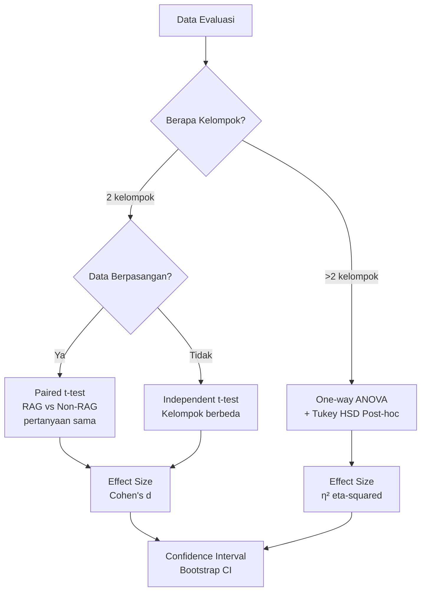

# Analisis Statistik

## Pendahuluan

Modul analisis statistik menyediakan uji statistik formal untuk memvalidasi perbedaan performa antara konfigurasi RAG. Modul ini mendukung publikasi akademis dengan uji hipotesis, effect size, dan confidence interval.

---

## Mengapa Analisis Statistik?

### Masalah Tanpa Statistik

| Skenario                                | Tanpa Statistik    | Dengan Statistik                            |
| --------------------------------------- | ------------------ | ------------------------------------------- |
| RAG faithfulness: 0.85 vs Non-RAG: 0.78 | "RAG lebih baik"   | "Perbedaan signifikan (p < 0.05, d = 0.67)" |
| 5 pertanyaan diuji                      | Tidak cukup sampel | Power analysis menunjukkan n=50 dibutuhkan  |
| Variasi tinggi antar pertanyaan         | Diabaikan          | Confidence interval memperhitungkan variasi |

### Uji Yang Tersedia



---

## Statistik Deskriptif

### Struktur Hasil

```typescript
// src/lib/statistics/statistical-analysis.ts

interface DescriptiveStats {
    mean: number;           // Rata-rata aritmetik
    median: number;         // Nilai tengah
    stdDev: number;         // Simpangan baku sampel
    variance: number;       // Varians sampel
    min: number;            // Nilai minimum
    max: number;            // Nilai maksimum
    range: number;          // max - min
    n: number;              // Ukuran sampel
    sem: number;            // Standard Error of Mean
    skewness: number;       // Kemiringan distribusi (Fisher's)
    kurtosis: number;       // Keruncingan distribusi (excess kurtosis)
}
```

### Implementasi

```typescript
function calculateDescriptiveStats(data: number[]): DescriptiveStats {
    const n = data.length;
    if (n === 0) throw new Error("Data array is empty");

    // Sort for median and percentiles
    const sorted = [...data].sort((a, b) => a - b);

    // Mean
    const mean = data.reduce((sum, x) => sum + x, 0) / n;

    // Median
    const median = n % 2 === 0
        ? (sorted[n / 2 - 1] + sorted[n / 2]) / 2
        : sorted[Math.floor(n / 2)];

    // Variance and Standard Deviation (sample, Bessel's correction)
    const squaredDiffs = data.map(x => (x - mean) ** 2);
    const variance = squaredDiffs.reduce((sum, x) => sum + x, 0) / (n - 1);
    const stdDev = Math.sqrt(variance);

    // Standard Error of Mean
    const sem = stdDev / Math.sqrt(n);

    // Skewness (Fisher's)
    const m3 = data.reduce((sum, x) => sum + (x - mean) ** 3, 0) / n;
    const skewness = m3 / (stdDev ** 3);

    // Kurtosis (excess kurtosis: normal = 0)
    const m4 = data.reduce((sum, x) => sum + (x - mean) ** 4, 0) / n;
    const kurtosis = m4 / (stdDev ** 4) - 3;

    return {
        mean,
        median,
        stdDev,
        variance,
        min: sorted[0],
        max: sorted[n - 1],
        range: sorted[n - 1] - sorted[0],
        n,
        sem,
        skewness,
        kurtosis
    };
}
```

---

## Paired t-Test

Digunakan untuk membandingkan RAG vs Non-RAG pada pertanyaan yang sama (data berpasangan).

### Formula

$$t = \frac{\bar{d}}{s_d / \sqrt{n}}$$

Dimana:
- $\bar{d}$ = rata-rata perbedaan (RAG - Non-RAG per pertanyaan)
- $s_d$ = simpangan baku perbedaan
- $n$ = jumlah pasangan

### Implementasi

```typescript
interface StatisticalResult {
    testName: string;
    statistic: number;              // t-statistic
    pValue: number;
    significant: boolean;           // p < alpha
    effectSize?: number;            // Cohen's d
    effectSizeInterpretation?: string;
    confidenceInterval?: {
        lower: number;
        upper: number;
        level: number;              // e.g., 0.95
    };
    degreesOfFreedom?: number;
    sampleSize: number;
    interpretation: string;         // English
    interpretationId: string;       // Indonesian
}

function pairedTTest(
    group1: number[],   // RAG scores
    group2: number[],   // Non-RAG scores
    alpha = 0.05
): StatisticalResult {
    if (group1.length !== group2.length) {
        throw new Error("Paired t-test requires equal length arrays");
    }

    const n = group1.length;

    // Calculate differences
    const differences = group1.map((v, i) => v - group2[i]);

    // Mean and std of differences
    const meanDiff = differences.reduce((a, b) => a + b, 0) / n;
    const varDiff = differences.reduce((sum, d) =>
        sum + (d - meanDiff) ** 2, 0
    ) / (n - 1);
    const stdDiff = Math.sqrt(varDiff);

    // t-statistic
    const t = meanDiff / (stdDiff / Math.sqrt(n));
    const df = n - 1;

    // p-value (two-tailed)
    const pValue = tToPValue(Math.abs(t), df) * 2;

    // Cohen's d for paired data
    const cohensD = meanDiff / stdDiff;

    // Confidence interval for mean difference
    const tCrit = tCriticalValue(df, alpha / 2);
    const marginOfError = tCrit * (stdDiff / Math.sqrt(n));

    return {
        testName: "Paired t-test",
        statistic: t,
        pValue,
        significant: pValue < alpha,
        effectSize: cohensD,
        effectSizeInterpretation: interpretCohensD(cohensD),
        confidenceInterval: {
            lower: meanDiff - marginOfError,
            upper: meanDiff + marginOfError,
            level: 1 - alpha
        },
        degreesOfFreedom: df,
        sampleSize: n,
        interpretation: generateInterpretation(t, pValue, cohensD, "en"),
        interpretationId: generateInterpretation(t, pValue, cohensD, "id")
    };
}
```

---

## Independent t-Test

Digunakan untuk membandingkan dua kelompok independen.

### Implementasi

```typescript
function independentTTest(
    group1: number[],
    group2: number[],
    alpha = 0.05
): StatisticalResult {
    const n1 = group1.length;
    const n2 = group2.length;

    const mean1 = group1.reduce((a, b) => a + b, 0) / n1;
    const mean2 = group2.reduce((a, b) => a + b, 0) / n2;

    const var1 = group1.reduce((sum, x) => sum + (x - mean1) ** 2, 0) / (n1 - 1);
    const var2 = group2.reduce((sum, x) => sum + (x - mean2) ** 2, 0) / (n2 - 1);

    // Pooled standard error (Welch's t-test for unequal variances)
    const se = Math.sqrt(var1 / n1 + var2 / n2);
    const t = (mean1 - mean2) / se;

    // Welch-Satterthwaite degrees of freedom
    const df = ((var1 / n1 + var2 / n2) ** 2) /
        ((var1 / n1) ** 2 / (n1 - 1) + (var2 / n2) ** 2 / (n2 - 1));

    const pValue = tToPValue(Math.abs(t), df) * 2;

    // Cohen's d
    const pooledStd = Math.sqrt(
        ((n1 - 1) * var1 + (n2 - 1) * var2) / (n1 + n2 - 2)
    );
    const cohensD = (mean1 - mean2) / pooledStd;

    return {
        testName: "Independent t-test (Welch's)",
        statistic: t,
        pValue,
        significant: pValue < alpha,
        effectSize: cohensD,
        effectSizeInterpretation: interpretCohensD(cohensD),
        degreesOfFreedom: df,
        sampleSize: n1 + n2,
        interpretation: generateInterpretation(t, pValue, cohensD, "en"),
        interpretationId: generateInterpretation(t, pValue, cohensD, "id")
    };
}
```

---

## One-Way ANOVA

Digunakan untuk membandingkan lebih dari 2 kelompok (misalnya: 4 konfigurasi ablation).

### Formula

$$F = \frac{MS_{between}}{MS_{within}} = \frac{SS_{between} / (k-1)}{SS_{within} / (N-k)}$$

### Implementasi

```typescript
function oneWayANOVA(
    groups: number[][],
    alpha = 0.05
): StatisticalResult & { postHoc?: StatisticalResult[] } {
    const k = groups.length;  // Number of groups
    const N = groups.reduce((sum, g) => sum + g.length, 0);  // Total observations

    // Grand mean
    const allValues = groups.flat();
    const grandMean = allValues.reduce((a, b) => a + b, 0) / N;

    // Group means
    const groupMeans = groups.map(g =>
        g.reduce((a, b) => a + b, 0) / g.length
    );

    // Sum of Squares Between (SSB)
    const ssb = groups.reduce((sum, g, i) =>
        sum + g.length * (groupMeans[i] - grandMean) ** 2, 0
    );

    // Sum of Squares Within (SSW)
    const ssw = groups.reduce((sum, g, i) =>
        sum + g.reduce((s, x) => s + (x - groupMeans[i]) ** 2, 0), 0
    );

    // Mean Squares
    const dfBetween = k - 1;
    const dfWithin = N - k;
    const msb = ssb / dfBetween;
    const msw = ssw / dfWithin;

    // F-statistic
    const f = msb / msw;
    const pValue = fToPValue(f, dfBetween, dfWithin);

    // Effect size: eta-squared
    const etaSquared = ssb / (ssb + ssw);

    let result: StatisticalResult & { postHoc?: StatisticalResult[] } = {
        testName: "One-way ANOVA",
        statistic: f,
        pValue,
        significant: pValue < alpha,
        effectSize: etaSquared,
        effectSizeInterpretation: interpretEtaSquared(etaSquared),
        degreesOfFreedom: dfBetween,
        sampleSize: N,
        interpretation: `F(${dfBetween}, ${dfWithin}) = ${f.toFixed(2)}, p = ${pValue.toFixed(4)}`,
        interpretationId: `F(${dfBetween}, ${dfWithin}) = ${f.toFixed(2)}, p = ${pValue.toFixed(4)}`
    };

    // Post-hoc test if significant
    if (pValue < alpha) {
        result.postHoc = performTukeyHSD(groups, groupMeans, msw, alpha);
    }

    return result;
}
```

---

## Tukey HSD Post-Hoc Test

Digunakan setelah ANOVA signifikan untuk menentukan pasangan mana yang berbeda.

```typescript
function performTukeyHSD(
    groups: number[][],
    groupMeans: number[],
    msw: number,
    alpha: number
): StatisticalResult[] {
    const results: StatisticalResult[] = [];
    const k = groups.length;

    // Pairwise comparisons
    for (let i = 0; i < k - 1; i++) {
        for (let j = i + 1; j < k; j++) {
            const ni = groups[i].length;
            const nj = groups[j].length;

            // Studentized range statistic
            const se = Math.sqrt(msw * (1 / ni + 1 / nj) / 2);
            const q = Math.abs(groupMeans[i] - groupMeans[j]) / se;

            const df = groups.reduce((sum, g) => sum + g.length, 0) - k;
            const pValue = qToPValue(q, k, df);

            results.push({
                testName: `Tukey HSD: Group ${i + 1} vs Group ${j + 1}`,
                statistic: q,
                pValue,
                significant: pValue < alpha,
                sampleSize: ni + nj,
                interpretation: pValue < alpha
                    ? `Groups ${i + 1} and ${j + 1} differ significantly`
                    : `No significant difference between groups ${i + 1} and ${j + 1}`,
                interpretationId: pValue < alpha
                    ? `Kelompok ${i + 1} dan ${j + 1} berbeda secara signifikan`
                    : `Tidak ada perbedaan signifikan antara kelompok ${i + 1} dan ${j + 1}`
            });
        }
    }

    return results;
}
```

---

## Effect Size Interpretation

### Cohen's d

| Nilai       | Interpretasi (EN) | Interpretasi (ID) |
| ----------- | ----------------- | ----------------- |
| < 0.20      | Negligible        | Dapat diabaikan   |
| 0.20 - 0.49 | Small             | Kecil             |
| 0.50 - 0.79 | Medium            | Sedang            |
| ≥ 0.80      | Large             | Besar             |

```typescript
function interpretCohensD(d: number): string {
    const absD = Math.abs(d);
    if (absD < 0.20) return "negligible";
    if (absD < 0.50) return "small";
    if (absD < 0.80) return "medium";
    return "large";
}

function translateEffectSize(effect: string): string {
    const translations: Record<string, string> = {
        "negligible": "dapat diabaikan",
        "small": "kecil",
        "medium": "sedang",
        "large": "besar"
    };
    return translations[effect] || effect;
}
```

### Eta-Squared (η²)

| Nilai       | Interpretasi |
| ----------- | ------------ |
| < 0.01      | Negligible   |
| 0.01 - 0.05 | Small        |
| 0.06 - 0.13 | Medium       |
| ≥ 0.14      | Large        |

```typescript
function interpretEtaSquared(eta2: number): string {
    if (eta2 < 0.01) return "negligible";
    if (eta2 < 0.06) return "small";
    if (eta2 < 0.14) return "medium";
    return "large";
}
```

---

## Bootstrap Confidence Interval

Metode non-parametrik untuk estimasi confidence interval.

```typescript
function bootstrapConfidenceInterval(
    data: number[],
    statistic: (d: number[]) => number = mean,
    confidenceLevel = 0.95,
    nBootstrap = 1000
): { estimate: number; lower: number; upper: number; level: number } {
    const n = data.length;
    const bootstrapStats: number[] = [];

    // Generate bootstrap samples
    for (let i = 0; i < nBootstrap; i++) {
        // Sample with replacement
        const sample = Array.from({ length: n }, () =>
            data[Math.floor(Math.random() * n)]
        );
        bootstrapStats.push(statistic(sample));
    }

    // Sort for percentile calculation
    bootstrapStats.sort((a, b) => a - b);

    const alpha = 1 - confidenceLevel;
    const lowerIdx = Math.floor(nBootstrap * (alpha / 2));
    const upperIdx = Math.floor(nBootstrap * (1 - alpha / 2));

    return {
        estimate: statistic(data),
        lower: bootstrapStats[lowerIdx],
        upper: bootstrapStats[upperIdx],
        level: confidenceLevel
    };
}
```

---

## Perbandingan RAG vs Non-RAG

### Fungsi Komprehensif

```typescript
interface RAGComparisonResult {
    metric: string;                 // Nama metrik (English)
    metricId: string;               // Nama metrik (Indonesian)
    ragStats: DescriptiveStats;
    nonRagStats: DescriptiveStats;
    testResult: StatisticalResult;
    improvement: number;            // Absolute improvement
    improvementPercent: number;     // Relative improvement %
}

function compareRAGvsNonRAG(
    ragScores: number[],
    nonRagScores: number[],
    metricName: string,
    metricNameId: string,
    paired = true
): RAGComparisonResult {
    const ragStats = calculateDescriptiveStats(ragScores);
    const nonRagStats = calculateDescriptiveStats(nonRagScores);

    // Use paired or independent t-test
    const testResult = paired
        ? pairedTTest(ragScores, nonRagScores)
        : independentTTest(ragScores, nonRagScores);

    const improvement = ragStats.mean - nonRagStats.mean;
    const improvementPercent = nonRagStats.mean !== 0
        ? (improvement / nonRagStats.mean) * 100
        : 0;

    return {
        metric: metricName,
        metricId: metricNameId,
        ragStats,
        nonRagStats,
        testResult,
        improvement,
        improvementPercent
    };
}
```

### Contoh Penggunaan

```typescript
// Bandingkan faithfulness RAG vs Non-RAG
const comparison = compareRAGvsNonRAG(
    [0.85, 0.82, 0.91, 0.78, 0.88, ...],  // RAG faithfulness scores
    [0.65, 0.70, 0.68, 0.72, 0.66, ...],  // Non-RAG faithfulness scores
    "Faithfulness",
    "Kesetiaan"
);

// Hasil:
// {
//   metric: "Faithfulness",
//   metricId: "Kesetiaan",
//   ragStats: { mean: 0.848, stdDev: 0.048, ... },
//   nonRagStats: { mean: 0.682, stdDev: 0.027, ... },
//   testResult: {
//     testName: "Paired t-test",
//     statistic: 12.45,
//     pValue: 0.00001,
//     significant: true,
//     effectSize: 1.85,
//     effectSizeInterpretation: "large"
//   },
//   improvement: 0.166,
//   improvementPercent: 24.3
// }
```

---

## Analisis Multi-Metrik

```typescript
async function analyzeEvaluationRun(
    runId: string
): Promise<{
    comparisons: RAGComparisonResult[];
    summary: string;
    summaryId: string;
}> {
    // Fetch evaluation questions
    const questions = await db.select()
        .from(evaluationQuestions)
        .where(eq(evaluationQuestions.runId, runId));

    const metrics = [
        { name: "Faithfulness", nameId: "Kesetiaan", rag: "ragFaithfulness", nonRag: null },
        { name: "Answer Relevancy", nameId: "Relevansi Jawaban", rag: "ragAnswerRelevancy", nonRag: "nonRagAnswerRelevancy" },
        { name: "Context Precision", nameId: "Presisi Konteks", rag: "ragContextPrecision", nonRag: null },
        { name: "Answer Correctness", nameId: "Kebenaran Jawaban", rag: "ragAnswerCorrectness", nonRag: "nonRagAnswerCorrectness" }
    ];

    const comparisons: RAGComparisonResult[] = [];

    for (const metric of metrics) {
        if (metric.nonRag) {
            const ragScores = questions.map(q => q[metric.rag] || 0);
            const nonRagScores = questions.map(q => q[metric.nonRag!] || 0);

            comparisons.push(compareRAGvsNonRAG(
                ragScores, nonRagScores,
                metric.name, metric.nameId
            ));
        }
    }

    // Generate summary
    const significantImprovements = comparisons.filter(c => c.testResult.significant);

    return {
        comparisons,
        summary: generateSummary(comparisons, "en"),
        summaryId: generateSummary(comparisons, "id")
    };
}
```

---

## Laporan Statistik Bilingual

```typescript
function generateStatisticalReport(
    comparisons: RAGComparisonResult[],
    language: "en" | "id"
): string {
    const lines: string[] = [];

    if (language === "id") {
        lines.push("# Laporan Analisis Statistik\n");
        lines.push("## Ringkasan Hasil\n");

        for (const comp of comparisons) {
            lines.push(`### ${comp.metricId}\n`);
            lines.push(`- RAG: μ = ${comp.ragStats.mean.toFixed(3)}, σ = ${comp.ragStats.stdDev.toFixed(3)}`);
            lines.push(`- Non-RAG: μ = ${comp.nonRagStats.mean.toFixed(3)}, σ = ${comp.nonRagStats.stdDev.toFixed(3)}`);
            lines.push(`- Peningkatan: ${comp.improvementPercent.toFixed(1)}%`);
            lines.push(`- ${comp.testResult.interpretationId}\n`);
        }
    } else {
        lines.push("# Statistical Analysis Report\n");
        lines.push("## Summary of Results\n");

        for (const comp of comparisons) {
            lines.push(`### ${comp.metric}\n`);
            lines.push(`- RAG: μ = ${comp.ragStats.mean.toFixed(3)}, σ = ${comp.ragStats.stdDev.toFixed(3)}`);
            lines.push(`- Non-RAG: μ = ${comp.nonRagStats.mean.toFixed(3)}, σ = ${comp.nonRagStats.stdDev.toFixed(3)}`);
            lines.push(`- Improvement: ${comp.improvementPercent.toFixed(1)}%`);
            lines.push(`- ${comp.testResult.interpretation}\n`);
        }
    }

    return lines.join("\n");
}
```

---

## Referensi Terkait

- [02-infrastruktur-data.md](./02-infrastruktur-data.md) - Skema statistical_analyses table
- [09-metrik-evaluasi.md](./09-metrik-evaluasi.md) - Metrik yang dianalisis
- [11-api-endpoints.md](./11-api-endpoints.md) - API untuk menjalankan analisis
