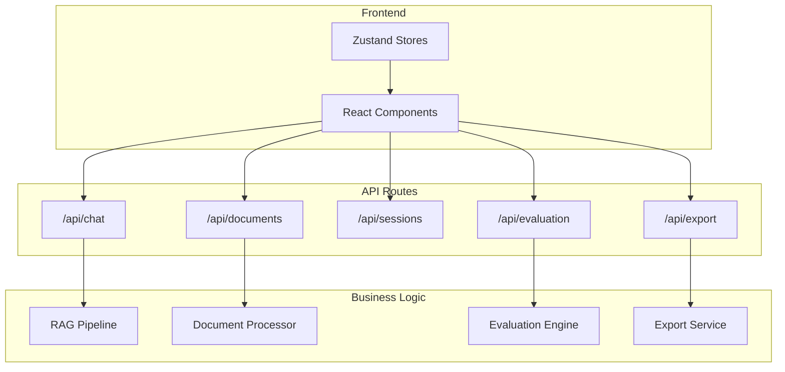

# API Endpoints

## Pendahuluan

Sistem mengekspos REST API melalui Next.js API Routes untuk komunikasi antara frontend dan backend. Dokumen ini menjelaskan endpoint yang tersedia, format request/response, dan pertimbangan desain.

---

## Arsitektur API



---

## Chat API

### POST `/api/chat`

Endpoint utama untuk chat dengan streaming response.

#### Request Body

```typescript
interface ChatRequest {
    messages: UIMessage[];          // Conversation history
    sessionId: string;              // Session identifier
    useRag?: boolean;               // Enable RAG (default: true)
    useAgenticMode?: boolean;       // Enable multi-step reasoning (default: false)
    retrievalStrategy?: "vector" | "keyword" | "hybrid";  // default: hybrid
    enableGuardrails?: boolean;     // Enable safety checks (default: true)
}

interface UIMessage {
    id: string;
    role: "user" | "assistant" | "system";
    content: string;
    createdAt?: Date;
}
```

#### Response (Streaming)

Response menggunakan `createUIMessageStreamResponse` dari AI SDK untuk streaming.

```typescript
// Stream parts yang dikirim:

// 1. Text content (progressive)
{ type: "text-delta", textDelta: "Berdasarkan informasi..." }

// 2. Agent steps (agentic mode)
{ type: "data", data: [{
    type: "agent-step",
    stepIndex: 0,
    stepType: "tool_call",
    toolName: "search_documents",
    status: "executing"
}]}

// 3. Retrieved chunks
{ type: "data", data: [{
    type: "retrieved-chunk",
    chunkId: "uuid",
    documentTitle: "Buku Pedoman",
    content: "...",
    similarity: 0.87
}]}

// 4. Final message metadata
{ type: "finish-message", message: {
    id: "msg-uuid",
    role: "assistant",
    content: "Jawaban lengkap...",
    metadata: {
        type: "agentic" | "rag" | "direct",
        retrievedChunks: [...],
        steps: [...],
        latencyMs: 2500
    }
}}
```

#### Contoh Penggunaan (Frontend)

```typescript
import { useChat } from "ai/react";

function ChatComponent() {
    const { messages, input, handleInputChange, handleSubmit } = useChat({
        api: "/api/chat",
        body: {
            sessionId: "session-uuid",
            useRag: true,
            useAgenticMode: true,
            retrievalStrategy: "hybrid"
        },
        onFinish: (message) => {
            // Access metadata
            const metadata = message.metadata;
            console.log("Chunks:", metadata.retrievedChunks);
            console.log("Steps:", metadata.steps);
        }
    });

    return (
        <form onSubmit={handleSubmit}>
            <input value={input} onChange={handleInputChange} />
            <button type="submit">Send</button>
        </form>
    );
}
```

---

## Documents API

### GET `/api/documents`

Mengambil daftar dokumen.

#### Response

```typescript
interface DocumentsResponse {
    documents: {
        id: string;
        title: string;
        fileName: string;
        fileType: string;
        fileSize: number;
        processingStatus: "pending" | "processing" | "completed" | "failed";
        chunkingStrategy?: string;
        chunksCount?: number;
        createdAt: string;
    }[];
    total: number;
}
```

---

### POST `/api/documents/upload`

Upload dan proses dokumen baru.

#### Request (multipart/form-data)

```typescript
interface UploadRequest {
    file: File;                     // PDF, DOCX, TXT, or MD
    title?: string;                 // Optional, default: filename
    chunkingStrategy?: "auto" | "recursive" | "semantic" | "sentence_window" | "hierarchical";
}
```

#### Response (Streaming Progress)

```typescript
// Progress events
{ stage: "extracting", progress: 10, message: "Mengekstrak teks..." }
{ stage: "analyzing", progress: 25, message: "Menganalisis struktur..." }
{ stage: "chunking", progress: 40, message: "Membagi dokumen..." }
{ stage: "embedding", progress: 60, message: "Menghasilkan embedding..." }
{ stage: "storing", progress: 95, message: "Menyimpan ke database..." }
{ stage: "completed", progress: 100, message: "Selesai", documentId: "uuid" }
```

---

### DELETE `/api/documents/[id]`

Menghapus dokumen dan semua chunk terkait.

#### Response

```typescript
{ success: true, deletedChunks: number }
```

---

### GET `/api/documents/[id]/progress`

Mengambil progress pemrosesan dokumen.

#### Response

```typescript
interface ProgressResponse {
    documentId: string;
    stage: string;
    progress: number;
    message?: string;
    estimatedTimeMs?: number;
}
```

---

### POST `/api/documents/[id]/retry`

Retry pemrosesan dokumen yang gagal.

#### Request

```typescript
interface RetryRequest {
    fromStage?: string;  // Resume from specific stage
}
```

---

## Sessions API

### GET `/api/sessions`

Mengambil daftar sesi chat.

#### Response

```typescript
interface SessionsResponse {
    sessions: {
        id: string;
        title: string;
        useRag: boolean;
        useAgenticMode: boolean;
        retrievalStrategy: string;
        messageCount: number;
        createdAt: string;
        updatedAt: string;
    }[];
}
```

---

### POST `/api/sessions`

Membuat sesi baru.

#### Request

```typescript
interface CreateSessionRequest {
    title?: string;                 // Default: "New Chat"
    useRag?: boolean;               // Default: true
    useAgenticMode?: boolean;       // Default: false
    retrievalStrategy?: string;     // Default: "hybrid"
}
```

#### Response

```typescript
interface SessionResponse {
    id: string;
    title: string;
    // ... other fields
}
```

---

### GET `/api/sessions/[id]`

Mengambil detail sesi termasuk pesan.

#### Response

```typescript
interface SessionDetailResponse {
    session: {
        id: string;
        title: string;
        // ...
    };
    messages: {
        id: string;
        role: string;
        content: string;
        retrievedChunks?: RetrievedChunk[];
        agentSteps?: AgentStep[];
        createdAt: string;
    }[];
}
```

---

### DELETE `/api/sessions/[id]`

Menghapus sesi dan semua pesan terkait.

---

### GET `/api/sessions/[id]/messages`

Mengambil pesan dalam sesi dengan pagination.

#### Query Parameters

```typescript
{
    limit?: number;   // Default: 50
    offset?: number;  // Default: 0
    order?: "asc" | "desc";  // Default: "asc"
}
```

---

## Evaluation API

### GET `/api/evaluation`

Mengambil daftar evaluation runs.

#### Response

```typescript
interface EvaluationRunsResponse {
    runs: {
        id: string;
        name: string;
        description?: string;
        status: "pending" | "running" | "completed" | "failed";
        totalQuestions: number;
        completedQuestions: number;
        retrievalStrategy: string;
        useAgenticMode: boolean;
        createdAt: string;
        completedAt?: string;
    }[];
}
```

---

### POST `/api/evaluation`

Membuat evaluation run baru.

#### Request

```typescript
interface CreateEvaluationRequest {
    name: string;
    description?: string;
    retrievalStrategy?: "vector" | "keyword" | "hybrid";
    chunkingStrategy?: string;
    useAgenticMode?: boolean;
    questionCount?: number;         // 5 (quick) or 50 (production)
    questionIds?: string[];         // Specific questions to evaluate
}
```

#### Response

```typescript
interface CreateEvaluationResponse {
    id: string;
    name: string;
    status: "pending";
    // ...
}
```

---

### POST `/api/evaluation/[id]/run`

Menjalankan evaluation run.

#### Response (Streaming)

```typescript
// Progress events
{ type: "progress", current: 1, total: 50, question: "..." }
{ type: "result", questionId: "q1", metrics: { faithfulness: 0.85, ... } }
{ type: "completed", summary: { avgFaithfulness: 0.84, ... } }
```

---

### GET `/api/evaluation/[id]/results`

Mengambil hasil evaluation run.

#### Response

```typescript
interface EvaluationResultsResponse {
    run: EvaluationRun;
    questions: {
        id: string;
        question: string;
        groundTruth: string;
        ragAnswer: string;
        nonRagAnswer?: string;
        ragFaithfulness: number;
        ragAnswerRelevancy: number;
        // ... all metrics
    }[];
    aggregatedMetrics: {
        avgFaithfulness: number;
        avgAnswerRelevancy: number;
        // ...
    };
    statisticalAnalysis?: StatisticalResult[];
}
```

---

### POST `/api/evaluation/ablation`

Menjalankan ablation study.

#### Request

```typescript
interface AblationRequest {
    name: string;
    configurations: AblationConfig[];
    questionCount?: number;
}
```

#### Response

```typescript
interface AblationResponse {
    id: string;
    results: {
        configName: string;
        metrics: EvaluationMetrics;
        latencyProfile: LatencyProfile;
    }[];
    statisticalComparison: StatisticalResult[];
}
```

---

### POST `/api/evaluation/annotations`

Menyimpan human annotation.

#### Request

```typescript
interface AnnotationRequest {
    evaluationQuestionId: string;
    annotatorId: string;
    faithfulnessRating: number;     // 1-5
    relevancyRating: number;        // 1-5
    correctnessRating: number;      // 1-5
    hasHallucination: boolean;
    hallucinationNotes?: string;
    overallQuality: number;         // 1-5
    annotationTimeMs: number;
    notes?: string;
}
```

---

### GET `/api/evaluation/annotations/sampling`

Mengambil sample pertanyaan untuk annotasi.

#### Query Parameters

```typescript
{
    runId: string;
    sampleSize?: number;    // Default: 10
    strategy?: "random" | "stratified" | "edge_cases";
}
```

---

## Export API

### POST `/api/export`

Export data dalam berbagai format.

#### Request

```typescript
interface ExportRequest {
    type: "evaluation" | "ablation" | "annotations" | "sessions";
    id?: string;                    // Specific run/session ID
    format: "json" | "csv" | "excel" | "latex";
    includeStatistics?: boolean;
    language?: "en" | "id";
}
```

#### Response

File download dengan content-type sesuai format.

---

### GET `/api/evaluation/hallucination-summary`

Mengambil ringkasan metrik halusinasi.

#### Query Parameters

```typescript
{
    runId?: string;
    groupBy?: "question" | "document" | "category";
}
```

---

## Error Handling

### Format Error Response

```typescript
interface ErrorResponse {
    error: {
        code: string;               // "VALIDATION_ERROR", "NOT_FOUND", etc.
        message: string;
        details?: Record<string, unknown>;
    };
}
```

### HTTP Status Codes

| Code | Meaning                        |
| ---- | ------------------------------ |
| 200  | Success                        |
| 201  | Created                        |
| 400  | Bad Request (validation error) |
| 401  | Unauthorized                   |
| 404  | Not Found                      |
| 429  | Rate Limited                   |
| 500  | Internal Server Error          |

---

## Rate Limiting

```typescript
const RATE_LIMITS = {
    chat: {
        requests: 60,
        window: "1m"
    },
    documents: {
        uploads: 10,
        window: "1h"
    },
    evaluation: {
        runs: 5,
        window: "1h"
    }
};
```

---

## Referensi Terkait

- [01-ikhtisar-arsitektur.md](./01-ikhtisar-arsitektur.md) - Arsitektur API layer
- [06-agentic-rag.md](./06-agentic-rag.md) - Chat API agentic mode
- [08-guardrails-keamanan.md](./08-guardrails-keamanan.md) - Validasi input/output
- [09-metrik-evaluasi.md](./09-metrik-evaluasi.md) - Evaluation API metrics
- [12-state-management.md](./12-state-management.md) - Frontend state integration
