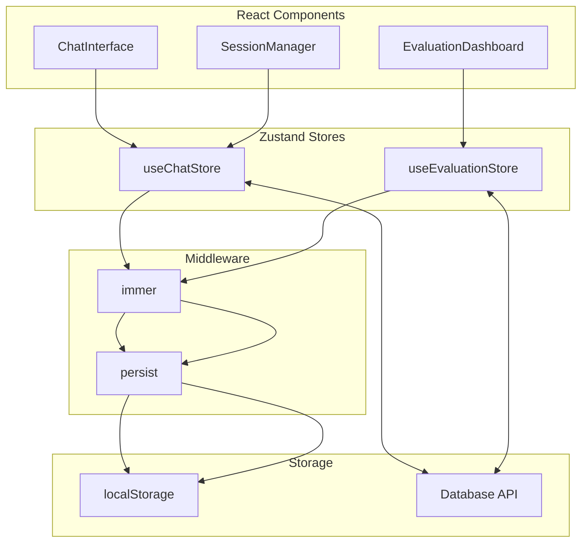
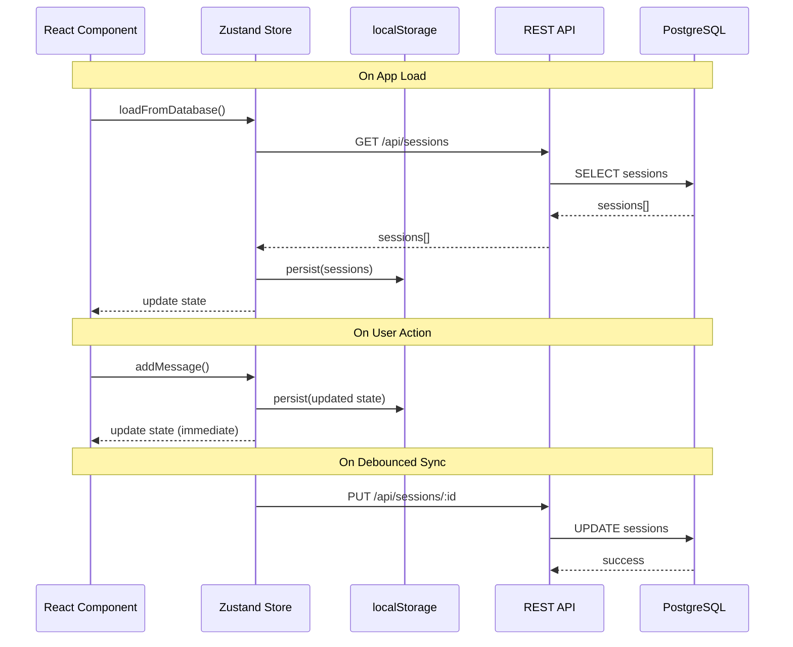

# State Management

## Pendahuluan

Sistem menggunakan Zustand untuk state management di sisi frontend. Zustand dipilih karena API yang sederhana, dukungan TypeScript yang baik, dan kemampuan persistence bawaan. Dokumen ini menjelaskan arsitektur store, pola desain, dan integrasi dengan API.

---

## Mengapa Zustand?

### Perbandingan dengan Alternatif

| Aspek          | Zustand   | Redux      | React Context |
| -------------- | --------- | ---------- | ------------- |
| Boilerplate    | Minimal   | Tinggi     | Minimal       |
| TypeScript     | Excellent | Good       | Manual        |
| Persistence    | Built-in  | Middleware | Manual        |
| DevTools       | Supported | Excellent  | Limited       |
| Bundle Size    | ~1KB      | ~7KB       | 0             |
| Learning Curve | Rendah    | Tinggi     | Rendah        |

### Keputusan Desain

1. **Immer middleware**: Immutable updates dengan sintaks mutable
2. **Persist middleware**: Sinkronisasi dengan localStorage
3. **Separation of concerns**: Store terpisah untuk chat dan evaluation

---

## Arsitektur Store



---

## Chat Store

### Struktur State

```typescript
// src/lib/stores/chat-stores.ts

interface AgentStep {
    stepIndex: number;
    stepType: "reasoning" | "tool_call" | "retrieval" | "synthesis" | "reranking";
    toolName?: string;
    toolInput?: Record<string, unknown>;
    toolOutput?: unknown;
    reasoning?: string;
    durationMs: number;
    timestamp: number;
}

interface RetrievedChunk {
    chunkId: string;
    documentTitle: string;
    content: string;
    similarity: number;
    retrievalMethod?: "vector" | "keyword" | "hybrid";
    vectorScore?: number;
    bm25Score?: number;
}

interface ChatMessage {
    id: string;
    role: "user" | "assistant" | "system";
    content: string;
    createdAt: number;
    agentSteps?: AgentStep[];
    retrievedChunks?: RetrievedChunk[];
    latencyMs?: number;
    tokenCount?: number;
    language?: "en" | "id";
}

interface ChatSession {
    id: string;
    title: string;
    messages: ChatMessage[];
    createdAt: number;
    updatedAt: number;
    settings: ChatSettings;
    isEphemeral?: boolean;  // Memory-only, not persisted to DB
}

interface ChatSettings {
    useRag: boolean;
    useAgenticMode: boolean;
    retrievalStrategy: "vector" | "keyword" | "hybrid";
    enableGuardrails: boolean;
    language: "auto" | "en" | "id";
    maxSteps: number;
    temperature: number;
}
```

### Definisi Store

```typescript
interface ChatStore {
    // State
    sessions: ChatSession[];
    activeSessionId: string | null;
    settings: ChatSettings;
    isLoading: boolean;
    error: string | null;
    streamingContent: string;

    // Computed
    activeSession: ChatSession | undefined;

    // Actions
    createSession: (title?: string, settings?: Partial<ChatSettings>) => string;
    deleteSession: (sessionId: string) => void;
    setActiveSession: (sessionId: string) => void;

    addMessage: (sessionId: string, message: ChatMessage) => void;
    updateMessage: (sessionId: string, messageId: string, updates: Partial<ChatMessage>) => void;
    deleteMessage: (sessionId: string, messageId: string) => void;

    setSettings: (settings: Partial<ChatSettings>) => void;
    setLoading: (loading: boolean) => void;
    setError: (error: string | null) => void;
    setStreamingContent: (content: string) => void;
    appendStreamingContent: (content: string) => void;

    // Sync
    syncWithDatabase: () => Promise<void>;
    loadFromDatabase: () => Promise<void>;
}
```

### Implementasi

```typescript
import { create } from "zustand";
import { persist, createJSONStorage } from "zustand/middleware";
import { immer } from "zustand/middleware/immer";

const DEFAULT_SETTINGS: ChatSettings = {
    useRag: true,
    useAgenticMode: false,
    retrievalStrategy: "hybrid",
    enableGuardrails: true,
    language: "auto",
    maxSteps: 10,
    temperature: 0.7
};

export const useChatStore = create<ChatStore>()(
    persist(
        immer((set, get) => ({
            // Initial state
            sessions: [],
            activeSessionId: null,
            settings: DEFAULT_SETTINGS,
            isLoading: false,
            error: null,
            streamingContent: "",

            // Computed getter
            get activeSession() {
                const state = get();
                return state.sessions.find(s => s.id === state.activeSessionId);
            },

            // Actions
            createSession: (title = "New Chat", customSettings) => {
                const sessionId = crypto.randomUUID();

                set((state) => {
                    state.sessions.push({
                        id: sessionId,
                        title,
                        messages: [],
                        createdAt: Date.now(),
                        updatedAt: Date.now(),
                        settings: { ...state.settings, ...customSettings }
                    });
                    state.activeSessionId = sessionId;
                });

                return sessionId;
            },

            deleteSession: (sessionId) => {
                set((state) => {
                    const index = state.sessions.findIndex(s => s.id === sessionId);
                    if (index !== -1) {
                        state.sessions.splice(index, 1);
                    }
                    if (state.activeSessionId === sessionId) {
                        state.activeSessionId = state.sessions[0]?.id ?? null;
                    }
                });
            },

            setActiveSession: (sessionId) => {
                set((state) => {
                    state.activeSessionId = sessionId;
                });
            },

            addMessage: (sessionId, message) => {
                set((state) => {
                    const session = state.sessions.find(s => s.id === sessionId);
                    if (session) {
                        session.messages.push(message);
                        session.updatedAt = Date.now();
                    }
                });
            },

            updateMessage: (sessionId, messageId, updates) => {
                set((state) => {
                    const session = state.sessions.find(s => s.id === sessionId);
                    if (session) {
                        const message = session.messages.find(m => m.id === messageId);
                        if (message) {
                            Object.assign(message, updates);
                        }
                    }
                });
            },

            deleteMessage: (sessionId, messageId) => {
                set((state) => {
                    const session = state.sessions.find(s => s.id === sessionId);
                    if (session) {
                        const index = session.messages.findIndex(m => m.id === messageId);
                        if (index !== -1) {
                            session.messages.splice(index, 1);
                        }
                    }
                });
            },

            setSettings: (newSettings) => {
                set((state) => {
                    Object.assign(state.settings, newSettings);
                });
            },

            setLoading: (loading) => {
                set((state) => {
                    state.isLoading = loading;
                });
            },

            setError: (error) => {
                set((state) => {
                    state.error = error;
                });
            },

            setStreamingContent: (content) => {
                set((state) => {
                    state.streamingContent = content;
                });
            },

            appendStreamingContent: (content) => {
                set((state) => {
                    state.streamingContent += content;
                });
            },

            // Database sync
            syncWithDatabase: async () => {
                const { sessions, activeSession } = get();
                if (!activeSession || activeSession.isEphemeral) return;

                try {
                    await fetch(`/api/sessions/${activeSession.id}`, {
                        method: "PUT",
                        headers: { "Content-Type": "application/json" },
                        body: JSON.stringify({
                            title: activeSession.title,
                            messages: activeSession.messages,
                            settings: activeSession.settings
                        })
                    });
                } catch (error) {
                    console.error("Failed to sync with database:", error);
                }
            },

            loadFromDatabase: async () => {
                try {
                    const response = await fetch("/api/sessions");
                    const { sessions } = await response.json();

                    set((state) => {
                        // Merge with local sessions, preferring remote
                        for (const remote of sessions) {
                            const localIndex = state.sessions.findIndex(
                                s => s.id === remote.id
                            );
                            if (localIndex >= 0) {
                                // Update existing
                                state.sessions[localIndex] = remote;
                            } else {
                                // Add new
                                state.sessions.push(remote);
                            }
                        }
                    });
                } catch (error) {
                    console.error("Failed to load from database:", error);
                }
            }
        })),
        {
            name: "chat-store",
            storage: createJSONStorage(() => localStorage),
            partialize: (state) => ({
                sessions: state.sessions.filter(s => !s.isEphemeral),
                activeSessionId: state.activeSessionId,
                settings: state.settings
            })
        }
    )
);
```

---

## Evaluation Store

### Struktur State

```typescript
// src/lib/stores/evaluation-store.ts

interface EvaluationRun {
    id: string;
    name: string;
    description?: string;
    status: "pending" | "running" | "completed" | "failed";
    totalQuestions: number;
    completedQuestions: number;
    retrievalStrategy: string;
    chunkingStrategy: string;
    useAgenticMode: boolean;
    createdAt: number;
    completedAt?: number;
}

interface EvaluationQuestion {
    id: string;
    runId: string;
    question: string;
    groundTruth: string;
    ragAnswer?: string;
    nonRagAnswer?: string;
    metrics?: {
        ragFaithfulness?: number;
        ragAnswerRelevancy?: number;
        ragContextPrecision?: number;
        ragContextRecall?: number;
        ragAnswerCorrectness?: number;
        // ... more metrics
    };
}

interface EvaluationStore {
    // State
    runs: EvaluationRun[];
    activeRunId: string | null;
    questions: Map<string, EvaluationQuestion[]>;
    isRunning: boolean;
    progress: { current: number; total: number } | null;

    // Actions
    fetchRuns: () => Promise<void>;
    createRun: (config: CreateRunConfig) => Promise<string>;
    startRun: (runId: string) => Promise<void>;
    deleteRun: (runId: string) => Promise<void>;
    setActiveRun: (runId: string) => void;

    // Results
    fetchResults: (runId: string) => Promise<void>;
    getAggregatedMetrics: (runId: string) => AggregatedMetrics | null;
}
```

### Implementasi

```typescript
export const useEvaluationStore = create<EvaluationStore>()(
    persist(
        immer((set, get) => ({
            runs: [],
            activeRunId: null,
            questions: new Map(),
            isRunning: false,
            progress: null,

            fetchRuns: async () => {
                const response = await fetch("/api/evaluation");
                const { runs } = await response.json();

                set((state) => {
                    state.runs = runs;
                });
            },

            createRun: async (config) => {
                const response = await fetch("/api/evaluation", {
                    method: "POST",
                    headers: { "Content-Type": "application/json" },
                    body: JSON.stringify(config)
                });

                const run = await response.json();

                set((state) => {
                    state.runs.unshift(run);
                    state.activeRunId = run.id;
                });

                return run.id;
            },

            startRun: async (runId) => {
                set((state) => {
                    state.isRunning = true;
                    state.progress = { current: 0, total: 0 };
                });

                try {
                    const response = await fetch(`/api/evaluation/${runId}/run`, {
                        method: "POST"
                    });

                    const reader = response.body?.getReader();
                    if (!reader) throw new Error("No response body");

                    const decoder = new TextDecoder();

                    while (true) {
                        const { done, value } = await reader.read();
                        if (done) break;

                        const text = decoder.decode(value);
                        const event = JSON.parse(text);

                        if (event.type === "progress") {
                            set((state) => {
                                state.progress = {
                                    current: event.current,
                                    total: event.total
                                };
                            });
                        } else if (event.type === "completed") {
                            set((state) => {
                                const run = state.runs.find(r => r.id === runId);
                                if (run) {
                                    run.status = "completed";
                                    run.completedAt = Date.now();
                                }
                            });
                        }
                    }
                } finally {
                    set((state) => {
                        state.isRunning = false;
                        state.progress = null;
                    });
                }
            },

            fetchResults: async (runId) => {
                const response = await fetch(`/api/evaluation/${runId}/results`);
                const { questions } = await response.json();

                set((state) => {
                    state.questions.set(runId, questions);
                });
            },

            getAggregatedMetrics: (runId) => {
                const questions = get().questions.get(runId);
                if (!questions) return null;

                const metrics = questions
                    .filter(q => q.metrics)
                    .map(q => q.metrics!);

                if (metrics.length === 0) return null;

                // Calculate averages
                return {
                    avgFaithfulness: average(metrics.map(m => m.ragFaithfulness || 0)),
                    avgAnswerRelevancy: average(metrics.map(m => m.ragAnswerRelevancy || 0)),
                    avgContextPrecision: average(metrics.map(m => m.ragContextPrecision || 0)),
                    avgContextRecall: average(metrics.map(m => m.ragContextRecall || 0)),
                    avgAnswerCorrectness: average(metrics.map(m => m.ragAnswerCorrectness || 0)),
                    count: metrics.length
                };
            }
        })),
        {
            name: "evaluation-store",
            storage: createJSONStorage(() => localStorage),
            partialize: (state) => ({
                runs: state.runs,
                activeRunId: state.activeRunId
            })
        }
    )
);
```

---

## Penggunaan dalam Komponen

### Chat Interface

```typescript
// src/components/chat/chat-interface.tsx

import { useChatStore } from "@/lib/stores/chat-stores";
import { useChat } from "ai/react";

export function ChatInterface() {
    const {
        activeSession,
        settings,
        addMessage,
        updateMessage,
        setStreamingContent,
        setLoading,
        setError
    } = useChatStore();

    const { messages, input, handleInputChange, handleSubmit } = useChat({
        api: "/api/chat",
        body: {
            sessionId: activeSession?.id,
            useRag: settings.useRag,
            useAgenticMode: settings.useAgenticMode,
            retrievalStrategy: settings.retrievalStrategy
        },
        onResponse: () => {
            setLoading(true);
            setStreamingContent("");
        },
        onFinish: (message) => {
            setLoading(false);

            // Persist to store
            if (activeSession) {
                addMessage(activeSession.id, {
                    id: message.id,
                    role: message.role,
                    content: message.content,
                    createdAt: Date.now(),
                    retrievedChunks: message.metadata?.retrievedChunks,
                    agentSteps: message.metadata?.steps
                });
            }
        },
        onError: (error) => {
            setLoading(false);
            setError(error.message);
        }
    });

    return (
        <div>
            {/* Render messages */}
            {messages.map(m => (
                <MessageBubble key={m.id} message={m} />
            ))}

            {/* Input form */}
            <form onSubmit={handleSubmit}>
                <input value={input} onChange={handleInputChange} />
            </form>
        </div>
    );
}
```

### Session Manager

```typescript
// src/components/chat/session-manager.tsx

import { useChatStore } from "@/lib/stores/chat-stores";

export function SessionManager() {
    const {
        sessions,
        activeSessionId,
        createSession,
        deleteSession,
        setActiveSession,
        syncWithDatabase,
        loadFromDatabase
    } = useChatStore();

    // Load from DB on mount
    useEffect(() => {
        loadFromDatabase();
    }, []);

    // Auto-sync on changes
    useEffect(() => {
        const timeout = setTimeout(syncWithDatabase, 1000);
        return () => clearTimeout(timeout);
    }, [sessions]);

    return (
        <div>
            <button onClick={() => createSession()}>
                New Chat
            </button>

            {sessions.map(session => (
                <SessionItem
                    key={session.id}
                    session={session}
                    isActive={session.id === activeSessionId}
                    onClick={() => setActiveSession(session.id)}
                    onDelete={() => deleteSession(session.id)}
                />
            ))}
        </div>
    );
}
```

---

## Persistence Strategy

### localStorage Schema

```typescript
// Key: "chat-store"
{
    state: {
        sessions: ChatSession[],
        activeSessionId: string | null,
        settings: ChatSettings
    },
    version: 0
}

// Key: "evaluation-store"
{
    state: {
        runs: EvaluationRun[],
        activeRunId: string | null
    },
    version: 0
}
```

### Sync Strategy



---

## Best Practices

### 1. Selector Pattern

```typescript
// Avoid re-renders with selectors
const messages = useChatStore(state => state.activeSession?.messages);
const settings = useChatStore(state => state.settings);

// Not: const { activeSession, settings } = useChatStore();
```

### 2. Optimistic Updates

```typescript
const deleteSession = async (sessionId: string) => {
    // Optimistic update (immediate UI feedback)
    useChatStore.getState().deleteSession(sessionId);

    try {
        await fetch(`/api/sessions/${sessionId}`, { method: "DELETE" });
    } catch (error) {
        // Rollback on failure
        useChatStore.getState().loadFromDatabase();
        toast.error("Failed to delete session");
    }
};
```

### 3. Ephemeral Sessions

```typescript
// Create session that won't persist to DB
const sessionId = useChatStore.getState().createSession("Temp Chat", {
    isEphemeral: true
});
```

---

## Referensi Terkait

- [01-ikhtisar-arsitektur.md](./01-ikhtisar-arsitektur.md) - Posisi store dalam arsitektur
- [11-api-endpoints.md](./11-api-endpoints.md) - API yang dipanggil dari store
